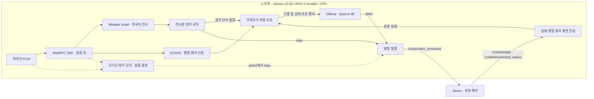

# EATED Service Robot (2026)

## 노트북 음성 제어 중간발표 자료

2026년 11월 19일 기준 · `dev/laptop` · 모빌리티시뮬레이션 중간 점검

EATED는 한국어로 물건을 요청하면 로봇이 물건을 찾고 집어 전달하는 서비스 로봇입니다. 노트북은 마이크 입력으로부터 가져오기와 정지 명령을 판단하고, Jetson은 로봇의 인식·파지·주행을 담당합니다. 이번 학기 노트북 작업의 핵심은 **CPU에서 한국어 음성 처리를 상시 실행하고, 정지 명령은 화자 인증이나 LLM 응답을 기다리지 않고 처리하는 것**입니다.

| 기존 시스템과 이번 학기 범위 | 발표에서 설명할 내용 |
|---|---|
| 공통 기반 | TurtleBot3, OpenMANIPULATOR-X, RealSense D435i, YOLO, MoveIt 2, ROS 2 기반 제어 |
| 이번 학기 노트북 기여 | 상시 청취 및 메모리 전사, LLM 준비·실패 처리, 화자 인증, 음성 정지 감지와 중복 억제, ROS 2 연동과 지연 관측, 연속 오디오 진단 저장 |
| Jetson 담당 | 카메라·물체 위치 추정, 팔·바퀴 제어, 작업 상태 머신. Jetson 개발 성과는 해당 브랜치의 검증 자료 기준으로 발표 |

기존 결과와 이번 학기 작업의 Git 기준은 `baseline-2026-11-04` 태그입니다. [프로젝트 배경과 확정 계획](docs/PROJECT_CONTEXT.md)

### 시스템 구성



- **가져오기 예시** — “목마른데 마실 거 가져다 줘” → 한국어 전사 → 상태·화자 조건 확인 → `fetch/coke` → Jetson 전달. 지원 물체는 콜라 `coke`, 휴지 `tissue`, 바세린 `vaseline`, 에어팟 `airpod`입니다. 작업 중이거나 상태가 불명확할 때는 fetch를 차단합니다.
- **정지 예시** — “스톱”, “멈춰”, “정지”를 감지하면 `stop`으로 처리합니다. 전사문 규칙은 화자나 LLM과 무관하게 동작합니다. 오디오 감지 후보를 활성화하면 연속 감지와 발화 종료 후 재검사가 전사보다 먼저 처리할 수 있습니다. 같은 발화의 성공한 정지는 중복 발행을 억제합니다.
- **운영과 관찰 설정** — 기본 설정의 오디오 정지 감지는 `off`입니다. `shadow`는 후보의 감지 결과를 로그로 남기며, 진단 설정은 `publish_commands=false`로 ROS 명령 발행을 막습니다. 파일 재생의 `active`는 로컬 콜백으로 동작을 확인합니다. [음성 패키지 실행 안내](src/voice_command_pkg/README.md)

### 구현 과정과 선택 이유

| 항목 | 관찰한 문제와 적용한 선택 | 상세 근거 |
|---|---|---|
| 상시 청취와 발화 처리 | 한 입력 스트림을 유지하고 녹음과 추론을 별도 스레드로 분리했습니다. 완성된 발화는 메모리에서 바로 전사합니다. | [상시 녹음](tools/voice_eval/results/2026-11-10_continuous_capture.md) · [메모리 전사](tools/voice_eval/results/2026-11-11_memory_transcription.md) |
| VAD와 STT | 짧은 정지 발화를 위해 시작 비율을 0.6에서 0.4로 낮췄습니다. 종료 무음 600·750·810·900ms 재생 비교에서 수정 문장 3개의 한 발화 유지 수가 0·2·2·3개여서 900ms를 유지했습니다. 무음에서 잘못된 전사를 만든 어휘 힌트는 제외했습니다. | [VAD 시작](tools/voice_eval/results/2026-11-12_vad_start_ratio.md) · [종료 비교](tools/voice_eval/results/2026-11-12_vad_end750.md) · [STT 설정](tools/voice_eval/results/2026-11-11_stt_settings.md) |
| LLM 응답 지연 | 시작할 때 비동기로 모델을 준비하고 메모리에 유지합니다. 일반 명령의 요청 제한은 10초이며 발화의 남은 유효시간이 더 짧으면 그 값을 적용합니다. | [워밍업과 요청 제한](tools/voice_eval/results/2026-11-11_llm_readiness.md) |
| 화자 인증 | 등록한 목소리와 발화의 음성 특징을 ECAPA로 비교합니다. STT와 병렬로 실행하고 등록 사용자만 fetch를 허용합니다. 정지는 화자 인증 결과와 무관합니다. | [화자 모델 비교](tools/voice_eval/results/2026-11-17_speaker_adaptation.md) |
| 오디오 정지 보완 | 연속 감지에서 놓친 발화는 VAD 종료 후 별도 스레드에서 다시 검사합니다. 원본 검사 실패 시 시작 위치와 음량을 바꾼 복사본으로 재시도하는 후보를 비교했습니다. 재검사는 0.5초 예산을 공유합니다. | [위치 보완](tools/voice_eval/results/2026-11-17_audio_stop_phases.md) · [음량 보완](tools/voice_eval/results/2026-11-18_audio_stop_gain.md) |
| 진단과 로봇 연동 | 발화별 WAV만으로는 VAD 이전 누락을 확인할 수 없어 선택형 연속 PCM 저장을 추가했습니다. 노트북과 Jetson에서 명령·상태 시각을 읽기 전용 관찰기로 비교합니다. | [연속 입력 진단](tools/voice_eval/results/2026-11-18_continuous_diagnostic.md) · [ROS 2 피드백](tools/voice_eval/results/2026-11-11_robot_feedback.md) · [지연 관측](tools/voice_eval/results/2026-11-12_end_to_end_latency.md) |

### 슬라이드에 인용할 검증 수치

| 평가 항목 | 관찰 결과 | 측정 조건과 해석 |
|---|---|---|
| 실제 마이크 정지 감지 | 연속 7/9, 보완 9/9, 전사문 규칙 9/9 | 스톱·멈춰·정지 각 3회. 보완이 연속 감지에서 놓친 두 발화를 처리했습니다. Shadow 시험이므로 명령 발행은 0건입니다. [시험 기록](tools/voice_eval/results/2026-11-18_continuous_diagnostic.md#후속-실시간-시험-stop_diagnostic8baovn) |
| 같은 연속 WAV의 로컬 active 재생 | 9개 발화에 정지 9회, 각 1회. 연속 7회와 보완 2회 | 후속 오디오 감지 7건과 전사문 정지 9건을 중복 억제했습니다. 일반 문장 3개와 생활 소음 37.59초에서 추가 정지 0건, 프레임 폐기 0건이었습니다. [재생 검증](tools/voice_eval/results/2026-11-18_active_stop_replay.md) |
| 음량 보완 개발 비교 | 정지 56/57 → 57/57, 일반 음성 오탐 0/78 | 같은 개발 자료로 비교한 결과입니다. 불명확한 입력은 미확정으로 기록했고, 시작 위치 반복 재생은 독립 표본 수로 세지 않습니다. [개발 비교](tools/voice_eval/results/2026-11-18_audio_stop_gain.md) |
| 60초 유휴 후 가져오기 | 3.889초, `fetch/coke` | 측정 도구의 한 사례에서 STT 1.757초와 LLM 2.131초를 포함합니다. 별도 시작 시 cold 워밍업은 49.536초였습니다. [측정 기록](tools/voice_eval/results/2026-11-11_llm_readiness.md) |
| 화자 인증 개발 자료 | 본인 허용 19/34 → 34/34, 타인 허용 0/10 | 같은 개발 자료에서 Resemblyzer와 ECAPA 구성을 비교했습니다. 독립 화자 검증은 생략하기로 했으며 이 수치를 최종 FAR·FRR로 쓰지 않습니다. [개발 비교](tools/voice_eval/results/2026-11-17_speaker_adaptation.md) |
| 기존 전사문 정지 Jetson 연동 | VAD 종료→발행 1.762455초, 발행→노트북 수락 응답 관찰 19.475ms | 1회 시험입니다. Jetson의 상태 전환과 명령 수락을 관찰했습니다. 발화 끝부터 팔·바퀴가 실제 멈출 때까지의 지연은 미측정입니다. [연동 기록](tools/voice_eval/results/2026-11-12_end_to_end_latency.md) |

### 5분 발표 구성안

| 슬라이드 | 시간 | 화면에 넣을 자료와 설명 |
|---|---:|---|
| 1. 프로젝트 목표와 역할 | 30초 | 로봇 사진과 요청 예시 한 문장. 노트북은 음성을 명령으로 바꾸고 Jetson은 실물 작업을 맡는다고 설명합니다. |
| 2. 음성 처리 구조 | 50초 | README 구성도. 가져오기와 정지의 경로를 다른 색으로 표시하고, 화자 인증과 LLM을 거치지 않는 정지 규칙에 주목합니다. |
| 3. 노트북에서 개선한 문제 | 55초 | 상시 청취·메모리 전사, 유휴 상태의 LLM 응답, 본인 음성 거부 문제를 각각 구현 변경과 연결합니다. |
| 4. 정지 실험 결과 | 60초 | 연속 감지 7/9와 보완 포함 9/9를 같은 9개 발화의 결과로 표시합니다. 아래에는 별도 행으로 파일 재생의 발화당 1회·생활 소음 추가 정지 0건을 넣습니다. |
| 5. 동작 영상 또는 로그 | 60초 | 기존 로봇 연동 영상에서 명령·상태 흐름을 보여주거나 노트북에서 `[AUDIO STOP]`·`[STT]`·중복 억제 로그를 보여줍니다. 영상·로그에 실제 연동, shadow, 로컬 재생 중 해당 조건을 표시합니다. |
| 6. 최종까지 남은 검증 | 45초 | 오디오 정지 후보의 실제 Jetson 수신과 물리 정지, 시연 환경 반복 시험, 독립 녹음 60문장 평가, STT 모델 크기 비교를 정리합니다. |

### 발표 시연과 재현 자료

- **지금 보여줄 화면** — 구성도, 위 실험 결과 표, 로컬 재생의 발화당 1회 처리 로그를 준비합니다. 이미 측정된 Jetson 결과를 보여줄 때는 기존 전사문 정지 경로임을 표시합니다.
- **노트북에서 현장 확인** — 준비된 음성 환경에서 진단 설정으로 실행하면 ROS 명령 발행 없이 정지 감지 로그를 확인할 수 있습니다. 실행 순서와 정상 판정은 [진단 실행 명령](tools/voice_eval/results/2026-11-18_continuous_diagnostic.md#로봇에서-확인할-항목)에 있습니다.
- **저장된 음성으로 재현** — 당시 노트북의 WAV·모델·화자 프로필이 있으면 [로컬 재생 명령](tools/voice_eval/results/2026-11-18_active_stop_replay.md#재현-명령)을 실행합니다. 재생에는 약 2분 이상 걸리므로 발표에는 검증 결과 표나 미리 준비한 로그 화면이 적합합니다. 원본 음성과 화자 프로필은 로컬에 보관하며 GitHub에는 코드와 결과 보고서를 제공합니다.
- **소스 탐색** — [음성 파이프라인](src/voice_command_pkg/voice_command_pkg/pipeline.py), [노트북 파라미터](src/voice_command_pkg/config/voice_command.yaml), [공유 ROS 메시지](src/eated_interfaces/msg/), [평가 도구](tools/voice_eval/), [실험 보고서](tools/voice_eval/results/)를 사용합니다.

## 로봇 본체 안내

ROS 2 Humble 기반의 TurtleBot3 + OpenMANIPULATOR-X 서비스 로봇 프로젝트입니다. Intel RealSense D435i의 RGB-D 영상과 YOLO를 이용해 물체를 찾고, MoveIt 2로 물체를 집은 뒤 사용자가 지정한 위치로 운반합니다.

현재 인식 대상은 다음 네 종류입니다.

- `airpod`
- `coke`
- `tissue`
- `vaseline`

## 주요 기능

- Logitech F710 조이스틱을 이용한 TurtleBot3 수동 주행
- 음성/LLM 결과를 `RobotCommand` 토픽으로 받아 목표 물체 설정
- 필요할 때만 YOLO 추론을 수행하는 `FindObject` Action Server
- RealSense RGB와 aligned depth를 이용한 물체의 3차원 좌표 계산
- `base_link` 좌표계로 변환된 물체 위치를 이용한 Pick 동작
- 물체 파지 후 CARGO 자세로 전환하고 배치 위치까지 수동 주행
- Y 버튼 비상 정지 및 X 버튼 HOME 복구
- Terminator 3×3 레이아웃을 이용한 9개 실행 터미널 준비

## 구성

```text
2026project/
├── src/
│   ├── control_pkg/       # 전체 작업 상태 머신과 Pick/Place 제어
│   ├── eated_interfaces/  # RobotCommand 메시지와 FindObject 액션
│   ├── joystick_pkg/      # TurtleBot3 수동 주행 및 버튼 입력
│   └── vision_pkg/        # YOLO + RGB-D 물체 위치 추정
├── best.pt                # airpod/coke/tissue/vaseline YOLO 모델
├── eated                  # 9분할 Terminator 실행 명령
├── eated_pane.sh          # 각 패널의 ROS 명령 준비
├── eated_hardware.sh      # 시리얼 그룹에서 하드웨어 실행
└── eated_terminator.conf  # Terminator 3×3 레이아웃
```

`build/`, `install/`, `log/`는 빌드 결과이므로 Git에 포함하지 않습니다.

## 개발 환경

- Ubuntu 22.04 / ROS 2 Humble
- NVIDIA Jetson Orin
- TurtleBot3 + OpenMANIPULATOR-X
- Intel RealSense D435i
- Logitech F710 (XInput 모드)
- MoveIt 2, `ros2_control`, RealSense ROS 2 wrapper
- Python 3.10, OpenCV, Ultralytics YOLO
- Jetson 환경과 호환되는 CUDA PyTorch/torchvision

추가로 다음 ROS 패키지가 설치되어 있어야 합니다.

- `turtlebot3_manipulation_bringup`
- `turtlebot3_manipulation_moveit_config`
- `realsense2_camera`
- `joy`

## 내려받기 및 빌드

이 프로젝트의 실행 파일에는 현재 로봇 PC의 경로가 반영되어 있으므로 `/home/fcsl/2026project`에 클론하는 것을 기준으로 합니다.

```bash
cd /home/fcsl
git clone https://github.com/dino3725/2026project.git
cd /home/fcsl/2026project

sudo apt install python3-colcon-common-extensions python3-rosdep2 python3-pip python3.10-venv python3-cffi \
  ros-humble-turtlebot3-manipulation-bringup ros-humble-turtlebot3-manipulation-moveit-config \
  ros-humble-realsense2-camera ros-humble-moveit ros-humble-joy \
  ros-humble-ld08-driver ros-humble-turtlebot3-manipulation-hardware \
  nvidia-jetpack-runtime cuda-cupti-12-6
sudo usermod -aG dialout "$USER"  # 라이다와 OpenCR 시리얼 포트 접근
source /opt/ros/humble/setup.bash
rosdep update
rosdep install --from-paths src --ignore-src -r -y
colcon build --symlink-install
source install/setup.bash
```

JetPack 6.2.3 / CUDA 12.6에서는 다음과 같이 프로젝트 전용 Python 패키지를 설치합니다.

```bash
python3 -m venv --system-site-packages .venv
.venv/bin/python -m pip install --no-deps torch==2.8.0 torchvision==0.23.0 \
  --index-url https://pypi.jetson-ai-lab.io/jp6/cu126
.venv/bin/python -m pip install 'numpy<2' 'opencv-python<4.9' ultralytics
```

`eated`의 각 패널은 이 가상환경의 패키지 경로를 자동으로 사용합니다. 패널 밖에서 Vision을 직접 실행할 때는 `export PYTHONPATH="$PWD/.venv/lib/python3.10/site-packages:${PYTHONPATH:-}"`를 먼저 실행합니다. 다른 JetPack 버전에서는 호환되는 PyTorch 빌드를 확인해야 합니다.

## 9분할 실행 화면 설치

```bash
sudo apt install terminator
chmod +x /home/fcsl/2026project/eated /home/fcsl/2026project/eated_pane.sh /home/fcsl/2026project/eated_hardware.sh
mkdir -p /home/fcsl/.local/bin
ln -sf /home/fcsl/2026project/eated /home/fcsl/.local/bin/eated
```

`~/.local/bin`이 PATH에 없다면 다음 줄을 `~/.bashrc`에 추가합니다.

```bash
export PATH="$HOME/.local/bin:$PATH"
```

그래픽 터미널에서 아래 명령을 실행합니다.

```bash
eated
```

Terminator에 9개 패널이 열리고 각 명령이 입력된 상태로 대기합니다. 명령은 자동 실행되지 않으며, 로봇 상태를 확인하면서 각 패널에서 Enter를 눌러야 합니다.

| 번호 | 역할 | 실행 시점 |
|---:|---|---|
| 1 | TurtleBot3 + OpenMANIPULATOR 하드웨어 Bringup | 가장 먼저 실행하고 controller 활성화 대기 |
| 2 | MoveIt `move_group` | 1번 준비 완료 후 |
| 3 | RealSense D435i | 카메라 연결 확인 후 |
| 4 | Vision Node 2 | 3번 RGB/depth 토픽 확인 후 |
| 5 | `joy_node` | F710을 XInput 모드로 연결한 후 |
| 6 | Joystick Control | 5번 `/joy` 토픽 확인 후 |
| 7 | Control Node | 로봇 주변을 비운 후 실행 |
| 8 | `/voice/robot_command` 구독 메시지 표시 | 다른 PC의 발행 전 실행 가능 |
| 9 | Control 상태 모니터 | 필요할 때 실행 |

> 8번 패널은 토픽을 발행하지 않고 수신한 메시지를 계속 표시합니다. 다른 PC에서 발행할 때 두 PC의 `ROS_DOMAIN_ID`를 동일하게 설정하세요. Control Node는 시작할 때 매니퓰레이터를 HOME 자세로 움직이므로, 실제 명령 발행은 7번 로그에 `Startup complete: joystick drive enabled`가 출력된 뒤에 하세요.

## 기본 동작 순서

1. 패널 1~7을 순서대로 실행합니다.
2. 패널 8에서 토픽 구독을 시작하고 Control Node가 `IDLE`인지 확인합니다.
3. 다른 PC에서 동일한 `ROS_DOMAIN_ID`로 `/voice/robot_command` 명령을 발행합니다.
4. 유효한 fetch 명령을 받으면 바로 인식 자세 이동 → YOLO 탐지 → Pick → CARGO 자세가 순서대로 수행됩니다.
5. 상태가 `DRIVE_TO_PLACE`가 되면 배치 위치까지 수동 주행합니다.
6. D435i 카메라에 손바닥을 연속 2초 펼쳐 보이면 로봇이 정지하고, 현재 CARGO 자세에서 그리퍼를 연 뒤 HOME으로 복귀합니다.

작업 중 일반 오류가 발생하면 Control Node가 팔을 HOME으로 복귀시킵니다. HOME 복귀도 실패하면 `ERROR` 상태에 머무르며 X 버튼으로 재시도할 수 있습니다. Y 버튼 또는 음성 `stop`은 비상 정지로 처리하며 자동 HOME 복귀를 시작하지 않습니다.

F710 XInput 버튼 역할은 다음과 같습니다.

| 버튼 | 기능 |
|---|---|
| A | `IDLE` 상태에서 마지막으로 요청한 물체 인식/Pick 다시 시작 |
| B | 사용하지 않음 |
| X | `ERROR` 상태에서 매니퓰레이터 HOME 복구 |
| Y | 모든 진행 동작 비상 정지 및 조이스틱 주행 권한 복구 |

## 명령 토픽 직접 보내기

Control Node가 `IDLE`인 상태에서 실행합니다.

```bash
source /opt/ros/humble/setup.bash
source /home/fcsl/2026project/install/setup.bash

ros2 topic pub --once /voice/robot_command \
  eated_interfaces/msg/RobotCommand \
  "{action: fetch, target_class: airpod, transcript: '에어팟 가져다줘'}"
```

`target_class`는 `airpod`, `coke`, `tissue`, `vaseline` 중 하나여야 합니다.

노트북의 `local-voice-robot-command` 저장소 `ros2-command-integration` 브랜치는
같은 `/voice/robot_command` 토픽에 `eated_interfaces/msg/RobotCommand`를
발행합니다. `fetch`는 목표 물체를 설정하고, `stop`(빈 `target_class`)은 진행 중인
동작을 취소하고 로봇을 `ERROR` 상태로 전환합니다. Control Node가 `IDLE`일 때
`fetch`를 보내면 `/control/command_status`에서 수락 여부를 확인할 수 있습니다.

## Vision 단독 확인

RealSense와 Vision Node를 실행한 후 다음 액션으로 물체 좌표를 확인할 수 있습니다.

```bash
ros2 action send_goal /find_object \
  eated_interfaces/action/FindObject \
  "{target_class: coke}" --feedback
```

성공하면 결과의 `x`, `y`, `z`는 `frame_id: base_link` 기준의 미터 단위 좌표입니다. 첫 추론에서는 CUDA backend 초기화 때문에 시간이 더 걸릴 수 있으며, 초기화가 끝난 뒤 인식 timeout이 시작됩니다.

## 주요 설정

- Control/Pick 설정: `src/control_pkg/config/control.yaml`
- Vision 설정: `src/vision_pkg/config/vision2.yaml`
- 카메라 장착 TF: `src/vision_pkg/launch/vision2.launch.py`
- 조이스틱 주행 속도: `src/joystick_pkg/joystick_pkg/total_control.py`

현재 Pick 설정은 실제 로봇 기준의 초기값입니다.

- PREGRASP: 검출 위치 위 5 cm
- RETREAT: 파지 직후 실제 툴 위치에서 `base_link` Z 방향으로 최대 15 cm의 직선 경로를 계산하고, MoveIt이 만든 구간만 상승한 뒤 CARGO로 이동
- Pick 목표점: 검출 위치에서 `base_link` +X 방향으로 2 cm 보정
- MoveIt 속도/가속도 배율: 0.10
- RETREAT 직선 경로의 보간 간격: 5 mm (`retreat_cartesian_step_m`)
- 그리퍼 파지 판정: 닫힘 중 stall이 발생하고 관절 위치가 임계값 이상일 때 성공

카메라 장착 위치나 그리퍼 중심이 바뀌면 `pick_calibration_xyz_m`, 카메라 mount TF, 접근/상승 offset을 반드시 다시 실측 보정해야 합니다.

## 손바닥으로 물체 놓기

Vision Node 2와 함께 실행되는 Google MediaPipe Hands 노드가 D435i RGB 영상을
읽습니다. `DRIVE_TO_PLACE` 상태에서만 손바닥을 검사하고, 손가락 네 개가 펼쳐진
상태가 연속 2초 유지되면 `/vision/open_palm` 신호로 그리퍼를 엽니다. 손이
사라지거나 카메라 프레임이 끊기면 시간 계산을 다시 시작합니다. 손 인식 상태는
Vision CV 창에 표시되고, 그리퍼를 열 때까지 남은 시간도 표시됩니다.

Jetson의 작업 공간 가상환경에 MediaPipe가 없다면 다음 명령으로 설치합니다.

```bash
cd /home/fcsl/2026project
.venv/bin/python -m pip install --no-deps \
  mediapipe==0.10.18 absl-py==2.3.1 flatbuffers==25.2.10 protobuf==4.25.8
```

이 작업 공간에서는 위 패키지를 설치하고 MediaPipe Hands 초기화를 확인했습니다.
Vision Node 2, Control Node, Joystick Control을 재시작해야 새 동작이 적용됩니다.

## 안전 주의사항

- 실제 로봇을 움직이기 전에 주변 사람과 장애물을 치웁니다.
- 처음 시험할 때는 낮은 속도를 유지하고 언제든 Y 버튼을 누를 수 있게 합니다.
- Y 비상 정지 후에는 X 버튼으로 HOME 복구가 끝나야 정상 작업을 다시 시작할 수 있습니다.
- 비상 정지는 소프트웨어 정지 기능입니다. 하드웨어 전원 차단 장치를 대체하지 않습니다.
