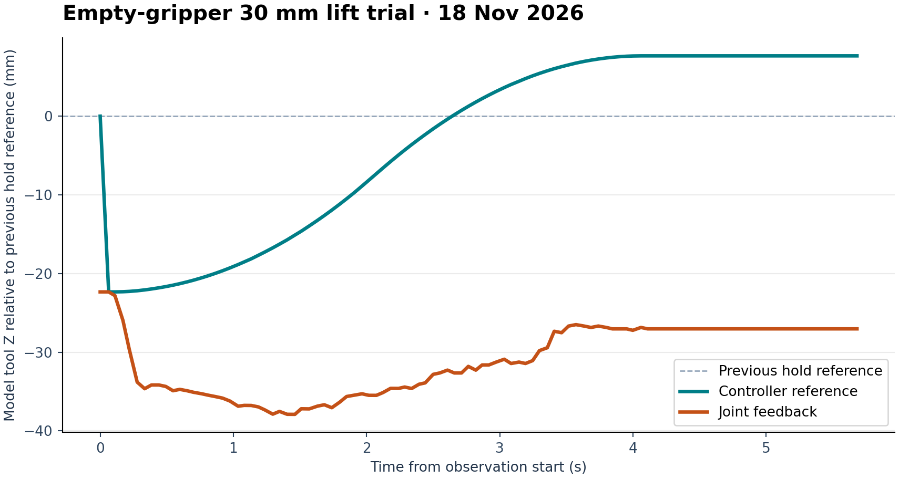
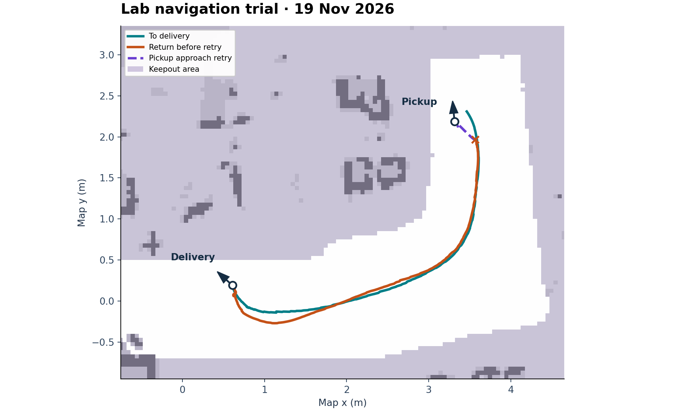

# EATED Service Robot (2026)

ROS 2 Humble 기반의 TurtleBot3 + OpenMANIPULATOR-X 서비스 로봇 프로젝트입니다. Intel RealSense D435i의 RGB-D 영상과 YOLO를 이용해 물체를 찾고, MoveIt 2로 물체를 집은 뒤 사용자가 지정한 위치로 운반합니다.

현재 인식 대상은 다음 네 종류입니다.

- `airpod`
- `coke`
- `tissue`
- `vaseline`

## 중간발표용 진행 현황 · 2026-11-19

**연구실 실물에서 픽업·전달 위치를 등록하고, 빈 집게로 두 목표에 자율주행 도착했습니다.** 전달은 출발 정렬과 Nav2 재기동 후 도착했고, 픽업 복귀는 진행 실패 후 마지막 구간을 다시 계획해 도착했습니다. 기본 Pick 흐름은 콜라 5회 중 4회 파지·전달·HOME 복귀를 마쳤습니다. 신규 형상 기반 시험에서는 캔을 잡았고, 상자에서 들어 올리는 단계가 남았습니다.

| 분야 | 구현 및 확인 결과 | 남은 검증 |
| --- | --- | --- |
| 음성 명령 | 노트북의 VAD → faster-whisper → 로컬 Ollama 분류 → ROS 2 명령 발행. 규칙으로 판단하는 정지 경로 적용 | 음성 명령부터 자율 이동·파지·전달까지 연속 시연 |
| RGB-D 좌표 | D435i 장착 TF v1 적용. 콜라 인식 3/3회. 깊이 픽셀 선택 및 촬영 시각 기준 TF 조회 개선 | 상자 높이 약 12mm 잔차와 물체별 좌표 오차 확인 |
| 매니퓰레이터 | 기존 방식 콜라 성공 4/5회. 모델 기반 캔 중심축, 손가락 접촉점, TCP, 접근·하강·상승 후보 구현 및 실물 단계 시험 | 팔 추종 오차와 상승 시작 시 목표 높이 하락 해결, 반복 성공률 측정 |
| 자율주행 | Cartographer 지도, AMCL 위치 추정, Nav2 경로와 GIMP 기반 가상 벽, F710 주차 위치 등록, 빈 집게 양방향 실물 시험 | 픽업 정차 재현성, 상자와의 파지 거리, 하중을 싣고 주행하는 시험 |
| 실행·관측 | SSH에서 `eateded`로 기본 실행, 노트북 RViz에서 DDS를 통해 지도·경로 표시 | 일반 작업 상태 머신에 픽업·전달 자율주행 연결 |

### 시스템 구성

```text
노트북 ─ 마이크 → VAD → STT → 로컬 LLM → /voice/robot_command
                                              │ 같은 ROS_DOMAIN_ID의 DDS
Jetson ────────────────────────────────────────┘
  ├─ 비전: D435i RGB-D → YOLO /find_object → base_link의 관측 좌표
  ├─ 팔: 제어 상태 머신 → MoveIt 2 / ros2_control → 팔과 그리퍼
  ├─ 전달: MediaPipe 손바닥 2초 또는 F710 B → 집게 열기 → HOME
  └─ 주행 시험: LDS-02 → Cartographer 지도 / AMCL → Nav2 → twist_mux → 바퀴
```

기본 물체 작업의 이동 단계는 F710 수동 주행입니다. 지도 기반 자율주행은 빈 집게·HOME 상태의 별도 시험에서 검증했습니다. 음성 노드와 상태 머신의 주행 통합 구상은 [프로젝트 설계와 개발 계획](docs/PROJECT_CONTEXT.md), 노트북 실행과 분류기 결과는 [음성 패키지 문서](src/voice_command_pkg/README.md)에 있습니다.

### 카메라 보정과 파지 개선

- **11/12 장착 보정** — ChArUco 자료와 RGB-D로 카메라의 장착 TF를 계산해 `end_effector_link → d435i_link`에 적용했습니다. RealSense 내부값은 공장값을 사용하고, 하드웨어와 MoveIt의 팔 받침 모델을 실측에 맞춰 +25mm로 맞췄습니다. 실물 콜라 인식은 3/3회였고, 80mm 상자의 계산 높이에는 약 12mm 잔차가 있었습니다. [채택 보정값과 검증](docs/measurements/accepted_calibration_test_2026-11-12.md)
- **11/17 반복 파지** — 기존 방식으로 콜라 5회 중 4회 파지·전달·HOME 복귀에 성공했습니다. 관절 피드백과 모델로 계산한 끝점은 접근 목표와 평균 11.47mm, 파지 목표와 평균 10.22mm 차이가 났습니다. 상승 후 평균 추종 오차는 어깨 +3.64°, 팔꿈치 +2.18°였습니다. [5회 시험 기록](docs/measurements/coke_pose_trials_2026-11-17.md)
- **11/18 좌표와 경로 개선** — RGB·깊이 영상의 촬영 시각 검증, 중복·오래된 표본 제외, 깊이 영상 시각의 TF 조회를 적용했습니다. 파지 실험에서는 관측 표면점, 캔 중심축, 손가락 접촉점, 모델 TCP와 MoveIt 도구 목표를 별도로 계산했습니다. 새 영상 20장 중 16장에서 캔 형상 품질 기준을 통과했습니다. 높이·좌우를 단계적으로 맞춘 뒤 집게의 파지 판정을 통과했으나 캔 밑면은 상자에 남았습니다. [파지 개선 설계와 실험](docs/measurements/grasp_algorithm_review_2026-11-17.md) · [실물 집기 기록](docs/measurements/data/2026-11-18/arm_lift_feedback/can_lift_readback.json)

| 11/18 상승 시험 | 계획한 이동량 | 관절 피드백과 모델로 계산한 집게 높이 변화 |
| --- | ---: | ---: |
| 캔을 잡은 상태 | +30mm | +1.9mm |
| 빈 집게 | +30mm | −4.7mm |

빈 집게 시험에서 새 궤적의 첫 목표가 직전 유지 목표보다 22.3mm 낮아졌습니다. 새 궤적을 당시 실제 관절값에서 시작했기 때문입니다. 30mm를 더한 최종 명령은 직전 유지 목표보다 7.7mm 높았습니다. 직전 명령을 이어서 시작하는 대안은 오프라인에서 목표 높이 +30mm를 재현했고 실물 검증이 남아 있습니다. 표의 높이는 관절 피드백에 순기구학을 적용해 계산했습니다. 두 실물 시험의 팔 시작 자세는 조금 달랐습니다. [상승 시험 비교](docs/measurements/data/2026-11-18/arm_lift_feedback/comparison.json) · [대안 계산](docs/measurements/data/2026-11-18/arm_lift_feedback/reference_replay.json)



### 지도, 픽업·전달 위치와 자율주행

Cartographer로 연구실 원본 지도를 저장하고, GIMP에서 지정한 금지 구역을 별도 마스크로 만들었습니다. AMCL은 원본 지도를 사용하고, Nav2는 전역·지역 비용지도에 금지 구역과 경계 비용을 반영합니다. F710으로 실제 원하는 위치와 방향에 주차하고, 정차 상태·AMCL·별도 라이다 정합을 확인해 두 좌표를 저장했습니다. [연구실 지도](maps/lab_20261118_145438.yaml) · [금지 구역 마스크](maps/lab_20261118_145438_keepout.yaml) · [작업 위치 YAML](maps/lab_20261118_145438_waypoints.yaml)

| 위치 | 지도 x, y (m) | 지도 +X 기준 방향 | 등록 시 AMCL과 별도 라이다 정합의 위치 차이 |
| --- | --- | ---: | ---: |
| 픽업 | (3.315, 2.188) | 95.4° | 약 1.5cm |
| 전달 | (0.609, 0.190) | 138.0° | 약 2.6cm |

11/18에는 정면 0.50m와 좌회전 코너 경로 약 4.87m에 도착했습니다. 11/19에는 등록 위치를 사용해 빈 집게 양방향 주행을 시험했습니다. 등록 좌표 간 사전 계산 경로는 픽업 → 전달 4.90m, 전달 → 픽업 4.98m였습니다. 아래 수치는 실제 정차 시 AMCL 기준입니다. [11/18·11/19 주행 상세](src/eated_navigation/README.md) · [등록 좌표 간 사전 경로](docs/measurements/data/2026-11-19/navigation/route_review.json)

| 11/19 실물 시험 | 정차 위치 오차 | 정차 방향 오차 | 결과 |
| --- | ---: | ---: | --- |
| 픽업 주변 → 전달 | 6.7cm | 8.3° | 벽에서 약 25cm 벗어나고 방향을 맞춘 뒤 Nav2 재기동. 전달 주행 약 48초, 도착 후 정차 |
| 전달 → 픽업 | 6.0cm | 6.3° | 복귀 중 목표 약 34cm 앞에서 전진 진행 실패. 정차 후 약 0.41m 경로를 새로 계획하고 마지막 접근 약 13초 후 정차 |

픽업 최종 정차를 라이브 AMCL과 별도 라이다 정합으로 비교했습니다. 정합 좌표는 약 (3.36, 2.14)m, 방향 104.5°로, 픽업 목표와 약 7cm·9° 차이였습니다. 이 결과는 지도 기준 추정치입니다. 이번 시험의 전진 상한은 0.18m/s, 최대 바퀴 전진 명령은 0.13m/s였습니다. 가상 벽 부근과 도착 구간은 0.08m/s로 제한했습니다. 전역·지역 비용지도 차체 여유를 10mm에서 5mm로 줄이고 지역 비용지도는 2.5cm 격자로 시작했습니다. 원본 지도와 마스크는 5cm 격자이며 차체 모델 반경은 26cm입니다. [실행 파라미터](docs/measurements/data/2026-11-19/navigation/runtime_nav2.yaml) · [전달 도착 기록](docs/measurements/data/2026-11-19/navigation/delivery.json) · [픽업 재접근 기록](docs/measurements/data/2026-11-19/navigation/pickup.json)



### 로봇에서 확인할 항목

- [ ] 직전 유지 목표와 상승 경로 사이의 연속성을 유지하고, 빈 집게의 30mm 상승량을 먼저 확인합니다.
- [ ] 콜라를 집고 캔 밑면이 지지면에서 실제로 떨어지는지 확인합니다. 이후 운반 자세에서 손바닥 인식과 F710 B 버튼 전달 동작을 각각 확인합니다.
- [ ] 등록된 두 목표를 빈 집게로 반복 주행하며 픽업 정차 거리·방향의 분산을 측정합니다. 픽업에서 상자에 접근하는 동작과 물체를 든 상태에서의 주행도 별도로 확인합니다.
- [ ] 검증한 주행과 팔 동작을 일반 작업 상태 머신에 연결해 음성부터 전달까지 종단간 실물 시험을 진행합니다.

## 주요 기능

- Logitech F710 조이스틱을 이용한 TurtleBot3 수동 주행
- 음성/LLM 결과를 `RobotCommand` 토픽으로 받아 목표 물체 설정
- 필요할 때만 YOLO 추론을 수행하는 `FindObject` Action Server
- RealSense RGB와 aligned depth를 이용한 물체의 3차원 좌표 계산
- `base_link` 좌표계로 변환된 물체 위치를 이용한 Pick 동작
- 물체 파지 후 CARGO 자세로 전환하고 배치 위치까지 수동 주행
- Y 버튼 비상 정지 및 X 버튼 HOME 복구
- Terminator 3×3 레이아웃을 이용한 9개 실행 터미널 준비

## 구성

```text
2026project/
├── src/
│   ├── control_pkg/       # 전체 작업 상태 머신과 Pick/Place 제어
│   ├── eated_interfaces/  # RobotCommand 메시지와 FindObject 액션
│   ├── joystick_pkg/      # TurtleBot3 수동 주행 및 버튼 입력
│   ├── vision_pkg/        # YOLO + RGB-D 물체 위치 추정
│   ├── eated_navigation/  # 지도, Nav2, 가상 벽, 주행 시험
│   └── voice_command_pkg/ # 노트북의 온디바이스 음성 처리
├── best.pt                # airpod/coke/tissue/vaseline YOLO 모델
├── eated                  # 9분할 Terminator 실행 명령
├── eateded                # SSH용 헤드리스 실행
├── maps/                  # 연구실 지도, 금지 구역, 작업 위치
├── eated_pane.sh          # 각 패널의 ROS 명령 준비
├── eated_hardware.sh      # 시리얼 그룹에서 하드웨어 실행
└── eated_terminator.conf  # Terminator 3×3 레이아웃
```

`build/`, `install/`, `log/`는 빌드 결과이므로 Git에 포함하지 않습니다.

## 개발 환경

- Ubuntu 22.04 / ROS 2 Humble
- NVIDIA Jetson Orin
- TurtleBot3 + OpenMANIPULATOR-X
- Intel RealSense D435i
- Logitech F710 (XInput 모드)
- MoveIt 2, `ros2_control`, RealSense ROS 2 wrapper
- Python 3.10, OpenCV, Ultralytics YOLO
- Jetson 환경과 호환되는 CUDA PyTorch/torchvision

추가로 다음 ROS 패키지가 설치되어 있어야 합니다.

- `turtlebot3_manipulation_bringup`
- `turtlebot3_manipulation_moveit_config`
- `realsense2_camera`
- `joy`

## 내려받기 및 빌드

이 프로젝트의 실행 파일에는 현재 로봇 PC의 경로가 반영되어 있으므로 `/home/fcsl/2026project`에 클론하는 것을 기준으로 합니다.

```bash
cd /home/fcsl
git clone --branch jetson/development https://github.com/dino3725/2026project.git
cd /home/fcsl/2026project

sudo apt install python3-colcon-common-extensions python3-rosdep2 python3-pip python3.10-venv python3-cffi \
  ros-humble-turtlebot3-manipulation-bringup ros-humble-turtlebot3-manipulation-moveit-config \
  ros-humble-realsense2-camera ros-humble-moveit ros-humble-joy \
  ros-humble-ld08-driver ros-humble-turtlebot3-manipulation-hardware \
  nvidia-jetpack-runtime cuda-cupti-12-6
sudo usermod -aG dialout "$USER"  # 라이다와 OpenCR 시리얼 포트 접근
source /opt/ros/humble/setup.bash
rosdep update
rosdep install --from-paths src --ignore-src -r -y
colcon build --symlink-install --packages-skip voice_command_pkg
source install/setup.bash
```

JetPack 6.2.3 / CUDA 12.6에서는 다음과 같이 프로젝트 전용 Python 패키지를 설치합니다.

```bash
python3 -m venv --system-site-packages .venv
.venv/bin/python -m pip install --no-deps torch==2.8.0 torchvision==0.23.0 \
  --index-url https://pypi.jetson-ai-lab.io/jp6/cu126
.venv/bin/python -m pip install 'numpy<2' 'opencv-python<4.9' ultralytics
```

`eated`의 각 패널은 이 가상환경의 패키지 경로를 자동으로 사용합니다. 패널 밖에서 Vision을 직접 실행할 때는 `export PYTHONPATH="$PWD/.venv/lib/python3.10/site-packages:${PYTHONPATH:-}"`를 먼저 실행합니다. 다른 JetPack 버전에서는 호환되는 PyTorch 빌드를 확인해야 합니다.

## SSH에서 실행하고 노트북 RViz로 보기

Jetson에서 기본 인식·픽업 실행을 한 터미널에서 관리합니다. `--dry-run`으로 순서를 먼저 볼 수 있습니다.

```bash
cd ~/2026project
./eateded --dry-run
./eateded
```

노트북에서 지도와 주행을 보려면 같은 Wi-Fi에서 ROS 2 Humble을 사용하고, 활성화된 Jetson Nav2와 ROS 도메인을 맞춥니다. 아래의 `jetson.local`은 실제 Jetson 호스트 이름 또는 Wi-Fi IP로 바꿉니다.

```bash
scp fcsl@jetson.local:/home/fcsl/2026project/docs/measurements/data/2026-11-19/navigation/roundtrip.rviz ~/eated-roundtrip.rviz
source /opt/ros/humble/setup.bash
ROS_DOMAIN_ID=37 ROS_LOCALHOST_ONLY=0 rviz2 -d ~/eated-roundtrip.rviz
```

Nav2의 지도, 비용지도, 로봇 위치와 계획 경로는 해당 노드가 활성화돼 있을 때 표시됩니다. 지도 생성·Nav2 준비 명령은 [주행 패키지 README](src/eated_navigation/README.md)에 있습니다.

## 9분할 실행 화면 설치

```bash
sudo apt install terminator
chmod +x /home/fcsl/2026project/eated /home/fcsl/2026project/eated_pane.sh /home/fcsl/2026project/eated_hardware.sh
mkdir -p /home/fcsl/.local/bin
ln -sf /home/fcsl/2026project/eated /home/fcsl/.local/bin/eated
```

`~/.local/bin`이 PATH에 없다면 다음 줄을 `~/.bashrc`에 추가합니다.

```bash
export PATH="$HOME/.local/bin:$PATH"
```

그래픽 터미널에서 아래 명령을 실행합니다.

```bash
eated
```

Terminator에 9개 패널이 열리고 각 명령이 입력된 상태로 대기합니다. 명령은 자동 실행되지 않으며, 로봇 상태를 확인하면서 각 패널에서 Enter를 눌러야 합니다.

| 번호 | 역할 | 실행 시점 |
|---:|---|---|
| 1 | TurtleBot3 + OpenMANIPULATOR 하드웨어 Bringup | 가장 먼저 실행하고 controller 활성화 대기 |
| 2 | MoveIt `move_group` | 1번 준비 완료 후 |
| 3 | RealSense D435i | 카메라 연결 확인 후 |
| 4 | Vision Node 2 | 3번 RGB/depth 토픽 확인 후 |
| 5 | `joy_node` | F710을 XInput 모드로 연결한 후 |
| 6 | Joystick Control | 5번 `/joy` 토픽 확인 후 |
| 7 | Control Node | 로봇 주변을 비운 후 실행 |
| 8 | `/voice/robot_command` 구독 메시지 표시 | 다른 PC의 발행 전 실행 가능 |
| 9 | Control 상태 모니터 | 필요할 때 실행 |

> 8번 패널은 토픽을 발행하지 않고 수신한 메시지를 계속 표시합니다. 다른 PC에서 발행할 때 두 PC의 `ROS_DOMAIN_ID`를 동일하게 설정하세요. Control Node는 시작할 때 매니퓰레이터를 HOME 자세로 움직이므로, 실제 명령 발행은 7번 로그에 `Startup complete: joystick drive enabled`가 출력된 뒤에 하세요.

## 기본 동작 순서

1. 패널 1~7을 순서대로 실행합니다.
2. 패널 8에서 토픽 구독을 시작하고 Control Node가 `IDLE`인지 확인합니다.
3. 다른 PC에서 동일한 `ROS_DOMAIN_ID`로 `/voice/robot_command` 명령을 발행합니다.
4. 유효한 fetch 명령을 받으면 바로 인식 자세 이동 → YOLO 탐지 → Pick → CARGO 자세가 순서대로 수행됩니다.
5. 상태가 `DRIVE_TO_PLACE`가 되면 배치 위치까지 수동 주행합니다.
6. D435i 카메라에 손바닥을 연속 2초 펼쳐 보이면 로봇이 정지하고, 현재 CARGO 자세에서 그리퍼를 연 뒤 HOME으로 복귀합니다.

작업 중 일반 오류가 발생하면 Control Node가 팔을 HOME으로 복귀시킵니다. HOME 복귀도 실패하면 `ERROR` 상태에 머무르며 X 버튼으로 재시도할 수 있습니다. Y 버튼 또는 음성 `stop`은 비상 정지로 처리하며 자동 HOME 복귀를 시작하지 않습니다.

F710 XInput 버튼 역할은 다음과 같습니다.

| 버튼 | 기능 |
|---|---|
| A | `IDLE` 상태에서 마지막으로 요청한 물체 인식/Pick 다시 시작 |
| B | `DRIVE_TO_PLACE`에서 집게 열기 후 HOME 복귀. 손바닥 2초 신호와 같은 동작 |
| X | `ERROR` 상태에서 매니퓰레이터 HOME 복구 |
| Y | 모든 진행 동작 비상 정지 및 조이스틱 주행 권한 복구 |

## 명령 토픽 직접 보내기

Control Node가 `IDLE`인 상태에서 실행합니다.

```bash
source /opt/ros/humble/setup.bash
source /home/fcsl/2026project/install/setup.bash

ros2 topic pub --once /voice/robot_command \
  eated_interfaces/msg/RobotCommand \
  "{action: fetch, target_class: airpod, transcript: '에어팟 가져다줘'}"
```

`target_class`는 `airpod`, `coke`, `tissue`, `vaseline` 중 하나여야 합니다.

노트북의 `local-voice-robot-command` 저장소 `ros2-command-integration` 브랜치는
같은 `/voice/robot_command` 토픽에 `eated_interfaces/msg/RobotCommand`를
발행합니다. 현재 저장소에서는 [`voice_command_pkg`](src/voice_command_pkg/README.md)로 실행할 수 있습니다. `fetch`는 목표 물체를 설정하고, `stop`(빈 `target_class`)은 진행 중인
동작을 취소하고 로봇을 `ERROR` 상태로 전환합니다. Control Node가 `IDLE`일 때
`fetch`를 보내면 `/control/command_status`에서 수락 여부를 확인할 수 있습니다.

## Vision 단독 확인

RealSense와 Vision Node를 실행한 후 다음 액션으로 물체 좌표를 확인할 수 있습니다.

```bash
ros2 action send_goal /find_object \
  eated_interfaces/action/FindObject \
  "{target_class: coke}" --feedback
```

성공하면 결과의 `x`, `y`, `z`는 `frame_id: base_link` 기준의 미터 단위 좌표입니다. 첫 추론에서는 CUDA backend 초기화 때문에 시간이 더 걸릴 수 있으며, 초기화가 끝난 뒤 인식 timeout이 시작됩니다.

## 주요 설정

- Control/Pick 설정: `src/control_pkg/config/control.yaml`
- Vision 설정: `src/vision_pkg/config/vision2.yaml`
- 카메라 장착 TF: `src/vision_pkg/config/camera_mount.yaml`
- 조이스틱 주행 속도: `src/joystick_pkg/joystick_pkg/total_control.py`

현재 Pick 설정은 실제 로봇 기준의 초기값입니다.

- PREGRASP: 검출 위치 위 5 cm
- RETREAT: 파지 직후 실제 툴 위치에서 `base_link` Z 방향으로 최대 15 cm의 직선 경로를 계산하고, MoveIt이 만든 구간만 상승한 뒤 CARGO로 이동
- Pick 목표점: 검출 위치에서 `base_link` +X 방향으로 2 cm 보정
- MoveIt 속도/가속도 배율: 0.10
- RETREAT 직선 경로의 보간 간격: 5 mm (`retreat_cartesian_step_m`)
- 그리퍼 파지 판정: 닫힘 중 stall이 발생하고 관절 위치가 임계값 이상일 때 성공

카메라 장착 위치나 그리퍼 중심이 바뀌면 `pick_calibration_xyz_m`, 카메라 mount TF, 접근/상승 offset을 반드시 다시 실측 보정해야 합니다.

## 손바닥으로 물체 놓기

Vision Node 2와 함께 실행되는 Google MediaPipe Hands 노드가 D435i RGB 영상을
읽습니다. `DRIVE_TO_PLACE` 상태에서만 손바닥을 검사하고, 손가락 네 개가 펼쳐진
상태가 연속 2초 유지되면 `/vision/open_palm` 신호로 그리퍼를 엽니다. 손이
사라지거나 카메라 프레임이 끊기면 시간 계산을 다시 시작합니다. 손 인식 상태는
Vision CV 창에 표시되고, 그리퍼를 열 때까지 남은 시간도 표시됩니다.

Jetson의 작업 공간 가상환경에 MediaPipe가 없다면 다음 명령으로 설치합니다.

```bash
cd /home/fcsl/2026project
.venv/bin/python -m pip install --no-deps \
  mediapipe==0.10.18 absl-py==2.3.1 flatbuffers==25.2.10 protobuf==4.25.8
```

이 작업 공간에서는 위 패키지를 설치하고 MediaPipe Hands 초기화를 확인했습니다.
Vision Node 2, Control Node, Joystick Control을 재시작해야 새 동작이 적용됩니다.

## 안전 주의사항

- 실제 로봇을 움직이기 전에 주변 사람과 장애물을 치웁니다.
- 처음 시험할 때는 낮은 속도를 유지하고 언제든 Y 버튼을 누를 수 있게 합니다.
- Y 비상 정지 후에는 X 버튼으로 HOME 복구가 끝나야 정상 작업을 다시 시작할 수 있습니다.
- 비상 정지는 소프트웨어 정지 기능입니다. 하드웨어 전원 차단 장치를 대체하지 않습니다.
