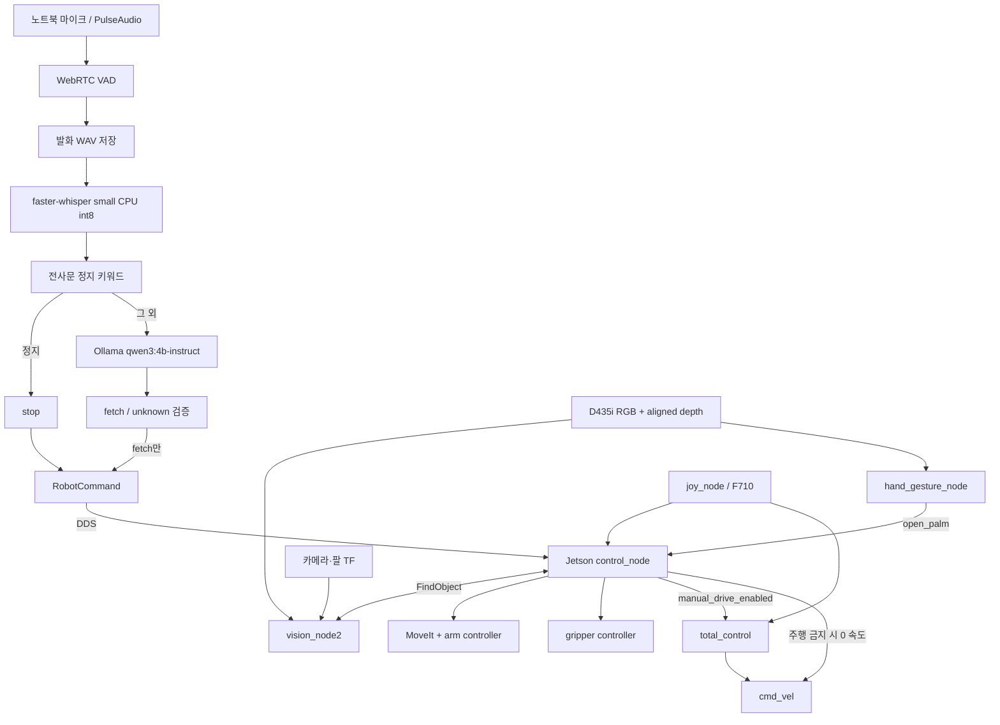

# 워크스페이스 상세 분석 — 2026-11-10

대상: `/home/fcsl/2026project`, `main`, HEAD `13d3d7d`.

**2026-11-11 후속 변경:** 아래 본문은 11/10 분석 시점의 기록이다. 이후 사용자의 다음 단계 진행 요청에 따라 control의 결과 대기 실패 시 취소 대상 유지, 늦은 목표 수락 취소, 수락 직후 정지와 등록 사이의 처리, 자동 HOME 복구 중 실패한 목표 취소를 보완했다. 액션 수락·완료 여부를 확인할 수 없는 실패는 자동 HOME 대신 ERROR에 머무르게 했다. [추가 회귀 시험](../src/control_pkg/test/test_action_lifecycle.py) 10개를 포함해 control 패키지 30 passed / 1 skipped, 패키지 빌드 및 설치 경로 import를 확인했다. 취소 요청 전송의 모의 검증이며, 실제 로봇의 취소 완료·물리 정지를 검증한 것은 아니다. 본문의 나머지 정적 위험까지 해결됐다는 뜻은 아니다.

같은 날 팔·라이다의 3단 장착 확인과 사용자 실측을 [실측 기록](measurements/measured_geometry_2026-11-11.yaml)에 반영했다. 층간 증가량에 따른 높이는 계산값이며, URDF·카메라 TF·팔 자세·속도 파라미터에는 아직 적용하지 않았다.

이후 사용자 실행 승인과 환경 준비 확인 아래 기존 인식 자세에서 콜라 비전 예비 측정 3회를 실행했다. 3회 모두 검출했으나 상자 윗면·카메라 실측 높이와의 대조에서 +25mm 단순 보정이 아직 검증되지 않았다. 실제 구동 범위, 결과, 남은 확인은 [실물 예비 측정 보고서](measurements/vision_pilot_2026-11-11.md)에 별도로 기록했다. 아래 본문의 “하드웨어 미실행” 등은 최초 분석 당시의 범위다.

이 프로젝트는 한국어 음성으로 네 종류의 물체를 요청하고, RGB-D 비전으로 위치를 찾은 뒤 OpenMANIPULATOR로 집어 수동 주행으로 운반하고 손 펼침 신호로 놓는 ROS 2 시스템이다. 현재 소스에는 자율주행, 화자 인증, 상시 녹음, 음성 측의 작업 결과 피드백은 구현되어 있지 않다.

**분석 범위와 증거 구분**

- 분석 시작 시 Git 추적 항목 110개, 실제 존재 109개. `AGENTS.md` 하나가 작업 트리에서 삭제되어 있다.
- 현재 소스, launch, 설정, 메시지, 테스트, 실행 스크립트, 문서, 평가 도구와 데이터 구조를 확인했다.
- `best.pt`는 ZIP 및 pickle opcode를 정적으로 읽어 메타데이터를 확인했다. 가중치를 실행하거나 다시 학습·평가하지 않았다.
- `.venv`, `build`, `install`, `log`, `.git`는 구조·의존성·링크·로그·이력을 검사했다. 가상환경의 제삼자 파일 약 2만 4천 개와 Git의 모든 과거 객체를 개별 코드 감사한 것은 아니다.
- 코드 사실, 이번에 실행한 검증, 과거 보고서의 측정값, 정적 분석상 위험을 구분한다. 하드웨어 동작과 실시간 음성·DDS·YOLO 성능은 이번 분석에서 재시험하지 않았다.
- 로봇 노드 생성, action 전송, 속도 발행, 마이크 녹음, LLM 평가, 패키지 설치, 빌드, 브랜치 전환은 수행하지 않았다. 분석 보고서 외 프로젝트 소스는 변경하지 않았다.

**1. 저장소와 실행 환경**

| 항목 | 확인 결과 |
|---|---|
| 로컬 브랜치 | `main` |
| HEAD | `13d3d7d` — VAD 시작 비율 0.6으로 변경 및 실제 정지 인식 측정 |
| 원격 추적 상태 | 로컬에 저장된 `origin/main`과 같은 커밋. fetch하지 않았으므로 서버 최신 상태를 의미하지 않음 |
| 기존 변경 | ` D AGENTS.md`, 93줄 삭제. 복원하지 않음 |
| 기준 태그 | `baseline-2026-11-04` 존재, HEAD까지 8개 커밋 |
| 보관 태그 | `archive/jetson-manipulator-2026-11-04` 존재, main에 없는 커밋 41개 |
| 아키텍처 | `aarch64` |
| Python | 3.10.12 |
| ROS | 환경 설정 후 `humble`, `ROS_DOMAIN_ID=37` |
| 가상환경 | `include-system-site-packages=true` |
| 전체 크기 | 약 1.3 GB, 대부분 `.venv` |

| 경로 | 디스크 사용량 | 의미 |
|---|---:|---|
| `.venv` | 1.2 GB | Jetson용 PyTorch·비전 의존성 |
| `.git` | 7.9 MB | 현재 및 보관된 개발 이력 |
| `build` | 6.4 MB | ROS 인터페이스 생성물과 Python 빌드 설정 |
| `install` | 1.7 MB | 실행 진입점·환경 설정·소스 심볼릭 링크 |
| `log` | 1.1 MB | colcon 빌드 기록 5회 |
| `src` | 788 KB | 소스 및 로컬 캐시 포함 |
| `tools` | 144 KB | 음성 평가 코드·데이터·보고서 |
| `docs` | 분석 전 28 KB | 프로젝트 계획·인수인계 |
| `best.pt` | 5,466,394 bytes | YOLO 가중치 |

Git 추적 Python은 62파일, 7,634줄이다. 테스트·launch·setup·평가 도구를 제외한 패키지 내부 Python 모듈은 합계 4,688줄이다. 줄 수에는 주석·공백을 포함한다.

| 패키지 | 추적 파일 수 | 전체 텍스트 줄 수 | 역할 |
|---|---:|---:|---|
| `control_pkg` | 20 | 2,088 | 작업 상태, 팔·그리퍼·비전 액션, 정지 및 복구 |
| `vision_pkg` | 19 | 2,216 | YOLO, 깊이, TF, 실시간 화면, 손 펼침 |
| `joystick_pkg` | 9 | 452 | 수동 베이스 주행 |
| `voice_command_pkg` | 28 | 2,217 | 마이크, VAD, Whisper, 정지 규칙, Ollama, ROS 발행 |
| `eated_interfaces` | 5 | 68 | 공통 메시지 2개·액션 1개 |

**2. 전체 연결 구조**



노트북은 음성 모델 처리, Jetson은 카메라·로봇 제어를 담당한다. Wi-Fi DDS는 두 프로세스를 연결하지만, 현재 명령 메시지는 단순 pub/sub이며 작업 ID·응답 상관관계·만료 시각·재전송/중복 처리 규약은 없다.

**3. ROS 인터페이스와 통신 계약**

| 인터페이스 | 타입 | 생산자 → 소비자 | 용도 |
|---|---|---|---|
| `/voice/robot_command` | `RobotCommand` | voice → control | fetch 또는 stop |
| `/control/command_status` | `RobotCommandStatus` | control → 현재 음성 노드 구독 없음 | 명령 수락·거절 |
| `/control/state` | `std_msgs/String` | control → vision2, hand, 모니터 | 상태 전이 |
| `/control/target_class` | `std_msgs/String` | control → 외부 구독자 | 목표 클래스 |
| `/control/manual_drive_enabled` | `std_msgs/Bool` | control → joystick | 주행 권한 |
| `/control/release_countdown_sec` | `std_msgs/Float32` | control → vision2 | 손 펼침 유지 남은 시간 |
| `/vision/open_palm` | `std_msgs/Bool` | hand → control, vision2 | 손 펼침 관찰 |
| `/vision/debug_image` | `sensor_msgs/Image` | vision → 외부 뷰어 | RGB 및 상태 오버레이 |
| `/joy` | `sensor_msgs/Joy` | joy driver → control, joystick | 버튼·스틱 |
| `/joint_states` | `sensor_msgs/JointState` | 외부 하드웨어 → control | 현재 팔 관절값 |
| `/cmd_vel` | `geometry_msgs/Twist` | joystick 및 control → 외부 베이스 | 이동 속도 |
| `/arm_controller/joint_trajectory` | `JointTrajectory` | control → 외부 팔 controller | 정지 시 현재 위치 hold |
| `/find_object` | `FindObject` action | control ↔ vision | 클래스별 3차원 위치 요청 |
| `/move_action` | `MoveGroup` action | control ↔ MoveIt | PREGRASP/PICK 목표 계획·실행 |
| `/compute_cartesian_path` | `GetCartesianPath` service | control ↔ MoveIt | 수직 후퇴 계획 |
| `/execute_trajectory` | `ExecuteTrajectory` action | control ↔ MoveIt | 후퇴 궤적 실행 |
| `/arm_controller/follow_joint_trajectory` | `FollowJointTrajectory` action | control ↔ 팔 controller | HOME/RECOGNITION/CARGO |
| `/gripper_controller/gripper_cmd` | `GripperCommand` action | control ↔ gripper controller | 열기·닫기 |

입력 영상은 `/realsense/d435i/color/image_raw`, 깊이는 `/realsense/d435i/aligned_depth_to_color/image_raw`, 내부 파라미터는 `/realsense/d435i/color/camera_info`이다.

`RobotCommand`: `header`, `action`, `target_class`, `transcript`; fetch/stop/unknown 문자열 상수. 음성 측 LLM 출력의 `object`가 ROS 메시지의 `target_class`로 변환된다. stamp는 발행 시각이므로 발화 시작·종료 시각은 담지 않는다.

`RobotCommandStatus`: `header`, `accepted`, `action`, `target_class`, `message`. 작업 완료 결과 전용 메시지가 아니다. 현재는 명령 수락/거절 처리에서 발행한다.

`FindObject`: goal은 `target_class`; result는 `success,x,y,z,confidence,frame_id,message`; feedback은 `detected,stable_time,confidence`. 거리 단위는 m. 결과 좌표의 frame은 controller가 `base_link`와 일치하는지 검사한다.

state/target/manual authority는 reliable + transient local depth 1로 마지막 값을 신규 구독자에게 전달한다. 영상 입력과 vision2 debug 영상은 sensor-data QoS이다. voice 명령과 status는 depth 10 일반 QoS다. 구형 vision_node의 debug 영상은 일반 reliable이므로 v2와 구독 요구 조건이 다르다.

**4. 음성 패키지: 실제 동작과 경계**

파일별 책임:

- `audio_capture.py` 315줄: PulseAudio 입력 장치 조회, `parec` 프로세스, PCM 프레임 읽기, RMS gate, VAD 상태 기계, VAD 모니터 CLI.
- `pipeline.py` 421줄: 모델 준비, 한 발화 녹음, WAV 저장, STT, stop 우선 판정, LLM, 발행 callback, 반복/예외 처리.
- `command_classifier.py` 184줄: Ollama HTTP 요청, JSON schema, 허용 조합 검증, 응답 및 내부 시간 수집.
- `transcript_rules.py` 72줄: NFC·소문자·공백/기호 제거, 오인식 철자 치환, 부분 문자열 정지 키워드.
- `command_protocol.py` 28줄: ROS로 보낼 fetch/stop 조합 제한.
- `parameters.py` 65줄: ROS 평탄화 파라미터에서 dataclass 설정 생성.
- `voice_command_node.py` 103줄: 파이프라인 작업 스레드, 메시지 발행, dry run, 종료 처리.
- `prompts/system_prompt.txt`: 네 물체 및 unknown 의미 분류 규칙과 예시.

현재 순서: Whisper 모델 로드 → Ollama `/api/tags` 확인 → 매 발화마다 새 마이크 스트림 생성 → 초기 1.2초 폐기 → VAD 발화 수집 → 스트림 종료 → WAV 저장 → Whisper → stop 규칙 → 필요하면 LLM → ROS 발행 → 다음 스트림 시작.

`VoiceCommandNode`에 worker thread가 있다는 사실은 상시 녹음을 의미하지 않는다. 녹음과 STT/LLM은 동일 worker에서 순차 수행된다.

| 음성 파라미터 | 실제 기본값 |
|---|---|
| PCM | 16 kHz, mono, signed 16 bit |
| 프레임 | 30 ms = 480 samples = 960 bytes |
| WebRTC aggressiveness | 3 |
| 시작 RMS | 200 |
| 시작 창 | 300 ms, 10프레임 중 6프레임 |
| 시작 구간 폐기 | 스트림마다 1,200 ms |
| pre-roll | 450 ms |
| 종료 무음 | 900 ms |
| 최대 발화 | 15초 |
| Whisper | small, cpu, int8, ko |
| LLM | qwen3:4b-instruct, localhost:11434 |
| 요청 설정 | think false, temperature 0, seed 0, num_ctx 2048, num_predict 32 |
| timeout / keep_alive | 120초 / 10m |
| 기본 녹음 저장 | `~/2026project/recordings` |
| 기본 발행 | true |

시작 시만 RMS를 추가 적용하고 발화 중에는 WebRTC 결과만 사용한다. 종료 무음은 프레임 단위 올림이다. 예를 들어 500ms는 17프레임, 실제 510ms가 된다. Whisper에는 파일 경로와 language만 전달한다. 메모리 전사, beam_size 파라미터, initial_prompt/hotwords는 현재 구현에 없다.

정지 키워드: `멈춰, 멈추, 멈춤, 정지, 스톱, stop, 중단, 움직이지마, 그만움직, 그대로서`. `멈쳐/멈처`를 `멈춰`, `스탑/스땁/스텁`을 `스톱`으로 정규화한다. 키워드는 문장 어디든 포함되면 승리한다. 따라서 `멈추지 말고 콜라 가져와`, 음악 정지 등도 stop이다. 반대로 `가만히 있어`는 키워드에 없다. 이것은 의미 분석 기반 정지와 다른 명시적 정책이다.

LLM schema에는 fetch와 unknown만 존재한다. 출력은 정확히 action/object 두 키만 허용하고 `(fetch, 네 물체)` 또는 `(unknown, 빈 문자열)`만 통과한다. ROS 발행은 별도 검증으로 fetch 및 규칙이 만든 stop만 허용한다. controller가 다시 검증하는 다층 구조가 장점이다. LLM이 임의 관절각·속도·셸 명령을 만들어 실행하는 구조는 아니다.

**확인된 음성 문제**

1. **청취 공백**: `pipeline.py:115,235,361,408`. STT·LLM 동안 스트림이 닫혀 stop 발화 자체가 수집되지 않는다. 다음 스트림의 1.2초 폐기도 반복된다. 현재 최우선 구조 문제다.
2. **Ollama 시작 의존성**: `pipeline.py:354`. stop 규칙 자체는 Ollama 없이 처리되지만 생성자가 `ensure_ollama_ready()`를 무조건 호출한다. Ollama가 꺼진 상태로 시작하면 녹음 루프에 진입하지 못한다. 모의 생성자 검증으로 재현했다. 이미 초기화에 성공한 뒤 Ollama가 내려간 경우와 구분해야 한다.
3. **녹음 저장이 필수 경로**: 저장 실패가 fatal이다. 디스크 가득 참·쓰기 불가가 음성 stop까지 막을 수 있다. 보존 주기·최대 용량·저장 끄기 옵션이 없다.
4. **모델 워밍업 없음**: `/api/tags`는 모델 목록 확인이지 추론 워밍업이 아니다. timeout 120초, keep_alive 10m가 유지되어 첫 요청 지연 및 청취 공백이 길어진다.
5. **결과 구독 없음**: 상태·수락/거절을 읽지 않으므로 작업 중 fetch도 전송하고 Jetson이 거절한다. 명령이 처리·완료되었는지 음성 측이 표시하지 못한다.
6. **종료의 제한**: `stop_event`는 프레임 읽기 사이 확인한다. `read_frame()` 자체는 blocking read이고 STT/HTTP 호출도 중간 취소하지 않는다. worker join 3초가 모든 처리를 종료했다는 보장은 아니다.
7. **VAD 설정 경계 오류 재현**: `VadConfig(start_window_ms=30,start_speech_ratio=0.1)`는 허용되지만 `round(1*0.1)=0`이므로 무음 1프레임에 start를 만든다. 기본값에서는 재현되지 않는다. 최소 1 또는 ceil 및 일관성 검사가 필요하다.
8. **프로토콜 입력 타입 검사 누락 재현**: `command_payload({'action':'fetch','object':[]})`와 object가 dict인 경우 False/None 대신 TypeError. 정상 LLM은 앞선 검증으로 막지만 공개 순수 함수 계약은 불완전하다.
9. **지연 이름의 혼동**: `voice_end_to_command`는 VAD가 end를 선언한 뒤부터 측정하므로 900ms 종료 무음과 ROS 전송·로봇 전환 시간을 포함하지 않는다. 이것만을 발화 종료→로봇 정지 지연으로 보고하면 안 된다.
10. **부분 문자열의 오정지 가능성**: 예를 들어 정지라는 글자가 인명·다른 어휘 안에 있어도 정지로 판정된다. 이는 현재 정책과 일관되지만 일반 대화 분포에서 오정지가 0임을 뜻하지 않는다.

**5. 제어 패키지와 상태 기계**

`control_node.py`는 1,315줄, 메서드/함수 50개로 상태 기계, action 처리, 모션 구성, 실패 복구, ROS I/O가 한 클래스에 모여 있다. RLock, goal lock, operation_id, stop event를 사용하고 ROS callback은 reentrant, executor는 4스레드, 작업은 별도 daemon thread로 처리한다.

```text
시작 → RETURN_HOME → HOME 이동 → IDLE
IDLE → MOVE_TO_RECOGNITION → VISION_SEARCH → PICKING
     → MOVE_TO_CARGO → DRIVE_TO_PLACE → PLACING → RETURN_HOME → IDLE
일반 실패 → ERROR → 자동 RETURN_HOME → IDLE
HOME 실패 → ERROR 유지
Y 또는 음성 stop → ERROR 유지 → X → RETURN_HOME → IDLE
```

`task_state.py`의 9개 상태는 문자열 Enum이다. 수동 주행은 IDLE, DRIVE_TO_PLACE, ERROR에서 허용한다. `command_protocol.py`는 대소문자·공백을 정규화하고 fetch 대상 허용목록 및 stop의 빈 target을 검증한다. unknown은 거절한다.

fetch 수락 시 controller는 먼저 상태와 주행 권한을 바꾼 뒤 worker를 시작해 연속 fetch가 같은 IDLE 상태를 보고 중복 시작하는 것을 줄인다. A는 IDLE에서 마지막 target을 재실행하고, X는 ERROR에서 HOME 복구, Y는 어떤 작업이든 정지한다. 버튼은 상승 에지로 처리한다.

실제 Pick 순서:

1. RECOGNITION 관절 자세로 이동, 0.5초 대기.
2. `/find_object` 요청, 성공 여부와 frame 확인.
3. 물체 좌표에 `(0.02,0,0)`을 더함.
4. gripper OPEN → 목표 위 5cm PREGRASP → PICK 목표.
5. gripper CLOSE. `stalled`이고 위치가 `-0.008` 이상이면 파지로 판정.
6. 현재 end effector TF와 joint state로 최대 15cm 수직 상승 경로 요청.
7. 부분 경로라도 유효하면 실행, 경로가 없거나 일부 준비 오류면 후퇴를 생략.
8. 관절 CARGO 자세 → DRIVE_TO_PLACE, 수동 주행 허용.
9. 손 펼침 유지 조건을 만족하면 현재 CARGO 자세에서 gripper OPEN → HOME.

PREGRASP와 PICK은 각각 MoveGroup 위치 제약 목표다. 두 지점의 Z 차이가 5cm인 것은 사실이지만, 그 사이를 강제 직선 하강시키는 Cartesian path 요청은 아니다. 명시적 Cartesian path는 RETREAT에 사용한다. 물체를 원하는 높이에 내려놓는 별도 Place 궤적도 없으며 CARGO 위치에서 그리퍼를 여는 방식이다.

| 제어 값 | 현재값 |
|---|---|
| HOME | `[0,-101,53,70]`도 |
| RECOGNITION | `[0,-30,-41,115]`도 |
| CARGO | `[-73,-30,38,-10]`도 |
| 고정 자세 이동시간 | 4초 |
| 시작 시 HOME | true |
| pick_enabled | true |
| gripper open / close | 0.019 / -0.010 |
| gripper effort / 파지 임계 | 0.2 / -0.008 |
| 좌표 보정 | base_link X +2cm |
| 접근 / 후퇴 | Z +5cm / 최대 +15cm |
| MoveIt velocity / acceleration | 0.10 / 0.10 |
| 위치 제약 | 각 변 0.01m BOX. 단순 ±1cm라는 뜻은 아님 |
| orientation constraint | false |
| 계획시간 / 시도 | 3초, 3회; replan true, 2회 |
| 후퇴 보간 / 관절 점프 | 5mm / 0.35rad |
| 서버 응답 / 일반 결과 timeout | 10초 / 20초 |
| 비전 결과 timeout | 60초 |
| 손 펼침 | 2초, 관찰 간격 최대 0.4초 |

고정 자세 이동은 FollowJointTrajectory 직접 전송이므로 MoveIt의 0.10 scaling이 적용되는 경로가 아니다. 그 경로의 동작 속도는 4초 duration과 실제 controller 설정에 좌우된다. HOME/RECOGNITION/CARGO를 보내기 전 이 코드에서 충돌 계획을 호출하지 않는다.

**확인된 제어 문제 및 정적 위험**

1. **결과 timeout 시 goal 취소 누락 — 모의 재현**. `control_node.py:1073`의 `_wait_result`는 finally에서 active goal을 제거한다. `_wait_future`가 timeout으로 예외를 내면 이 제거가 먼저 실행되고, 상위 `_fail_operation`의 일괄 취소 대상에 원래 goal이 없다. mock 결과: active goal 0, cancel 호출 0. 원래 action이 살아 있는 동안 HOME 복구가 시작될 수 있다.
2. **goal 수락 timeout의 늦은 응답 — 정적 위험**. `_send_goal`은 응답 후에 active 목록에 등록한다. 정상 실패 복구에서는 operation_id가 바뀌지 않을 수 있어, 늦게 수락된 goal을 `_cancel_goal_if_stale`도 취소하지 않을 수 있다. timeout 처리와 목표 수명주기를 함께 보강해야 한다.
3. **정지 상태의 의미**. `_handle_emergency_stop`은 action 취소 요청, zero velocity, arm hold 후 수동 주행을 다시 허용한다. ERROR는 베이스를 계속 잠그는 상태가 아니다. X가 있어야 팔 작업이 정상 복귀하지만 베이스는 조이스틱으로 재주행할 수 있다. 현재 문서에도 이 정책이 나타난다.
4. **취소 완료 확인 없음**. cancel_goal_async의 응답/완료를 기다리지 않는다. 따라서 `accepted=true` status는 정지 요청을 처리했다는 뜻이지 실제 모터가 멈췄음을 검증한 신호가 아니다.
5. **관절 상태 신선도 미검사**. 마지막 joint state의 수신 시각을 보관하지 않는다. 정지 hold와 RETREAT 시작 상태에 오래된 관절값이 들어갈 수 있다.
6. **후퇴 생략 뒤 CARGO 직행**. TF, joint state, 계획 서비스, 실행 가능 경로가 없으면 후퇴를 건너뛰고 CARGO로 진행한다. 기존 테스트도 이 정책을 명시적으로 허용한다. 장애물·물체와의 여유가 확보됐다는 보장은 없다.
7. **인식 좌표 유효성·도달 영역 부족**. frame 검사는 있지만 controller에서 xyz의 finite 검사, 허용 거리·높이 검사, 객체 이동 감지, 재인식/자동 재시도는 없다. 현재 vision helper는 finite를 검사하지만 외부 action 서버의 결과까지 독립적으로 검증하지는 않는다.
8. **동시성 경계**. `_set_state`는 operation_id 확인과 실제 상태 변경이 서로 다른 lock 구간이다. `_set_manual_drive` 호출도 모든 경로에서 operation_id와 묶여 있지 않다. 비상정지와 worker의 아주 좁은 교차 실행에서 상태/권한이 다시 바뀔 가능성을 검증할 race 테스트가 없다. 실제 발생을 재현한 것은 아니다.
9. **파지 확인의 한계**. stall+position은 물체 파지를 간접 추정한다. 장애물에 걸림, 미끄러짐, 운반 중 물체 이탈, gripper가 실제 완전 개방됐는지를 별도로 확인하지 않는다.
10. **설정 검증의 불균형**. 버튼 중복, 벡터 길이, 그리퍼 임계, 수직 후퇴 방향은 확인하지만 모든 숫자의 finite, duration, scaling 범위를 엄격히 제한하지 않는다.

**6. 비전: 검출에서 로봇 좌표까지**

`vision_node.py` 877줄은 `/find_object` 서버 본체다. `vision_node2.py` 528줄은 이를 상속해 상시 영상 표시와 첫 추론 warmup을 추가한다. 이름과 달리 서로 독립된 두 인식 알고리즘이 아니다. 현재 실행 스크립트는 v2를 사용한다. 두 노드를 동시에 띄우면 같은 action 이름을 제공하므로 대체 구현으로 취급해야 한다.

1. RGB와 aligned depth를 ApproximateTimeSynchronizer로 묶는다(queue 5, slop 50ms).
2. 가장 최신 프레임 쌍만 보관하고 sequence로 같은 프레임의 재사용을 막는다.
3. 한 시점에 goal 하나만 예약한다.
4. goal의 target이 모델 class names에 있는지 확인한다.
5. RGB age가 0.5초 이하인지 확인한다.
6. YOLO confidence 0.5 이상이며 요청 클래스와 같은 box 중 신뢰도가 가장 높은 하나를 선택한다.
7. box 중심의 7×7 깊이 중 양수·finite 값의 중앙값을 사용한다.
8. 중심 깊이가 없으면 box 내부 절반 폭·높이 영역으로 확대한다. 이 fallback은 최소 10개 및 영역의 10% 이상 유효 깊이를 요구한다.
9. CameraInfo의 fx,fy,cx,cy로 optical 좌표를 계산한다.
10. 영상 timestamp의 TF로 base_link에 변환한다.
11. 누적 유효 감지시간 2초, 최소 위치 샘플 10개이면 x,y,z,confidence 각각의 중앙값을 반환한다.

역투영은 `X=(u-cx)Z/fx`, `Y=(v-cy)Z/fy`, `Z=depth`다. 16UC1은 scale 0.001을 곱하고 32FC1은 m로 취급한다.

주의할 점은 stable이라는 이름이다. 검출 실패가 생겨도 전체 `detected_time`과 samples를 비우지 않고 마지막 연속 구간의 시작 시각만 끊는다. 따라서 결과는 **연속 2초 동일 물체의 정지 검증**이 아니라 **유효 구간의 누적 2초 및 표본 수 조건**이다. 위치 분산, 속도, 객체 ID 추적, 여러 같은 클래스 물체 사이의 전환은 검사하지 않는다.

v2는 첫 goal에서 640×640 검은 영상으로 backend를 준비한 뒤 인식 timeout 10초를 시작한다. CUDA 가능 시 device 0, 아니면 CPU다. 외부 control의 대기 한도는 60초이므로 warmup 시간은 여전히 그 한도 안에 들어야 한다. warmup 호출 도중 취소를 중간 확인하지 않는다.

실시간 미리보기는 RGB callback이 별도로 담당하고 최대 60Hz로 제한한다. 카메라가 30FPS라면 실제 60FPS를 생성하는 것은 아니다. 최신 추론 overlay만 캐시하고 1초 넘으면 사용하지 않는다. OpenCV GUI 처리는 main thread, ROS executor는 별도 thread다. DISPLAY/WAYLAND가 없으면 창을 비활성화하고 이미지 토픽은 유지한다.

카메라 mount TF: `end_effector_link → d435i_link`, translation `(-0.065,0.0195,0.052)m`, roll/pitch/yaw 모두 0. RGB 역투영 frame은 `d435i_color_optical_frame`. 중간 optical frame 변환은 외부 카메라/로봇 TF에 의존한다.

추가 한계:

- box 중심은 물체의 파지 중심이나 질량중심과 같지 않다.
- 같은 클래스의 최고 confidence 물체가 프레임마다 바뀌면 서로 다른 물체 위치가 중앙값에 섞일 수 있다.
- 중심 7×7 경로는 유효 깊이가 단 1개여도 사용하며, fallback과 유효 표본 기준이 다르다.
- pinhole 계산은 왜곡계수를 사용하지 않는다. 입력 영상과 CameraInfo의 적합성은 실제 카메라 구성에서 확인해야 한다.
- frame_id가 설정과 다르면 경고만 출력하고 설정된 camera_frame을 계속 사용한다.
- RGB/depth 해상도 일치 및 미래 timestamp에 대한 명시적 거절이 없다. age 검사는 양의 오래됨만 검사한다.
- inference 완료 직후 결과 반환 전에 timeout/cancel을 다시 검사하지 않는 경로가 있다. 긴 추론 중 도착한 취소는 다음 반복에서 처리되거나, 완료 조건이 먼저 만족되면 성공이 될 수 있다.
- final overlay를 기록한 직후 recognition cleanup이 snapshot을 지우므로 FINAL 좌표가 화면에 유지된다고 보장되지 않는다.
- 두 vision launch는 기본 model_path가 빈 문자열이라 모델 경로를 명시하지 않으면 실패한다. `best.pt`는 패키지 data_files에 포함되지 않는다.
- 현재 main의 vision2 launch에는 config_file 인자가 없다. 보관 태그에는 추가되어 있다.

**7. 손 펼침 인식과 전달 동작**

`hand_gesture_node.py`는 MediaPipe Hands를 생성하지만 실제 추론은 DRIVE_TO_PLACE에서만 한다. max_num_hands 1, model_complexity 0, detection/tracking confidence 0.7, 최대 10Hz다.

`hand_gesture.py`는 검지·중지·약지·소지 네 손가락에 대해 PIP 각도 150도 이상, 손목→tip 거리가 손목→PIP 거리의 1.1배 이상인지 검사한다. 엄지, 손바닥 면 방향, 사람의 신원은 검사하지 않는다. 따라서 정확한 기능명은 '네 손가락을 편 손 감지'에 가깝다.

`OpenPalmGate`는 true 관찰 2초, 관찰 간격 0.4초 이하를 요구한다. false가 오면 즉시 reset, 다음 true까지 간격이 길어도 다시 시작한다. 상태가 바뀌면 gate도 reset한다. 영상이 끊긴 상태에서 타이머만으로 gripper가 열리는 구조는 아니다.

다만 Bool에 원본 영상 timestamp가 없고 손 검출 노드도 영상 나이를 검사하지 않는다. 네트워크에서 지연된 true가 수신되는 경우 실제 손의 현재 상태를 알 수 없다. 전달 준비 위치 확인·베이스 완전 정지 확인 없이 손 조건만으로 현재 CARGO에서 그리퍼를 연다. 화면의 안내 문자열 `Hold for 2.0 s`도 파라미터 대신 하드코딩이다.

**8. 조이스틱과 베이스 주행 권한**

`total_control.py` 316줄은 팔을 제어하지 않고 베이스만 다룬다. 왼쪽 스틱 axis 1을 선속도, axis 0을 각속도로 사용하며 deadzone 0.08 후 입력을 세제곱해 중심 부근을 둔감하게 한다. joy driver 자체 deadzone은 실행 스크립트에서 0.05다.

| 값 | 설정 |
|---|---|
| 최대 선속도 | 0.20m/s |
| 최대 각속도 | 0.60rad/s |
| 최대 선가속도 | 0.60m/s² |
| 최대 각가속도 | 1.80rad/s² |
| 제어 주기 | 0.02초, 50Hz |
| joy timeout | 0.30초 |
| 시작 입력 보류 | 1초 |
| 버튼 | A=0, X=2, Y=3 |

중립 요구 상태가 있으며 권한 변경 및 버튼 정지 뒤 스틱을 중앙으로 돌려야 재가동한다. A/X를 받으면 우선 정지하고 controller의 권한 응답을 기다린다. Y는 자체적으로 정지 후 수동 권한을 회복한다.

joy timeout은 목표 속도를 0으로 바꾸지만 이미 출력하던 속도는 slew로 감속한다. 최대 선속도 0.2에서 설정 가속도 0.6이면 timeout 뒤 약 0.34초 추가 감속이 가능하다. 이는 계산상 동작이며 실제 정지거리 측정값은 아니다.

`manual_drive_enabled` 초기값은 true다. control 노드가 아예 없어도 중립 조건 뒤 수동 주행이 가능하다. 반대로 control이 주행을 막은 마지막 상태에서 죽으면 그 값이 유지될 수 있다. controller heartbeat/lease가 없다.

`/cmd_vel`은 이 노드가 50Hz로, control이 주행 금지 시 20Hz로 함께 발행한다. 수동/자동 속도 중재기나 비상정지 잠금은 없다. 현재 제어 의도에는 맞지만 Nav2 출력을 여기에 추가하면 0 속도와 경쟁한다. Nav2를 통합하기 전에 발행 주체와 우선순위 계약이 필요하다.

조이스틱 패키지의 테스트는 lint 2개 및 skip 1개뿐이다. deadzone, slew, timeout, 중립 재허용, 버튼·권한 경쟁에 대한 기능 테스트는 없다.

**9. 모델 파일과 성능 근거**

`best.pt` 정적 메타데이터 확인:

- 크기 5,466,394 bytes, archive entry 509개.
- SHA256 `d0892d275d9795595d0808136c692dbec5652b08e6e451589ebf01971b68ab08`.
- 구조 `DetectionModel`, `yolo11n.yaml`, 클래스 수 4.
- 클래스 인덱스: 0 airpod, 1 coke, 2 tissue, 3 vaseline.
- 생성 버전 8.4.152. 현재 가상환경 Ultralytics 8.4.166과 다름.
- 메타데이터에 AGPL-3.0 표기 존재.
- 저장된 train_metrics에는 precision 0.95313, recall 0.94169, mAP50 0.9535, mAP50-95 0.80954가 있다. README의 별도 test 결과와 같은 평가라고 취급하지 않는다.

README가 기록한 test 151장 결과: 전체 precision 0.952, recall 0.924, mAP50 0.949, mAP50-95 0.823. airpod/tissue recall 1.0, coke 0.839, vaseline 0.857. 알려진 혼동은 airpod→tissue, vaseline→airpod이다. 원본 test 이미지, annotation, data.yaml, 전체 학습 실행 기록이 현재 작업 트리에 없어 이번에 독립 재현하지 못했다.

텍스트 분류 성능과 실제 음성·로봇 성공률은 분리해야 한다.

| 평가 | 기록된 결과 | 해석 범위 |
|---|---|---|
| 현재 텍스트 회귀 | 64/64 | 4물체 각 9, stop 17, unknown 11. 기존 문장 회귀 |
| 현재 stop 텍스트 | 17/17 규칙 | 음향/STT 오류를 포함하지 않음 |
| 과거 v2 held-out | 148/160, 92.5% | coke/tissue/snack/unknown, 현재 클래스와 다름 |
| 실제 정지 발화 | 16/20, 80% | 로컬 규칙 판정까지; 성공한 16회 지연 중앙값 2.59초 |
| 일반 문장 오정지 | 0/5 | 5건 표본에 한정 |
| 정지 세부 | 멈춰 4/4, 정지 2/4, 스톱 2/4, 로봇 멈춰 4/4, 그만 움직여 4/4 | 짧은 단어의 STT 실패 존재 |
| 과거 첫 LLM 지연 | 중앙값 57.45초, n=3 | 옛 프롬프트, 노트북 환경 |
| 규칙 분리 후 첫 LLM | 44.6초 기록 | 변경된 프롬프트의 별도 기록, 위와 동일 실험으로 취급하지 않음 |
| 과거 재청취 준비 | 중앙값 1.82초, n=5 | 스트림 시작+1.2초 폐기; STT/LLM 공백은 별도 |

실제 정지 보고서의 2.59초는 VAD 종료 무음 약 0.9초 + STT 약 1.68초 등에 해당한다. ROS 발행·네트워크·Jetson 상태·모터 물리 정지 시간은 포함하지 않는다. 실패한 4회의 정지 지연이 성공 지연 통계에서 제외된 것도 중요하다.

Whisper 정지 힌트는 실패 4개를 회복했지만 별도의 잡음 3개를 힌트 문장으로 전사해 오정지를 일으켰다는 기록이 있다. 따라서 힌트를 넣으면 무조건 개선된다고 결론낼 수 없다.

**10. 평가 도구와 데이터 품질**

- `test_llm_pick_objects.py`: 현재 파이프라인과 같은 `interpret_text`를 호출한다. 64문장과 분류별 결과, confusion, 시간, rule/LLM 경로를 출력한다. warm 평균에는 빠른 rule stop들도 섞이므로 순수 LLM 지연으로 해석하면 안 된다.
- `test_llm_classifier.py`: 구형 107-case 구성(base/generalization/edge/repeat), snack을 기대한다. 현재 classifier를 import하므로 현재 물체 구성의 회귀 기준으로 쓰면 안 된다.
- `test_llm_dev.py` + `dev_cases_v1.json`: 과거 120문장 개발 자료. basic 100, hard 20; 현재 데이터 구조 검증 통과.
- `test_llm_final_heldout.py` + `final_heldout_v2.json`: 과거 160문장, base 120/hard 40, 이미 한 번 실행된 자료. 이번에는 JSON 구조·중복·분포만 검증했다. 모델 평가는 반복하지 않았다.
- held-out 스크립트는 classifier 파일 hash만 출력하고 prompt는 별도 파일이다. 현재 방식으로는 prompt·모델 digest·설정 전체를 동결했다는 증거가 부족하다. `--run-once` 이름도 재실행을 기술적으로 막는 영구 기록은 없다.
- `measure_baseline.py`: 모델 unload/재로드, 기존 WAV STT+LLM, 마이크 재시작 시간 측정. 현재 `interpret_text` 대신 `classify_command_with_metrics`를 직접 호출하므로 stop 규칙이 반영된 최신 pipeline의 종합 기준선 도구로는 불일치한다.
- `measure_stop_speech.py`: 직접 발화 prompt, start timeout, STT, stop rule만 실행. 실패 WAV는 recordings 아래 보존, 전사문 CSV는 ignore, 보고서는 집계값 중심. ROS 명령은 발행하지 않는다.
- 측정 도구는 `build_pipeline_config({})` 기본값으로 구성한다. 임의 ROS launch YAML에서 변경한 값이 자동 전달되는 구조가 아니다. 측정 조건 기록에 주의가 필요하다.
- 과거 보고서는 커밋만 기록한 곳이 있어 당시 uncommitted 수정까지 재현할 수 없다. stop 측정 보고서는 `a1c4164`를 표시하지만 이후 commit의 규칙/ratio 내용을 포함하므로 commit hash 하나만으로 실험 상태를 고정했다고 단정할 수 없다.

데이터 SHA256:

- dev 120: `91f634b48ae578de9625a48144937f9b1d466ed12936fc96cb469b391701e2ce`.
- final 160: `3dd2eaf0f40a763ca0525f5a5a0baf6755ab3c4fded7d803dbe9645a94563301`.
- 현재 prompt 테스트는 끝 newline을 제거한 SYSTEM_PROMPT의 SHA256 `b184e9bc9b5c26ef822a79d2d18025aaecbde07f014325f2515817b653ff8df6`를 고정하며 이번에 통과했다.

**11. 빌드·의존성·운영 스크립트**

최신 빌드 기록: `log/build_2026-11-10_20-31-34`, 실행 인자 `colcon build --symlink-install --packages-skip voice_command_pkg`. 4패키지의 기록된 command exit code는 0, stderr는 모두 빈 파일이다. build/install의 깨진 symlink는 0개다. 이전 4개 빌드 기록도 존재하며 기록된 command exit code는 0이다.

이는 최신 로그의 성공을 확인한 것이며 이번 분석에서 다시 빌드한 것은 아니다. install에는 control, interfaces, joystick, vision만 있고 voice는 없다. Python 소스와 YAML의 상당 부분은 symlink로 현재 작업 트리를 가리킨다. 따라서 Git checkout으로 소스를 바꾸면 이전에 설치한 Python 실행도 영향을 받는다. install을 독립 배포본으로 볼 수 없다.

| 의존성 | 현재 가상환경/환경 확인 |
|---|---|
| torch / torchvision | 2.8.0 / 0.23.0 |
| Ultralytics | 8.4.166 |
| MediaPipe | 0.10.18 |
| NumPy | 1.26.4 |
| opencv-python | 4.8.1.78 |
| protobuf | 4.25.8 |
| pytest | 시스템 6.2.5 |
| faster-whisper | 현재 환경에서 없음 |
| webrtcvad | 현재 환경에서 없음 |

torch, torchvision, cv2, mediapipe, ultralytics, vision_node, vision_node2, hand_gesture_node의 import는 성공했다. 모델 inference·CUDA kernel·MediaPipe 실제 graph·ROS node 생성까지 검증한 것은 아니다.

`pip check`는 MediaPipe 의존성 jax, jaxlib, opencv-contrib-python, sentencepiece, sounddevice 누락 5개를 보고한다. README는 Jetson에 `--no-deps` 설치를 안내하므로 import 성공과 패키지 metadata 의존성 완전 충족을 구분해야 한다. 현 상태만으로 손 인식이 반드시 실패한다고 말할 수는 없다.

Python 패키지 4개는 ament_python, interfaces는 ament_cmake + rosidl 생성이다. setup entry point는 control 1개, joystick 1개, vision 3개, voice 2개로 7개다. resource의 빈 파일은 ament index marker이며 누락된 구현이 아니다. setup.cfg는 실행 파일을 `lib/<package>`에 설치하도록 지정한다.

voice requirements는 faster-whisper 1.2.1, webrtcvad-wheels 2.0.14만 고정한다. 나머지 전이 의존성·Ollama 모델 digest·운영체제 전체를 잠그는 lockfile은 없다. vision setup에는 mediapipe만 특정 버전이고 numpy/ultralytics는 고정하지 않는다. 패키지 manifest의 직접 import 의존성도 완전하지 않다. 예를 들어 vision/voice launch가 쓰는 ament_index_python의 직접 선언, Python torch 등은 외부/전이 의존성에 기대는 부분이 있다. voice의 PulseAudio 실행 파일 설치 조건도 ROS manifest로 모두 표현되어 있지 않다.

실행 도구:

- `eated`: 그래픽 세션과 Terminator 설치·설정 파일을 검사하고 독립 9분할 창을 연다.
- `eated_pane.sh`: ROS와 install source, `.venv/lib/python3.10/site-packages`를 PYTHONPATH에 추가. 명령을 Readline 입력으로 준비하고 Enter 이후 실행한다. `EATED_PANE_DRY_RUN=1` 지원.
- `eated_hardware.sh`: `sg dialout` 이후 ROS library path를 복구하고 LDS-02를 설정해 실제 hardware launch를 실행하는 wrapper.
- `eated_terminator.conf`: 3×3 pane, 각 pane의 절대 경로와 명령, 폰트·색·scrollback 설정.
- `voice_env.sh`: 사용자 홈 기반 workspace, ROS/install/venv 경로 설정, 기본 domain 37. source용 스크립트.
- `EATED_TERMINALS.md`: 실행 순서 요약.

9개 pane: hardware → MoveIt → RealSense → vision2 → joy driver → joystick → control → voice topic echo → state monitor. 7번은 home_on_startup=true 때문에 Enter로 실행하면 실제 팔 HOME 이동이 시작된다. 8번은 음성 처리를 수행하지 않고 수신 토픽만 출력한다.

Jetson scripts/config는 `/home/fcsl/2026project`와 Python 3.10 경로가 고정이다. voice_env는 workspace 경로를 바꿀 수 있지만 Python 디렉터리는 역시 고정이다. Jetson 스크립트 자체는 ROS_DOMAIN_ID를 지정하지 않고 상위 환경에 의존한다. 이번 셸의 값은 37이었지만 새 환경에서 자동으로 같은 값이 된다는 보장은 없다.

**12. 테스트와 이번 검증 결과**

패키지별 디렉터리에서 ROS 환경 및 해당 src 경로를 구성하고, `PYTEST_DISABLE_PLUGIN_AUTOLOAD=1`, `PYTHONDONTWRITEBYTECODE=1`, `pytest test -q -p no:cacheprovider --tb=short`로 실행했다. 실제 ROS 노드를 띄우지 않는 기존 mock/순수 함수 테스트다.

| 패키지 | 통과 | skip | 기능 범위 |
|---|---:|---:|---|
| control | 20 | 1 | 명령 검증, 자동 시작, A 반복, HOME 실패 복구, 손 유지, 상태 권한, 부분 후퇴, lint |
| vision | 12 | 1 | 손 landmark 기하, 검출 선택, 깊이 단위/중앙값/fallback, 역투영, 위치 중앙값, lint |
| joystick | 2 | 1 | lint만 |
| voice | 120 | 1 | VAD, schema/prompt hash, 발행 계약, stop 규칙, YAML 일치, mock 발행, lint |
| 합계 | **154** | **4** | 146 기능 사례 + 8 lint 테스트 |

skip 4개는 모두 copyright test의 명시적 decorator 때문이다. warning은 autoload를 끈 상태의 pytest marker 등록 경고와 flake8 entry_points deprecation이었다. 기능 실패는 없었다.

그러나 workspace root에서 기본 import 방식으로 `pytest src --collect-only`를 실행하면 동일한 `test_copyright.py`, `test_flake8.py`, `test_pep257.py`, `test_command_protocol.py` 이름 때문에 **10개 import file mismatch 오류**가 발생했다. 패키지별 실행 성공과 root 단일 실행 가능 여부는 다르다. colcon처럼 패키지를 분리하거나 명시적인 pytest import mode 및 lint 실행 경로 구성이 필요하다.

추가 검증:

- 소스 Python AST 파싱 통과, shell `bash -n` 통과.
- dev/final JSON 구조 및 중복·클래스 수 검증 통과. LLM 호출 없음.
- best.pt 메타데이터/해시 확인.
- build/install 깨진 링크 0개.
- 액션 timeout 취소 누락 모의 재현.
- Ollama 없는 시작 실패 모의 재현.
- malformed object TypeError 모의 재현.
- 극단 VAD 설정에서 무음 start 모의 재현.
- Git diff whitespace 검사 통과.

테스트 공백: action timeout/late acceptance/정지 race, joystick 동작, Vision action의 frame-age·cancel·timeout·goal 경쟁, 카메라 지연, 실제 연속 녹음, STT/LLM 실패 복구, worker 종료, DDS 단절, 로봇 물리 정지·파지·충돌, 전체 종단 시험. 테스트 개수가 많아도 이런 통합 동작이 보장되는 것은 아니다.

**13. main에 없는 보관 태그의 실험 결과**

`archive/jetson-manipulator-2026-11-04`는 main에 없는 41개 커밋을 보존한다. 그 안에는 `tools/manipulator_eval/`과 측정 CSV·그림·격자 PDF, 인식 자세 개선, vision2 config_file 지원이 있다. 현재 작업 디렉터리에 없다는 사실과 저장소 이력에 전혀 없다는 것은 다르다.

확인한 보관 파일군: arm_probe, baseline_math, live_detect, make_grid_pdf, make_vision_only_config, pose_jog, pose_sweep, record_vision_trials, ros_common, snapshot_state, summarize_results, test_baseline_math, targets/marks CSV, raw CSV, 결과 보고서·이미지. 이 보고서는 이들 전체의 독립 코드 감사를 완료했다고 주장하지 않는다. 존재 목록과 핵심 결과 보고서, 현재 소스와의 설정 차이를 확인했다.

핵심 차이:

- main recognition pose: `[0,-30,-41,115]`.
- archive YAML recognition pose: `[0,-45,-33,115]`.
- archive 보고서: 8cm 박스 위, 전방 24cm, 좌우 0/±6cm 조건에서 vaseline의 기존 자세 오분류를 줄이기 위해 자세를 선정했다.
- 선택 자세의 12조건 중 11조건에서 프레임 검출 비율 1.0 기록. tissue 오른쪽은 0.0. 이는 12회 Pick 성공률이 아니라 고정 조건 영상 프레임 검출률이다.
- coke z 오차 약 +7cm, 예상 픽셀과 관찰 픽셀 차이 100~160px가 기록되어 있다. 원인을 확정한 calibration 결과는 아니다.
- archive는 매니퓰레이터 계획 자체도 수정했다. 현재 main의 계획 문서와 동일한 합의 상태라고 간주하면 안 된다.

태그를 자동 적용하거나 코드를 되돌리지 않았다. 이후 제공된 대화 기록을 대조한 결과, 사용자는 11/10 20:26에 Jetson의 41개 커밋을 현재 개발에서 제외하고 태그로만 보관하기로 이미 결정했다. 기준은 음성 개선을 유지한 main `13d3d7d`이며, 아카이브는 통합 대기 작업이 아니다. 자세한 결정과 실행 증거는 [대화 기록 분석](CONVERSATION_ANALYSIS_2026-11-10.md)에 있다.

**14. 문서·메타데이터·재현성 상태**

- README 최상위 트리에는 voice 패키지가 없으며 음성 저장소가 별도로 남아 있는 설명도 있다. 현재 통합 구조와 불일치한다.
- 음성 README에는 '비전과 아직 연결하지 않았다', 'Wi-Fi DDS 검증 미포함', 'OpenManipulator 집기 미포함'이라는 옛 문장이 남아 있다. HANDOFF의 통합 실물 확인 기록과 다르다.
- 음성 README와 PROJECT_CONTEXT 일부 VAD 설명은 80%지만 실제 YAML/코드 기본값은 60%다.
- PROJECT_CONTEXT 문제 목록에는 stop도 LLM을 거친다는 변경 전 설명이 남아 있다. 실제 현재 stop 규칙은 LLM을 우회한다.
- 'Ollama가 꺼져 있어도 stop 동작'은 순수 interpret_text 및 초기화 후 상황에는 맞지만 시작 단계에는 맞지 않는다.
- HANDOFF의 '다음 작업: ROS 패키지화, 정지 규칙' 중 두 항목은 현재 이미 구현되었다.
- CLAUDE.md와 HANDOFF는 AGENTS.md를 참조하지만 파일이 삭제되어 링크가 끊겨 있다.
- `.claude/settings.json`의 deny 규칙은 Claude 도구 설정이다. ROS 프로그램 자체의 물리적 실행 차단 장치가 아니다.
- root LICENSE 파일은 없다. 대부분 패키지는 Apache-2.0이라고 선언하고 joystick은 TODO license/description이다. best.pt에는 AGPL-3.0 표기가 있으므로 출처·라이선스 메타데이터를 일관되게 정리할 필요가 있다. 여기서 배포의 법적 적합성을 판정하지는 않는다.
- CI workflow, root pytest 설정, 컨테이너, 통합 의존성 lockfile, 현재 클래스 기준 녹음 held-out, 전체 로봇 재현 시험 절차의 자동 실행 설정은 현재 트리에 없다.
- root ignore는 build/install/log/venv/cache/wav/ROS bag 등을 제외하고 음성 평가 per-file CSV를 제외한다. voice 하위 ignore는 `.env`, 추가 음원, models까지 제외하지만 root 전체에 `.env` ignore가 적용되는 것은 아니다. 현재 비밀값 파일 발견을 뜻하는 지적은 아니다.
- WAV와 전체 transcript는 로컬 디스크·로그·DDS에 남을 수 있다. gitignore는 Git commit 제외 규칙이며 저장·전송 자체를 막지 않는다.

**15. 현재 계획 대비 구현 상태**

현재 날짜 2026-11-10은 main 문서의 1주차(11/6~13)에 해당한다. 중간 점검 11/20, 최종 발표 12/4는 저장소 계획에 기록된 일정이며 외부 일정표에서 재확인한 것은 아니다.

| 항목 | 현재 main |
|---|---|
| ROS 음성 패키지화·launch·YAML | 구현 |
| 전사문 정규화·stop 규칙 | 구현 |
| stop의 LLM 제외 | 구현 |
| VAD 시작 감도 변경 | 0.6 적용 |
| 음성 기준선·실제 정지 측정 도구/보고서 | 존재 |
| 상시 녹음 및 처리 큐 분리 | 미구현 |
| 종료 무음 500~600ms 실험값 적용 | 미적용, 900ms |
| 화자 인증 | 미구현 |
| 메모리 STT·모델/beam 비교·어휘 힌트 | 미구현 |
| 오디오 직접 정지 키워드 검출 | 미구현 |
| LLM 상시 로드·추론 워밍업·짧은 timeout | 미구현 |
| 상태 기반 안내·fetch 차단 | 미구현 |
| 두 PC 종단 지연 측정 | 미구현 |
| camera calibration·물체별 파지 보정·도달 판정·재시도 | 현재 main 미구현 |
| 매니퓰레이터 기준선/자세 실험 | archive에는 도구·일부 결과, main에는 없음 |
| 지도·Nav2·twist_mux·베이스 정렬·자동 복귀 | 현재 main 미구현 |

문서의 목표와 현재 측정의 차이: stop 목표 중앙값 ≤1.5초 및 20/20에 비해 과거 로컬 측정은 2.59초 및 16/20이다. 종단 지연은 더 넓은 측정이 필요하다. 현재 64/64 텍스트 회귀는 녹음 held-out ≥90% 목표 달성을 증명하지 않는다. 0/5 오정지도 일반 환경 전체의 오정지율 0을 의미하지 않는다.

**16. 후속 작업 우선순위 제안 — 구현 변경은 하지 않음**

1. goal timeout/late acceptance 수명주기를 바로잡고, 정상 실패와 emergency cancel에서 goal이 남지 않는 모의 테스트를 추가한다.
2. 녹음과 처리를 분리하고 stop을 처리 대기 뒤에 묻히지 않게 한다. 단순 FIFO 큐만 도입하면 stop 대기 문제는 남는다. 큐 길이·오래된 fetch 폐기·stop 우선순위를 함께 설계한다.
3. stop 경로가 시작 시 Ollama 준비, WAV 저장 성공에 필수 의존하지 않게 한다.
4. main을 현재 개발 기준으로 유지하고, 보관 실험의 관측 결과와 현재 적용 설정을 문서에서 구분한다. 대화 기록으로 확인된 최종 결정에 따라 archive의 코드·자세·계획 변경을 자동 복원하지 않는다.
5. 발화 종료→규칙 판정→ROS publish→control 수신→ERROR→실제 운동 정지라는 측정 지점을 구분한다. 메시지/측정 기록에 command ID와 시각을 연결한다.
6. 실제 반복 음성 평가로 짧은 stop STT 누락과 오정지를 함께 측정한다. 종료 무음·STT 힌트·모델 변경은 동일 조건 비교가 필요하다.
7. 기존 노트북 계획대로 LLM warmup/keepalive/timeout과 사용자 화면 피드백을 진행한다.
8. 로봇 측은 실제 위치/파지 오차 측정과 인식 자세 기준 확정 이후 물체별 보정·도달 판정으로 진행한다. Nav2 통합 전에는 cmd_vel 중재와 arm/base 동시 동작 정책이 선행되어야 한다.

이 순서는 확인된 결함과 의존 관계를 반영한 제안이다. 기존 문서에서 제외하기로 한 충돌 회피 복귀 같은 범위를 이번 분석만으로 새 개발 과제로 확정하지 않았다.

**17. 파일별 전수 목록과 코드 구조 부록**

아래 목록은 분석 시작 시 Git index의 110개 항목 전체를 기준으로 자동 생성한다. 새 분석 보고서 자체는 기존 110개에 포함하지 않는다. generated files와 제삼자 환경 파일은 위의 구조 분석에 포함하고 파일마다 의미를 중복 나열하지 않는다.


| # | 파일 | 크기(bytes) | 역할 |
|---:|---|---:|---|
| 1 | [.claude/settings.json](../.claude/settings.json) | 207 | Claude의 ros2 launch/run/pub/action/service deny 설정 |
| 2 | [.gitignore](../.gitignore) | 435 | 생성물·캐시·음성·ROS bag·전사문 CSV 제외 |
| 3 | `AGENTS.md` (삭제됨) | — | Git에 존재하지만 작업 트리에서 삭제된 에이전트 지침 |
| 4 | [CLAUDE.md](../CLAUDE.md) | 373 | 프로젝트 문서와 실행 제한 설정을 안내하는 Claude 지침 |
| 5 | [EATED_TERMINALS.md](../EATED_TERMINALS.md) | 554 | 9분할 터미널 실행 순서 요약 |
| 6 | [README.md](../README.md) | 10874 | 로봇 시스템 설치·실행·조작 설명; 일부 통합 전 내용 잔존 |
| 7 | [best.pt](../best.pt) | 5466394 | YOLO11n 네 클래스 가중치; 정적 메타데이터·해시 검사 |
| 8 | [docs/HANDOFF.md](../docs/HANDOFF.md) | 3234 | 사용자 작업 맥락 및 11/4 인수인계 |
| 9 | [docs/PROJECT_CONTEXT.md](../docs/PROJECT_CONTEXT.md) | 20316 | 목적·아키텍처·문제·합의된 개발 범위·일정·목표 |
| 10 | [eated](../eated) | 723 | Terminator 그래픽 실행 진입점 |
| 11 | [eated_hardware.sh](../eated_hardware.sh) | 349 | dialout 그룹 전환 후 실제 하드웨어 launch wrapper |
| 12 | [eated_pane.sh](../eated_pane.sh) | 3594 | 9개 실행 명령 준비 및 Enter 대기 |
| 13 | [eated_terminator.conf](../eated_terminator.conf) | 3462 | 3×3 레이아웃·패널 title·실행 경로 |
| 14 | [src/control_pkg/config/control.yaml](../src/control_pkg/config/control.yaml) | 1858 | 팔 자세·보정·속도·그리퍼·timeout·버튼 설정 |
| 15 | [src/control_pkg/control_pkg/__init__.py](../src/control_pkg/control_pkg/__init__.py) | 0 | Python 패키지 marker (빈 파일) |
| 16 | [src/control_pkg/control_pkg/command_protocol.py](../src/control_pkg/control_pkg/command_protocol.py) | 2177 | controller 입력 명령 정규화·수락 판정 |
| 17 | [src/control_pkg/control_pkg/control_node.py](../src/control_pkg/control_pkg/control_node.py) | 49554 | 상태 기계·작업 thread·모션/action·stop·복구 |
| 18 | [src/control_pkg/control_pkg/open_palm_gate.py](../src/control_pkg/control_pkg/open_palm_gate.py) | 1382 | 손 펼침 유지 시간 및 관찰 간격 gate |
| 19 | [src/control_pkg/control_pkg/task_state.py](../src/control_pkg/control_pkg/task_state.py) | 705 | 9개 상태와 수동 주행 허용 집합 |
| 20 | [src/control_pkg/launch/control.launch.py](../src/control_pkg/launch/control.launch.py) | 990 | config_file 인자를 받아 control_node 실행 |
| 21 | [src/control_pkg/package.xml](../src/control_pkg/package.xml) | 1147 | ROS 의존성·빌드 타입·버전·라이선스 선언 |
| 22 | [src/control_pkg/resource/control_pkg](../src/control_pkg/resource/control_pkg) | 0 | ament package index marker (빈 파일) |
| 23 | [src/control_pkg/setup.cfg](../src/control_pkg/setup.cfg) | 91 | ament Python 실행 파일 설치 위치 |
| 24 | [src/control_pkg/setup.py](../src/control_pkg/setup.py) | 1075 | Python 패키지·data files·console_scripts 설치 설정 |
| 25 | [src/control_pkg/test/test_command_protocol.py](../src/control_pkg/test/test_command_protocol.py) | 1064 | 허용 action/target 또는 object 조합 검사 |
| 26 | [src/control_pkg/test/test_command_start.py](../src/control_pkg/test/test_command_start.py) | 3758 | fetch 자동 시작·busy 거절·A 반복 검사 |
| 27 | [src/control_pkg/test/test_copyright.py](../src/control_pkg/test/test_copyright.py) | 962 | copyright lint; 명시적으로 skip |
| 28 | [src/control_pkg/test/test_error_home.py](../src/control_pkg/test/test_error_home.py) | 3086 | 일반 실패 HOME 복구와 실패 시 ERROR 검사 |
| 29 | [src/control_pkg/test/test_flake8.py](../src/control_pkg/test/test_flake8.py) | 884 | 패키지별 flake8 lint |
| 30 | [src/control_pkg/test/test_open_palm_gate.py](../src/control_pkg/test/test_open_palm_gate.py) | 1187 | 2초 true 유지·false·관찰 공백 reset 검사 |
| 31 | [src/control_pkg/test/test_pep257.py](../src/control_pkg/test/test_pep257.py) | 803 | 패키지별 docstring lint |
| 32 | [src/control_pkg/test/test_task_state.py](../src/control_pkg/test/test_task_state.py) | 639 | 상태별 수동 주행 권한 검사 |
| 33 | [src/control_pkg/test/test_vertical_retreat.py](../src/control_pkg/test/test_vertical_retreat.py) | 3711 | 현재 tool 좌표·부분 경로·계획 실패 처리 검사 |
| 34 | [src/eated_interfaces/CMakeLists.txt](../src/eated_interfaces/CMakeLists.txt) | 401 | rosidl 메시지·action 생성 설정 |
| 35 | [src/eated_interfaces/action/FindObject.action](../src/eated_interfaces/action/FindObject.action) | 201 | 물체 클래스 → 위치 결과 및 진행 feedback |
| 36 | [src/eated_interfaces/msg/RobotCommand.msg](../src/eated_interfaces/msg/RobotCommand.msg) | 157 | 명령 action/target/transcript/header |
| 37 | [src/eated_interfaces/msg/RobotCommandStatus.msg](../src/eated_interfaces/msg/RobotCommandStatus.msg) | 87 | 명령 수락 여부 및 메시지 |
| 38 | [src/eated_interfaces/package.xml](../src/eated_interfaces/package.xml) | 765 | ROS 의존성·빌드 타입·버전·라이선스 선언 |
| 39 | [src/joystick_pkg/joystick_pkg/__init__.py](../src/joystick_pkg/joystick_pkg/__init__.py) | 0 | Python 패키지 marker (빈 파일) |
| 40 | [src/joystick_pkg/joystick_pkg/total_control.py](../src/joystick_pkg/joystick_pkg/total_control.py) | 11133 | 베이스 스틱 입력·slew·timeout·권한·중립 gate |
| 41 | [src/joystick_pkg/package.xml](../src/joystick_pkg/package.xml) | 748 | ROS 의존성·빌드 타입·버전·라이선스 선언 |
| 42 | [src/joystick_pkg/resource/joystick_pkg](../src/joystick_pkg/resource/joystick_pkg) | 0 | ament package index marker (빈 파일) |
| 43 | [src/joystick_pkg/setup.cfg](../src/joystick_pkg/setup.cfg) | 93 | ament Python 실행 파일 설치 위치 |
| 44 | [src/joystick_pkg/setup.py](../src/joystick_pkg/setup.py) | 933 | Python 패키지·data files·console_scripts 설치 설정 |
| 45 | [src/joystick_pkg/test/test_copyright.py](../src/joystick_pkg/test/test_copyright.py) | 962 | copyright lint; 명시적으로 skip |
| 46 | [src/joystick_pkg/test/test_flake8.py](../src/joystick_pkg/test/test_flake8.py) | 884 | 패키지별 flake8 lint |
| 47 | [src/joystick_pkg/test/test_pep257.py](../src/joystick_pkg/test/test_pep257.py) | 803 | 패키지별 docstring lint |
| 48 | [src/vision_pkg/config/vision.yaml](../src/vision_pkg/config/vision.yaml) | 564 | 구형 vision_node 파라미터 |
| 49 | [src/vision_pkg/config/vision2.yaml](../src/vision_pkg/config/vision2.yaml) | 829 | vision_node2 및 hand_gesture_node 파라미터 |
| 50 | [src/vision_pkg/launch/vision.launch.py](../src/vision_pkg/launch/vision.launch.py) | 2937 | 구형 vision 노드 및 camera mount TF launch |
| 51 | [src/vision_pkg/launch/vision2.launch.py](../src/vision_pkg/launch/vision2.launch.py) | 3165 | v2·손 인식·camera mount TF launch |
| 52 | [src/vision_pkg/package.xml](../src/vision_pkg/package.xml) | 1080 | ROS 의존성·빌드 타입·버전·라이선스 선언 |
| 53 | [src/vision_pkg/resource/vision_pkg](../src/vision_pkg/resource/vision_pkg) | 0 | ament package index marker (빈 파일) |
| 54 | [src/vision_pkg/setup.cfg](../src/vision_pkg/setup.cfg) | 89 | ament Python 실행 파일 설치 위치 |
| 55 | [src/vision_pkg/setup.py](../src/vision_pkg/setup.py) | 1238 | Python 패키지·data files·console_scripts 설치 설정 |
| 56 | [src/vision_pkg/test/test_copyright.py](../src/vision_pkg/test/test_copyright.py) | 962 | copyright lint; 명시적으로 skip |
| 57 | [src/vision_pkg/test/test_flake8.py](../src/vision_pkg/test/test_flake8.py) | 884 | 패키지별 flake8 lint |
| 58 | [src/vision_pkg/test/test_hand_gesture.py](../src/vision_pkg/test/test_hand_gesture.py) | 830 | 곧은 손가락 및 접힌 손가락 판정 |
| 59 | [src/vision_pkg/test/test_pep257.py](../src/vision_pkg/test/test_pep257.py) | 803 | 패키지별 docstring lint |
| 60 | [src/vision_pkg/test/test_vision_utils.py](../src/vision_pkg/test/test_vision_utils.py) | 2562 | box 선택·깊이 인코딩/fallback·역투영·중앙값 검사 |
| 61 | [src/vision_pkg/vision_pkg/__init__.py](../src/vision_pkg/vision_pkg/__init__.py) | 0 | Python 패키지 marker (빈 파일) |
| 62 | [src/vision_pkg/vision_pkg/hand_gesture.py](../src/vision_pkg/vision_pkg/hand_gesture.py) | 1114 | 네 손가락 angle/distance 판정 |
| 63 | [src/vision_pkg/vision_pkg/hand_gesture_node.py](../src/vision_pkg/vision_pkg/hand_gesture_node.py) | 4327 | MediaPipe 입력 처리와 Bool 발행 |
| 64 | [src/vision_pkg/vision_pkg/vision_node.py](../src/vision_pkg/vision_pkg/vision_node.py) | 31735 | 요청형 RGB-D localization action 본체 |
| 65 | [src/vision_pkg/vision_pkg/vision_node2.py](../src/vision_pkg/vision_pkg/vision_node2.py) | 18719 | 비전 상속 구현: warmup·실시간 preview·손/상태 overlay |
| 66 | [src/vision_pkg/vision_pkg/vision_utils.py](../src/vision_pkg/vision_pkg/vision_utils.py) | 5168 | 검출 선택·깊이 중앙값·역투영·위치 중앙값 |
| 67 | [src/voice_command_pkg/.gitignore](../src/voice_command_pkg/.gitignore) | 436 | 음성 하위 녹음·모델·환경·비밀 설정·캐시 제외 |
| 68 | [src/voice_command_pkg/README.md](../src/voice_command_pkg/README.md) | 10644 | 음성 설치·실행·모델 및 과거 YOLO 결과; 일부 설명 오래됨 |
| 69 | [src/voice_command_pkg/config/voice_command.yaml](../src/voice_command_pkg/config/voice_command.yaml) | 1255 | 노트북 음성 실험 파라미터 |
| 70 | [src/voice_command_pkg/launch/voice_command.launch.py](../src/voice_command_pkg/launch/voice_command.launch.py) | 1042 | config_file로 음성 노드 실행 |
| 71 | [src/voice_command_pkg/package.xml](../src/voice_command_pkg/package.xml) | 821 | ROS 의존성·빌드 타입·버전·라이선스 선언 |
| 72 | [src/voice_command_pkg/requirements.txt](../src/voice_command_pkg/requirements.txt) | 47 | faster-whisper 및 webrtcvad-wheels 직접 버전 고정 |
| 73 | [src/voice_command_pkg/resource/voice_command_pkg](../src/voice_command_pkg/resource/voice_command_pkg) | 0 | ament package index marker (빈 파일) |
| 74 | [src/voice_command_pkg/setup.cfg](../src/voice_command_pkg/setup.cfg) | 103 | ament Python 실행 파일 설치 위치 |
| 75 | [src/voice_command_pkg/setup.py](../src/voice_command_pkg/setup.py) | 1355 | Python 패키지·data files·console_scripts 설치 설정 |
| 76 | [src/voice_command_pkg/test/test_audio_capture.py](../src/voice_command_pkg/test/test_audio_capture.py) | 2957 | VAD 기본 프레임 수·시작/종료·잡음 gate·설정 검사 |
| 77 | [src/voice_command_pkg/test/test_command_classifier.py](../src/voice_command_pkg/test/test_command_classifier.py) | 2616 | prompt hash·schema·결과 검증·request 설정 검사 |
| 78 | [src/voice_command_pkg/test/test_command_protocol.py](../src/voice_command_pkg/test/test_command_protocol.py) | 985 | 허용 action/target 또는 object 조합 검사 |
| 79 | [src/voice_command_pkg/test/test_copyright.py](../src/voice_command_pkg/test/test_copyright.py) | 962 | copyright lint; 명시적으로 skip |
| 80 | [src/voice_command_pkg/test/test_flake8.py](../src/voice_command_pkg/test/test_flake8.py) | 884 | 패키지별 flake8 lint |
| 81 | [src/voice_command_pkg/test/test_interpret_text.py](../src/voice_command_pkg/test/test_interpret_text.py) | 1445 | stop 규칙 우선·LLM 호출 우회 검사 |
| 82 | [src/voice_command_pkg/test/test_parameters.py](../src/voice_command_pkg/test/test_parameters.py) | 1538 | YAML과 코드 기본값 일치·override 검사 |
| 83 | [src/voice_command_pkg/test/test_pep257.py](../src/voice_command_pkg/test/test_pep257.py) | 803 | 패키지별 docstring lint |
| 84 | [src/voice_command_pkg/test/test_transcript_rules.py](../src/voice_command_pkg/test/test_transcript_rules.py) | 3362 | 정지 문장·오인식·일반 문장·정규화 검사 |
| 85 | [src/voice_command_pkg/test/test_voice_command_node.py](../src/voice_command_pkg/test/test_voice_command_node.py) | 2095 | ROS 메시지 mock 발행·unknown·dry run 검사 |
| 86 | [src/voice_command_pkg/voice_command_pkg/__init__.py](../src/voice_command_pkg/voice_command_pkg/__init__.py) | 70 | Python 패키지 marker / 설명 docstring |
| 87 | [src/voice_command_pkg/voice_command_pkg/audio_capture.py](../src/voice_command_pkg/voice_command_pkg/audio_capture.py) | 10284 | PulseAudio PCM 및 VAD state machine/monitor |
| 88 | [src/voice_command_pkg/voice_command_pkg/command_classifier.py](../src/voice_command_pkg/voice_command_pkg/command_classifier.py) | 5749 | Ollama schema 요청·결과 검증·시간 수집 |
| 89 | [src/voice_command_pkg/voice_command_pkg/command_protocol.py](../src/voice_command_pkg/voice_command_pkg/command_protocol.py) | 902 | 음성 발행 허용 조합·topic 계약 |
| 90 | [src/voice_command_pkg/voice_command_pkg/parameters.py](../src/voice_command_pkg/voice_command_pkg/parameters.py) | 2616 | ROS 파라미터 기본값과 pipeline config 변환 |
| 91 | [src/voice_command_pkg/voice_command_pkg/pipeline.py](../src/voice_command_pkg/voice_command_pkg/pipeline.py) | 15588 | 모델 준비와 반복 녹음/WAV/STT/규칙/LLM/발행 흐름 |
| 92 | [src/voice_command_pkg/voice_command_pkg/prompts/system_prompt.txt](../src/voice_command_pkg/voice_command_pkg/prompts/system_prompt.txt) | 4080 | 네 물체 의미 분류·unknown 정책·예시 |
| 93 | [src/voice_command_pkg/voice_command_pkg/transcript_rules.py](../src/voice_command_pkg/voice_command_pkg/transcript_rules.py) | 2323 | 한국어 정규화 및 substring stop 판정 |
| 94 | [src/voice_command_pkg/voice_command_pkg/voice_command_node.py](../src/voice_command_pkg/voice_command_pkg/voice_command_node.py) | 3672 | worker 실행·유효 명령 ROS 발행·dry run·종료 |
| 95 | [tools/voice_eval/README.md](../tools/voice_eval/README.md) | 1523 | 평가 도구 역할·동결·held-out 운영 규칙 |
| 96 | [tools/voice_eval/dev_cases_v1.json](../tools/voice_eval/dev_cases_v1.json) | 13243 | 과거 기본 100+어려운 20문장 |
| 97 | [tools/voice_eval/final_heldout_v2.json](../tools/voice_eval/final_heldout_v2.json) | 21173 | 과거 최종 기본 120+어려운 40문장 |
| 98 | [tools/voice_eval/measure_baseline.py](../tools/voice_eval/measure_baseline.py) | 11409 | LLM cold/warm·녹음 STT·마이크 재청취 시간 측정 |
| 99 | [tools/voice_eval/measure_stop_speech.py](../tools/voice_eval/measure_stop_speech.py) | 13185 | 실제 stop 발화·VAD 진단·오정지·로컬 지연 측정 |
| 100 | [tools/voice_eval/results/baseline_20261104_1638.md](../tools/voice_eval/results/baseline_20261104_1638.md) | 3750 | 기존 녹음 23개·cold/warm·재청취 측정 기록 |
| 101 | [tools/voice_eval/results/baseline_v1.md](../tools/voice_eval/results/baseline_v1.md) | 709 | 과거 classifier v1 첫 held-out 결과 |
| 102 | [tools/voice_eval/results/classifier_v2_freeze.md](../tools/voice_eval/results/classifier_v2_freeze.md) | 393 | 과거 v2 동결 기록 |
| 103 | [tools/voice_eval/results/final_heldout_v2.md](../tools/voice_eval/results/final_heldout_v2.md) | 2348 | 과거 160문장 일회 평가 결과 92.5% |
| 104 | [tools/voice_eval/results/stop_rules_20261104.md](../tools/voice_eval/results/stop_rules_20261104.md) | 2463 | stop 규칙 분리와 64/64 회귀 결과 |
| 105 | [tools/voice_eval/results/stop_speech_20261104_2010.md](../tools/voice_eval/results/stop_speech_20261104_2010.md) | 3478 | 실제 stop 16/20 및 2.59초 로컬 지연 기록 |
| 106 | [tools/voice_eval/test_llm_classifier.py](../tools/voice_eval/test_llm_classifier.py) | 8343 | 구형 snack 포함 107-case 평가 |
| 107 | [tools/voice_eval/test_llm_dev.py](../tools/voice_eval/test_llm_dev.py) | 5143 | 구형 개발 JSON 검증·선택적 LLM 평가 |
| 108 | [tools/voice_eval/test_llm_final_heldout.py](../tools/voice_eval/test_llm_final_heldout.py) | 6050 | 구형 final JSON 검증·일회 평가 절차 |
| 109 | [tools/voice_eval/test_llm_pick_objects.py](../tools/voice_eval/test_llm_pick_objects.py) | 6247 | 현재 64문장 stop 규칙+LLM 회귀 평가 |
| 110 | [voice_env.sh](../voice_env.sh) | 928 | 노트북 ROS 및 venv PYTHONPATH 환경 설정 |

**패키지 내부 Python의 함수·메서드 위치 목록**

중첩 함수는 상위 함수의 구현 일부이므로 제외하고, 모듈 함수와 클래스 직접 메서드를 나열한다. 역할 설명은 본문과 파일 목록을 함께 참조한다.

- `src/control_pkg/control_pkg/__init__.py`: 초기화 marker/docstring만 존재
- `src/control_pkg/control_pkg/command_protocol.py`: **CommandDecision** L14; `validate_voice_command` L23
- `src/control_pkg/control_pkg/control_node.py`: **OperationCancelled** L42; **ControlNode** L46; `ControlNode.__init__` L51; `ControlNode._declare_parameters` L208; `ControlNode._read_parameters` L258; `ControlNode._pose_parameter` L357; `ControlNode._xyz_parameter` L363; `ControlNode._quaternion_parameter` L369; `ControlNode._vector_norm` L381; `ControlNode.command_callback` L384; `ControlNode.joy_callback` L423; `ControlNode._rising_edge` L446; `ControlNode._begin_recognition` L454; `ControlNode._handle_recognition_request` L464; `ControlNode.palm_callback` L481; `ControlNode._handle_emergency_stop` L504; `ControlNode._handle_home_recovery` L521; `ControlNode.joint_state_callback` L540; `ControlNode._startup_home_sequence` L547; `ControlNode._recognition_pick_sequence` L564; `ControlNode._release_sequence` L631; `ControlNode._home_recovery_sequence` L643; `ControlNode._finish_task` L661; `ControlNode._find_object` L670; `ControlNode._send_joint_pose` L699; `ControlNode._send_gripper` L739; `ControlNode._send_cartesian_pose` L807; `ControlNode._send_vertical_retreat` L891; `ControlNode._wait_for_server` L1019; `ControlNode._send_goal` L1030; `ControlNode._cancel_goal_if_stale` L1057; `ControlNode._wait_result` L1073; `ControlNode._wait_future` L1092; `ControlNode._sleep_cancelable` L1113; `ControlNode._ensure_active` L1119; `ControlNode._start_operation` L1127; `ControlNode._cancel_active_goals` L1140; `ControlNode._publish_arm_hold` L1150; `ControlNode._set_duration` L1172; `ControlNode._add_xyz` L1178; `ControlNode._set_state` L1184; `ControlNode._restore_state_authority` L1202; `ControlNode._set_manual_drive` L1207; `ControlNode._base_safety_loop` L1218; `ControlNode._publish_zero_velocity` L1222; `ControlNode._publish_state` L1225; `ControlNode._publish_target` L1230; `ControlNode._publish_command_status` L1235; `ControlNode._fail_operation` L1250; `ControlNode.destroy_node` L1286; `main` L1297
- `src/control_pkg/control_pkg/open_palm_gate.py`: **OpenPalmGate** L4; `OpenPalmGate.__init__` L7; `OpenPalmGate.reset` L14; `OpenPalmGate.observe` L19; `OpenPalmGate.remaining_seconds` L32
- `src/control_pkg/control_pkg/task_state.py`: **TaskState** L6; `manual_drive_allowed` L27
- `src/joystick_pkg/joystick_pkg/__init__.py`: 초기화 marker/docstring만 존재
- `src/joystick_pkg/joystick_pkg/total_control.py`: **TotalControl** L11; `TotalControl.__init__` L14; `TotalControl._validate_button_parameters` L95; `TotalControl.authority_callback` L109; `TotalControl.joy_callback` L121; `TotalControl._gate_for_task_button` L190; `TotalControl.control_loop` L199; `TotalControl._warn_if_button_indices_unavailable` L232; `TotalControl.get_axis` L249; `TotalControl.get_button` L255; `TotalControl.apply_deadzone` L263; `TotalControl.slew` L270; `TotalControl.publish_base_command` L279; `TotalControl.stop_base` L286; `TotalControl.destroy_node` L294; `main` L301
- `src/vision_pkg/vision_pkg/__init__.py`: 초기화 marker/docstring만 존재
- `src/vision_pkg/vision_pkg/hand_gesture.py`: `_distance` L6; `_joint_angle` L10; `is_open_palm` L20
- `src/vision_pkg/vision_pkg/hand_gesture_node.py`: **HandGestureNode** L17; `HandGestureNode.__init__` L20; `HandGestureNode.state_callback` L65; `HandGestureNode.image_callback` L77; `HandGestureNode.destroy_node` L107; `main` L113
- `src/vision_pkg/vision_pkg/vision_node.py`: **CameraIntrinsics** L38; **FrameObservation** L48; **VisionNode** L60; `VisionNode.__init__` L63; `VisionNode._declare_parameters` L153; `VisionNode._read_parameters` L184; `VisionNode._validate_parameters` L221; `VisionNode.load_model` L251; `VisionNode._normalize_model_names` L261; `VisionNode.camera_info_callback` L271; `VisionNode.image_pair_callback` L292; `VisionNode.validate_target_class` L300; `VisionNode.goal_callback` L304; `VisionNode.cancel_callback` L318; `VisionNode.reset_recognition_state` L323; `VisionNode._set_recognition_active` L330; `VisionNode.execute_find_object` L335; `VisionNode._run_recognition` L360; `VisionNode._wait_for_new_frame` L481; `VisionNode._camera_stream_is_stale` L497; `VisionNode._validate_frame_age` L502; `VisionNode._process_frame` L511; `VisionNode.find_target_detection` L590; `VisionNode.transform_point_to_base` L626; `VisionNode._publish_feedback` L652; `VisionNode.publish_debug_image` L665; `VisionNode._draw_text_lines` L737; `VisionNode._depth_label` L758; `VisionNode._base_point_label` L764; `VisionNode._log_frame_error` L771; `VisionNode._log_observation` L777; `VisionNode._log_final_point` L807; `VisionNode._format_depth` L820; `VisionNode._format_point` L826; `VisionNode._success_result` L833; `VisionNode._failure_result` L848; `VisionNode.destroy_node` L854; `main` L860
- `src/vision_pkg/vision_pkg/vision_node2.py`: **OverlaySnapshot** L28; **VisionNode2** L41; `VisionNode2.__init__` L44; `VisionNode2._declare_parameters` L114; `VisionNode2._read_parameters` L127; `VisionNode2._validate_parameters` L142; `VisionNode2._set_recognition_active` L151; `VisionNode2.reset_recognition_state` L156; `VisionNode2._run_recognition` L161; `VisionNode2._ensure_inference_warmed_up` L166; `VisionNode2.publish_debug_image` L202; `VisionNode2.live_rgb_callback` L224; `VisionNode2.control_state_callback` L260; `VisionNode2.open_palm_callback` L268; `VisionNode2.release_countdown_callback` L274; `VisionNode2._draw_hand_overlay` L280; `VisionNode2._draw_live_overlay` L334; `VisionNode2._draw_snapshot` L365; `VisionNode2._draw_status_panel` L427; `VisionNode2._update_display_fps` L444; `VisionNode2.update_debug_window` L452; `VisionNode2.destroy_node` L496; `main` L506
- `src/vision_pkg/vision_pkg/vision_utils.py`: **Detection** L13; `Detection.center` L24; `select_target_detection` L32; `get_median_depth` L50; `get_detection_depth` L93; `deproject_pixel` L128; `median_localization` L151
- `src/voice_command_pkg/voice_command_pkg/__init__.py`: 초기화 marker/docstring만 존재
- `src/voice_command_pkg/voice_command_pkg/audio_capture.py`: **VadConfig** L25; `VadConfig.__post_init__` L42; `VadConfig.stream_warmup_frames` L60; `VadConfig.start_window_frames` L64; `VadConfig.start_required_speech_frames` L68; `VadConfig.end_silence_frames` L72; `VadConfig.pre_roll_frames` L76; `VadConfig.max_utterance_frames` L80; **AudioCaptureError** L84; **VadState** L88; **VadStateMachine** L95; `VadStateMachine.__init__` L98; `VadStateMachine.audio_time` L106; `VadStateMachine.reset_to_listening` L110; `VadStateMachine.process_frame` L116; `qualify_speech_for_state` L166; `get_default_source` L178; `start_capture` L199; `read_frame` L221; `stop_capture` L234; `run_vad_monitor` L249; `main` L302
- `src/voice_command_pkg/voice_command_pkg/command_classifier.py`: **ClassifierConfig** L83; `ClassifierConfig.chat_url` L92; `ClassifierConfig.tags_url` L96; `validate_result` L100; `build_request_payload` L114; `classify_command_with_metrics` L137; `classify_command` L167; `main` L176
- `src/voice_command_pkg/voice_command_pkg/command_protocol.py`: `command_payload` L12
- `src/voice_command_pkg/voice_command_pkg/parameters.py`: `build_pipeline_config` L37
- `src/voice_command_pkg/voice_command_pkg/pipeline.py`: **PipelineConfig** L45; **PipelineError** L57; `PipelineError.__init__` L60; `PipelineError.describe` L65; **PipelineStopped** L72; `load_whisper_model` L76; `ensure_ollama_ready` L95; `capture_utterance` L115; `next_recording_path` L239; `save_wav` L250; `audio_levels` L276; `transcribe_audio` L291; `classify_text` L308; `interpret_text` L321; **VoiceCommandPipeline** L338; `VoiceCommandPipeline.__init__` L341; `VoiceCommandPipeline.run_once` L361; `VoiceCommandPipeline.run_forever` L408
- `src/voice_command_pkg/voice_command_pkg/transcript_rules.py`: `normalize_transcript` L42; `find_stop_keyword` L56; `is_stop_command` L65; `stop_command` L70
- `src/voice_command_pkg/voice_command_pkg/voice_command_node.py`: **VoiceCommandNode** L18; `VoiceCommandNode.__init__` L21; `VoiceCommandNode.start` L36; `VoiceCommandNode.publish_command` L39; `VoiceCommandNode._run_pipeline` L61; `VoiceCommandNode.stop` L77; `main` L85

**감사 종료 시 상태**

분석은 기존 동작을 수정하지 않았다. 기존 `AGENTS.md` 삭제는 유지되며 이 보고서만 새 파일로 추가했다. 실물 동작·음성 인식·LLM·카메라 추론의 현재 성공 여부는 별도 현장 검증 대상이다.
