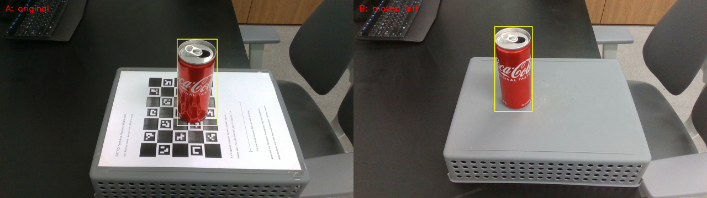
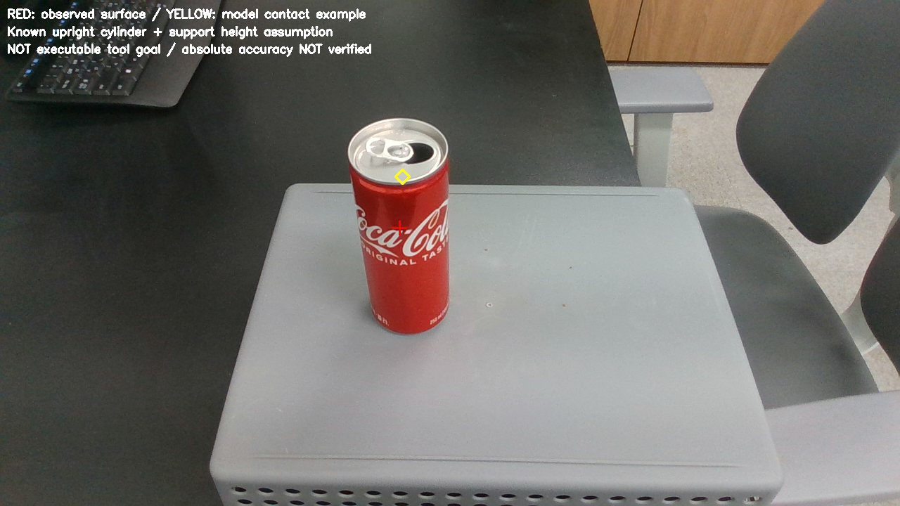
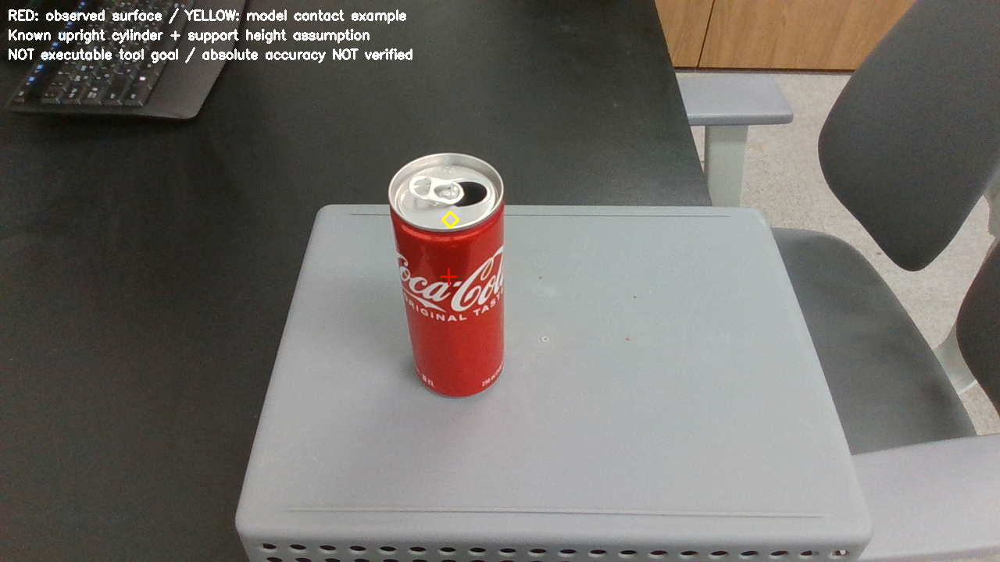

# 파지 알고리즘 개선 — 좌표 선택 및 물체 기준 분리

## 목표와 적용 상태

사용자의 중심 목표는 파지 알고리즘 자체의 개선이다. 카메라 가림은 파지 위치를
결정하고 실제 결과를 평가할 때 함께 확인한다. 가림만 해결하는 높이 보정으로
본 작업을 대체하지 않는다.

- **실제 파지 기본값은 기존 유지**: `localization_mode: legacy`, X +20mm,
  기존 자세·속도·그리퍼 값. 새 후보를 검증 없이 실제 파지에 적용하지 않았다.
- **실행 가능한 좌표 선택 후보 추가**: `candidate` 모드를 별도 선택할 수 있다.
- **물체 중심축 추정은 오프라인 실험 단계**: 원통 가정, TCP, 절대 위치의 검증이 남았다.
- **접촉점 → 도구 원점 변환은 순수 함수로 구현**: 실제 TCP 값은 아직 확정하지 않았다.
- `eated_interfaces` 변경 없음. 추가 진단 정보는 Jetson의 파일·로그에 저장한다.
- 사용자는 이번 세션에서 앞으로의 로봇 실행을 에이전트가 수행하도록 명시적으로
  허용했다. 각 실물 시험의 배치·주변 정리 확인은 별도로 받았다.

## 구현

### 관측 표면점 선택

`src/vision_pkg/vision_pkg/surface_localization.py`:

1. 중앙 창과 검출 사각형 내부 영역의 유효 깊이를 확인한다.
2. 깊이가 크게 갈리는 경우 그룹으로 나누고 충분한 지지를 받는 그룹이 없으면 거부한다.
3. 선택한 그룹의 **각 픽셀과 그 픽셀의 깊이**를 3D로 변환한다.
4. 강건한 중심에 가까운 실제 표면점 하나를 반환한다. 넓은 영역의 대표 깊이를
   다른 중앙 픽셀의 광선에 붙이지 않는다.

실험 초기 기준: 유효 비율 25%, 최소 10점, 깊이 그룹 간격 15mm, 그룹 지지율 70%,
그룹 깊이 P90-P10 폭 30mm. 이 값들은 검증된 로봇 허용 오차가 아니다.
지배적인 깊이 그룹도 배경일 수 있다. 이 방법은 물체 분할이나 물체 중심 추정을 보장하지 않는다.

최근 표본 구간은 안정 시간 +1초로 제한한다. 기본 0.5초를 초과해 유효 관측이 없으면
표본을 비운다. 충분한 기간·표본 수와 중앙값 주변 거리 P90(초기 10mm)을 확인한다.
잠깐의 검출 누락은 허용하므로 이 시간은 완전한 연속 검출 시간을 뜻하지 않는다.
새 후보도 반복 정밀도를 검사할 뿐 절대 정확도를 증명하지 않는다.

### 정확한 추론 자료 기록

`observation_output_directory`가 비어 있지 않을 때만 다음을 저장한다.

- 실제 YOLO 추론 RGB, 해당 동기화 콜백의 깊이 배열
- 각각의 타임스탬프·프레임, 깊이 단위, 사용한 pinhole 내부값
- 검출 사각형·관측 표면 좌표·후보 품질
- RGB 시각으로 조회한 카메라 → base TF(조회 실패도 명시)

PNG/NPY/JSON 기록은 디스크 공간과 실행 시간을 사용하므로 상시 기본값은 꺼져 있다.
이미지 저장 시간은 실행 시간에 영향을 준다. 촬영 모드의 시간으로 일반 성능을 평가하지 않는다.

### 물체 기준 및 접촉 기준

`object_geometry.py`는 알려진 반지름의 수직 원통을 가정하고 몸통 점들의 XY에
강건한 원 피팅을 수행한다. 캔 높이 범위·원통 잔차·보이는 원호의 조건을 확인한다.
사각형 ROI 자체는 분할 마스크가 아니다. 콜라 이외에 원통 가정을 자동 적용하지 않는다.

`control_pkg/grasp_reference.py`는 이미 추정된 물체 중심축과 지지면을 받아
윗면 아래 접촉점을 정의하고, `tool = contact - R * tcp_offset`으로 변환한다.
표면점을 중심축으로 간주하거나 TCP를 임의로 0으로 확정하지 않는다.

현재 URDF에서 end_effector 원점은 link5 X+126mm이고 손가락 관절 원점은
X+81.7mm, Y±21mm다. 이 원점만으로 실제 패드 접촉 위치나 최대 안쪽 간격을
확정할 수 없다. 따라서 계산 예시를 실제 팔 목표로 사용하지 않았다.

## 저장 자료 비교

출력: `log/grasp_algorithm_review_20261117_02/`, 요약 및 입력 해시:
`data/2026-11-17/grasp_algorithm_review/saved_frame_comparison.json`.

- 11/12 보정 후 6장, 11/11 정면·좌측 배치 6장: 총 12장.
- 같은 저장 RGB에 모델을 다시 실행한 비교다. 과거 액션의 실제 추론 프레임 복원은 아니다.
- 12/12 검출 및 기존·후보 표면점 반환. 기존 대체 깊이 경로 사용은 0/12.
- 두 방법의 점 차이: 11장은 0, 1장은 약 0.364mm.
- RGB/깊이 타임스탬프가 정확히 같은 자료는 5/12. 나머지 시간 차이를 JSON에 기록했다.
- 당시 latest TF를 영상 시각 TF로 대체하지 않고 카메라 좌표에서 비교했다.

따라서 이 자료만으로 대체 깊이 문제가 실제 실패 원인이었다거나 정확도가 개선됐다고
결론 낼 수 없다. 중앙 깊이가 정상인 경우 표면점 선택 수정만으로 물체 중심 문제가 해결되지 않는다.

## 현재 실물 촬영

사용자: 기존 상자와 콜라를 같은 지지면, 중심선·축선 전방 약 28.5cm로 준비하고
주변을 비웠다고 응답했다. 별도의 정확한 위치 실측은 받지 않았다.

실행: `./eateded --recognition-audit`

- 실행별 control 설정에서 `pick_enabled=false`만 변경한다.
- 기존 HOME으로 시작하고, 콜라 fetch 시 인식 자세 → 촬영 → HOME으로 진행한다.
- 집기·그리퍼 명령은 이 시퀀스에서 보내지 않는다. 공급 드라이버 초기화/종료 동작은 별개다.
- 첫 세션 로그: `log/eateded_20261117_223450_253950/`.
- 실행 중 파라미터로 Pick 비활성과 기록 경로를 확인했다.
- 첫 촬영 14프레임, 인식 후 HOME 및 IDLE 복귀 확인.

첫 위치의 분석: `log/grasp_live_geometry_20261117_center/geometry.json`.

| 값 | 결과 | 해석 |
|---|---|---|
| 기존 관측 표면점 | 약 (277, 11, 161)mm | 물체 중심 아님 |
| 원통 중심축 후보 평균 | (304.92, 11.67)mm | 수직 원통·지지면 가정하의 추정 |
| 프레임 간 축 좌표 전체 범위 | X 0.657mm, Y 0.782mm | 절대 정확도가 아닌 반복성 |
| 내부 피팅 검사 | 14/14 통과 | 독립 실측에 의한 합격 아님 |

지지면 base Z=70mm(상자 80mm, 모델의 base 높이 10mm), 콜라 반지름 26.5mm,
높이 134mm를 가정했다. 예시 접촉점은 윗면 30mm 아래이고 base Z=174mm지만
TCP·기울기가 확정되지 않아 팔 목표로 실행하지 않았다.

안내한 대략의 배치와 축 후보 사이에 약 20mm 전방 차이가 있다. 실측 불확실성,
좌표 사슬의 잔차, 형상 추정 편향 중 원인을 아직 분리하지 못했다.
따라서 사용자에게 콜라만 왼쪽으로 50mm 이동하도록 요청하여 상대 이동을 비교한다.

## 다음 작업과 한계

1. 같은 배치에서 좌측 이동을 정확한 추론 자료로 기록하고 상대 변화량 비교.
2. 원통 피팅의 배경 혼입과 잔차를 검토. 한 프레임의 잔차 P90은 약 9.8mm이며,
   모델이 모든 점을 잘 설명한다고 과장하지 않는다.
3. 물체 중심·접촉 기준·TCP와 팔 추종 오차를 구분해 확인.
4. 다른 배치에 대한 검증 후 파지 목표 계산과 연결. 도달 판정·재시도는 아직 미구현.

기존 도착 오차만으로 중단/경고하지 않는 동작, 실제 Y/음성 정지와 취소, 속도 0.10은 유지한다.

로봇에서 확인할 항목:
- [x] 기존 인식 자세에서 실제 추론 RGB-D/TF 기록 및 HOME 복귀
- [ ] 50mm 위치 변화에 대한 추정 중심축 변화
- [ ] 실제 접촉 기준과 TCP 확인
- [ ] 개선 목표의 접근·파지·운반과 카메라 시야 평가

## 두 번째 촬영: 좌측 이동 요청 후

사용자가 콜라를 로봇 기준 왼쪽 50mm로 옮겼다고 응답한 뒤 두 번째 촬영을 진행했다.
첫 CLI 단발 명령은 모니터에 수신됐지만 control에는 도착하지 않았다. 제어 로그와
IDLE 유지로 미실행을 확인했다. 이후 control 구독 엔드포인트·매칭 구독 수·IDLE을
확인한 발행자로 명령을 한 번 보내 인식 완료 및 HOME/IDLE 복귀를 확인했다.
추가 Y 확인을 요청하지 않았고 기존 비상정지 경로는 유지했다.

자료: `log/grasp_live_geometry_20261117_left50/geometry.json`,
`data/2026-11-17/grasp_algorithm_review/left50_comparison.json`.

| 값 | 첫 위치 | 두 번째 위치 | 변화 |
|---|---:|---:|---:|
| 프레임 수 | 14 | 13 | — |
| 중심축 후보 X | 304.92mm | 336.01mm | +31.10mm |
| 중심축 후보 Y | 11.67mm | 64.53mm | +52.86mm |
| 기존 표면점 X 평균 | 276.99mm | 309.37mm | +32.38mm |
| 기존 표면점 Y 평균 | 11.40mm | 64.48mm | +53.08mm |

좌측 변화는 요청한 50mm와 약 2.86mm 차이가 있지만, 이를 정확도 오차로 확정하지 않는다.
첫 영상의 표식 종이가 두 번째 영상에서는 없어졌고 상자 위치도 달라 보인다.
사용자는 후속 응답에서 상자도 조금 움직였을 수 있다고 확인했다. 약 31mm 전방 변화는
기존 방식에도 나타나므로 새 원통 피팅만의 오류라고 판단할 수 없다.
카메라 TF 평균 위치 변화는 약 0.04mm, 첫 프레임 회전 차이는 약 0.034°로 작다.
배경 특징 매칭은 대응점이 4개에 불과해 상자 이동의 정량 근거로 사용하지 않았다.

현재 촬영 시스템은 HOME/IDLE에서 켜져 있으며 Pick은 비활성이다. 새 중심축·접촉점은
실제 팔 목표로 적용하지 않았다. 두 배치를 통제된 50mm 이동 검증 통과로 기록하지 않는다.

## 세 번째 촬영: 전방 위치를 재측정한 기준

사용자가 콜라 중심을 바퀴 축 선 기준 전방 285mm로 다시 맞췄고,
좌우는 로봇 기준 왼쪽 약 50mm를 유지했다고 응답했다. Y 위치는 새로 실측한 값이 아니다.
기존 두 배치를 순수 좌측 이동 검증으로 사용하지 않고 새 배치를 별도 기준으로 기록했다.

앞으로 영상으로 확인 가능한 배치 변화는 에이전트가 먼저 확인하고, 영상만으로
확정할 수 없는 독립 거리 기준 등 필요한 정보만 사용자에게 묻도록 요청받았다.
로봇 실행은 사용자가 앞서 명시적으로 허용한 범위에서 에이전트가 수행한다.

실행 중 GetParameters 서비스로 `pick_enabled=false`, 상태 구독으로 IDLE,
control 명령 구독의 연결을 확인하고 촬영 명령을 한 번 발행했다.
12프레임 촬영과 HOME/IDLE 복귀를 확인했고 집기를 실행하지 않았다.

자료: `log/grasp_live_geometry_20261117_remeasured/geometry.json`,
`data/2026-11-17/grasp_algorithm_review/remeasured_reference_comparison.json`.

| 기준/계산 | 전방 X | 의미 |
|---|---:|---|
| 사용자 재측정 기준 | 285.0mm | 캔 중심, 측정 불확실성 미정 |
| 기존 관측점 평균 | 261.03mm | 보이는 캔 표면 |
| 기존 X+20mm 적용값 | 281.03mm | 기존 end_effector 목표 X |
| 원통 중심축 후보 평균 | 288.73mm | 모델 가정하의 물체 중심축 X |

중심축 후보와 사용자 X 기준의 차이는 +3.73mm다. 기존 팔 목표 X와 그 기준의 차이는
-3.97mm지만, 팔 목표와 물체 중심축은 서로 다른 기준점이다. 실제 접촉 정확도나
파지 성공률에서 새 방식이 우수하다는 증거로 사용하지 않는다. TCP와 팔 추종 검증이 남았다.

중심축 Y 후보는 65.56mm로 사용자가 유지했다고 한 대략의 50mm와 차이가 있다.
Y를 독립 재측정하지 않았으므로 15.56mm를 곧바로 보정값으로 사용하지 않는다.
프레임 간 전체 범위는 X 0.496mm, Y 0.460mm이며, 원통 잔차 P90은 2.17~2.96mm다.
모두 내부 일관성 지표이고 절대 정확도를 보장하지 않는다.

현재 총 39개 실제 추론 프레임을 세 배치에서 확보했다. 촬영 전용 시스템은 HOME/IDLE에서
대기하며, 새로운 중심축·접촉점 계산을 실제 파지에 연결하지 않았다.

## 품질 검사 보강과 모델 TCP·도달 검토

### 형상에 맞지 않는 점군을 거부

초기 구현은 원통 표면에서 5mm 이내인 점의 비율만 검사했다. 첫 배치는 그 비율이
약 77%여서 통과했지만, 나머지 점까지 포함한 잔차 P90은 9.21~9.85mm였다.
배경 혼입 등 형상 불일치를 통과시키지 않도록 잔차 P90이 5mm를 넘으면 거부하게 했다.
거부된 축은 디버그 가설로만 보존하고 정상 축 출력에는 넣지 않는다.

| 같은 저장 프레임 재생 | 기존 형상 검사 | 보강 후 |
|---|---:|---:|
| 첫 정면 배치 | 14/14 | 0/14 |
| 좌측 이동 후 배치 | 13/13 | 13/13 |
| 전방 재측정 배치 | 12/12 | 12/12 |

이는 개발 자료로 기준을 조정한 결과이지 독립 검증 결과가 아니다. 5mm는 잠정 설계값이며
실제 좌표 오차 5mm 보장을 뜻하지 않는다. 기존 JSON은 당시 분석으로 보존하고
`*_geometry_quality_v2.json`에 보강한 결과를 별도 저장했다.
원통 가정에 맞는 배경이 섞이는 경우까지 해결한 것은 아니며 실물 성공률 검증이 남았다.

### 손가락 모델에서 접촉 기준 추출

추가 실측을 줄이기 위해 현재 URDF와 설치된 손가락 STL을 읽었다.
안쪽 접촉 패드는 모델에서 35×15mm 사각형이며, 양쪽 패드 중심 사이의 가운데를
명목 TCP로 정의하면 `end_effector_link` 기준 `(0.4, 0, 0)mm`다.
최대 개방 명목 간격은 80mm, 지름 53mm 캔을 중앙에 두면 한쪽 여유는 13.5mm다.
손가락 맨 끝은 도구 원점보다 20.7mm 앞이다.

이 값은 실제 손가락·패드·장착 상태를 실측한 값이 아니다. 패드 길이 안에서 접촉 지점이
달라질 수 있으므로 명목 TCP와 실제 접촉점을 구분한다. 모델상 접촉 중심이 도구 원점에
가깝다는 이유만으로 실제 TCP가 검증됐다고 판단하지 않는다.
`nominal_gripper_reference.json`에 모델·메시 해시와 `hardware_tcp_validated=false`를 기록했다.

### 접촉점 후보의 읽기 전용 MoveIt 검사

`grasp_candidate_review.yaml`은 오프라인 검토용이고 실제 제어 launch에서는 읽지 않는다.
캔 윗면에서 25/40/55mm 아래, 집게 pitch 0/10/20도 조합 9개를 검사했다.
접근은 파지점 위 50mm, 상승 확인은 위 30mm이며 기존 제어 값을 변경한 것이 아니다.
`/compute_ik`와 `/plan_kinematic_path` 서비스만 호출했고 실행 액션은 보내지 않았다.
설치된 IK가 위치만 풀기 때문에 응답을 FK로 다시 계산해 기울기 차이 5도 이내,
접촉점 차이 2mm 이내인지 추가 검사했다. 이 역시 모델 내부 일치 검사다.

| 배치 가정 | 파지 위치·기울기 통과 | 접근·파지·상승 세 경로까지 통과 |
|---|---:|---:|
| 재측정 촬영의 추정 중심 X=288.72mm | 0/9 | 0/9 |
| 같은 캔이 로봇 쪽으로 20mm 이동 | 6/9 | 2/9 |

두 경로 조합은 윗면에서 각각 40/55mm 아래, 목표 pitch 0도다. 세 경로 모두 MoveIt
성공 코드를 반환했다. 요청 속도·가속 배율은 0.10이다. 현재 위치에서 IK가 실패했다는 것은
이 후보·시드·시간 제한 안에서 해를 찾지 못했다는 뜻이며, 모든 자세에서 물리적으로
도달 불가능하다는 증명은 아니다. 2cm 이동은 계획상의 가정이며 실제 인식으로 다시 확인해야 한다.

계획 장면에 상자·콜라·카메라 형상이 완전하게 들어 있다는 보장이 없고, 관절 경로 계획은
직선 하강을 보장하지 않는다. 경로 통과 결과를 곧바로 실행 가능한 충돌 없는 동작으로
취급하지 않는다. 실제 파지 성공률, 팔 추종 오차, 실제 TCP는 아직 검증하지 않았다.

검증: vision 패키지 40개 중 39개 통과·1개 skip, control 패키지 75개 중 74개 통과·1개 skip.
bringup 단위 테스트 11개도 앞선 구현 검증에서 통과했다. 이번 검사까지 실제 추가 팔 이동은 없었다.

다음 실물 확인에는 콜라만 약 2cm 가까이 옮기는 작업이 필요하여 사용자에게 요청했다.
새 배치는 재촬영하고, 품질 기준과 도달 검사를 실제 관측값으로 다시 확인한다.

로봇에서 확인할 항목:
- [ ] 가까운 배치에서 형상 품질·접근 및 상승 가능 후보 확인
- [ ] 실제 손가락 접촉점과 모델 TCP의 일치 여부
- [ ] 선택한 후보의 실제 접근·파지 성공 여부
- [ ] 반복 시험으로 기존 방식 대비 성공률과 운반 중 시야 비교

## 최신 결과: 가까운 실제 배치와 접근 높이 보강

사용자가 콜라만 약 2cm 로봇 쪽으로 옮기고 손을 뗐다고 응답했다. 실행 중 Pick 비활성을
서비스로 확인하고 기존 인식 자세 촬영 → HOME 복귀를 한 번 실행했다. 추가 Y 확인은
요청하지 않았으며 실제 정지·취소 경로와 기본 자세·속도는 유지했다.
영상으로 콜라가 상자 위에 서 있고 손이 시야에서 치워진 것을 에이전트가 확인했다.

- 새 촬영 13프레임, 형상 품질 검사 13/13 통과. 누적 네 배치 52프레임.
- 추정 중심축 평균 `(271.54, 62.91)mm`, 이전 재측정 배치 대비 `(-17.20, -2.65)mm`.
- 잔차 P90 2.33~4.39mm, 프레임 간 전체 범위 X 0.246mm / Y 0.535mm.
- 사용자가 옮긴 20mm는 대략의 이동이므로 2.80mm 차이를 절대 측정 오차로 해석하지 않는다.

### 고정된 접근 높이와 IK 검색의 한계 수정

첫 실제 배치 계획에서 접근 높이 +50mm를 적용하면 한 조합의 관절 경로가 통과했다.
하지만 윗면에서 55mm 아래를 잡을 때 이 접근점은 캔 윗면보다 5mm 낮다. 따라서
관절 경로 성공만으로 접근 준비가 됐다고 판단할 수 없었다.

검토 도구에 선택적 `--screen-finger-clearance`를 추가했다. 전체 열린 손가락 메시의
경계상자를 도구 좌표계로 변환해 접근 자세에서 가장 낮은 부분을 계산한다.
목표 기울기에서 손가락이 캔 윗면보다 최소 10mm 높도록 접근 거리를 늘리고,
IK 허용 각도·위치 오차(5도/2mm)에 따른 최악의 높이 차이를 추가 여유로 반영한다.
최종 IK 해의 FK로 실제 모델 간격을 다시 계산해 10mm 기준을 확인한다.
여기서 '간격'은 모델 기준이며 실제 하드웨어의 오차까지 보장하는 값이 아니다.

위치 전용 IK는 시드에 따라 기울기가 달라지므로 검토용 시드를 3개에서 8개로 확장했다.
그 결과 기존의 일부 검색 실패는 시드 범위에 의한 것이었음을 확인했다.
이전 0/9·6/9 등의 표는 당시 제한된 검색 결과이며, 현재 검토 도구의 최종 성능값으로
그대로 비교하지 않는다. 설치된 IK 설정이나 실제 제어 알고리즘은 변경하지 않았다.

최종 결과(`reachability_closer_actual_clearance_v3.json`):

| 캔 윗면에서 아래로 | 목표 pitch | 파지점에서 접근점까지 높이 | 접근 자세의 명목 손가락 간격 | 세 경로 |
|---|---:|---:|---:|---|
| 25mm | 0도 | 74.73mm | 17.61mm | 모두 계획 성공 |
| 40mm | 0도 | 89.73mm | 17.61mm | 모두 계획 성공 |
| 40mm | 10도 | 92.81mm | 20.75mm | 모두 계획 성공 |
| 55mm | 0도 | 104.73mm | 17.61mm | 모두 계획 성공 |

9개 중 파지 후보 8개가 위치·기울기 기준을 통과했고, 접근·상승 및 세 관절 경로까지
통과한 것은 4개다. 손가락 간격 검사는 접근 끝점에서의 보수적인 높이 검사다.
HOME→접근이나 하강 전체의 상자·콜라 충돌 검사, 실제 TCP 검증, 직선 하강,
운반 중 물체 유지와 카메라 가림을 대체하지 않는다. 후보를 실제 실행하지 않았다.
기존 제어기의 +50mm 기본 접근값도 바꾸지 않았다.

### 현재 완료 범위와 바로 다음 작업

완료: 관측 기록, 표면점 후보와 품질 판정, 원통 중심축 가설, 명목 TCP 추출,
물체 기준 파지 높이 후보, 손가락 크기를 반영한 접근 높이, 읽기 전용 경로 검토.
아직 미적용: 위 형상 후보를 일반 fetch의 실제 목표로 연결하는 동작, 실제 접촉 검증,
성공률 비교, 도달 실패 시 베이스 정렬과 재시도.

다음은 후보 하나의 전체 접근·하강 경로를 검토하고, 기존 취소·정지 구조 안에서
접근만 실행해 실제 손가락 위치를 확인하는 단계다. 이후 실제 파지와 반복 비교로 진행한다.
추가 실측부터 요구하지 않고 가능한 영상과 기록을 먼저 사용한다.
현재 촬영 전용 실행은 HOME/IDLE이며 `pick_enabled=false`다. 이번 추가 실행은 인식 촬영
한 번뿐이다. 변경 사항은 로컬에 저장했고 커밋·푸시는 아직 하지 않았다.

검증: 기존 패키지 검사(vision 39 통과/1 skip, control 74 통과/1 skip),
bringup 11 통과에 더해 검토 도구 문법 검사와 최종 4개 후보의 위치·각도·간격 및
계획 성공 결과를 재확인했다. 개발 자료에 대한 검증이며 독립적인 성공률 시험은 아니다.

로봇에서 확인할 항목:
- [x] 가까운 실제 배치 촬영과 HOME 복귀
- [x] 저장된 실제 관측값으로 파지·접근·상승 후보 계산 및 계획 확인
- [ ] 전체 접근 경로 검토 후 실제 손가락 접촉 기준 확인
- [ ] 새 목표를 적용한 파지 및 기존 방식과 반복 비교

## 접근 전용 실제 시험 1회

사용자의 계속 진행 요청에 따라 실제 집기는 수행하지 않고 새 파지 후보에 대한 높은 접근점만
시험했다. 기존 촬영 실행은 정상 종료했고, 단일 감독 프로세스에서 접근 전용 제어기를 실행했다.
현재 실행 로그는 `log/eateded_20261117_233829_374179/`다.

### 경로 검토와 실행 모드

`screen_grasp_path.py`는 link2~5의 충돌 메시 경계상자, 열린 상태와 닫힌 상태를 포함한
양쪽 손가락 경계상자, 장착 카메라의 140×100×100mm 보수적 영역을 변환해 검사한다.
상자는 X 0.10~0.55m, Y ±0.25m, 윗면 Z=0.09m 영역으로 넓게 잡았고 캔 영역은
반지름 방향 10mm, 높이 방향 20mm 여유를 추가했다. 이는 실측한 전체 환경 모델이 아니다.
회전한 경계상자와 장애물 상자의 분리 축 검사이므로 겹침은 실제 충돌의 확정이 아니라
보수적인 거부 조건이다. 주변 모든 물건이나 실제 하중 변형까지 검사한 것은 아니다.

기존 네 경로 중 세 개에서 끝부분의 손가락 영역이 여유를 포함한 캔 영역과 겹쳤다.
나머지 하나의 최소 분리 축 간격도 약 0.69mm여서 그대로 실행하지 않았다.
검토용 최소 손가락 높이 여유를 10mm에서 25mm로 늘린 별도 프로파일로 높은 접근점을 만들었다.
일반 제어기의 접근 높이·관절 자세·그리퍼 값·속도/가속 배율은 변경하지 않았다.

시간·속도·가속도가 포함된 경로는 실제 제어기의 spline 보간을 고려하여 5차식으로 표본을
만들고, 표본 사이 최대 이동도 도함수로 한계를 계산했다. 최종 경로는 554개 표본에서
영역 겹침이 없었고 최소 분리 축 간격 13.70mm, 표본 사이 모델 이동 상한 8.43mm였다.
닫힌 집게(양쪽 관절 0m) 상태로 MoveIt의 전체 로봇 상태 유효성 서비스도 554개 표본이
통과했다. 연속 경로 검사도 모델·가정 범위 안에서의 결과이며 실물의 완전한 충돌 보장이 아니다.

`eateded --reviewed-approach-plan <검토한 plan.json>` 모드를 추가했다. 시작 시 제어기는
움직임을 요청하지 않고 대기하며 `/measurement/execute_high_approach` 명시적 요청 한 번만
허용한다. fetch, 그리퍼 동작, 하강, 수동 주행은 실행하지 않는다. Y/음성 stop, 입력 최신성,
`operation_id`, `_send_goal` 등록·취소를 기존 측정 제어기에서 상속한다. 계획 파일 해시,
전체 trajectory 해시, 경로 검사 결과, 현재 시작 자세를 확인하며 재실행을 막는 기록을 남긴다.
팔 속도·가속 배율은 0.10 그대로다.

### 실행 전 두 차단을 해결한 방법

1. `/robot_description`에는 MoveIt과 robot_state_publisher가 서로 다른 XML 표현을
   발행하고 있었다. 두 노드의 실제 파라미터와 토픽 내용을 읽어 XML 정규화 후 내용이
   같음을 확인했다. 실행 제어기도 표현 차이 대신 정규화한 내용을 검사하도록 보강했다.
   실제 모델 내용이 다르면 차단 상태를 유지한다. 첫 검사에서는 움직임 요청을 보내지 않았다.
2. 드라이버 재기동 후 실제 자세는 일반 제어기의 HOME이 아니라 드라이버 초기 자세였다.
   HOME에서 만든 계획은 시작 자세 검사에서 거부됐다. 기준을 완화하지 않고 현재 자세에서
   새 경로를 만들었다. 이 거부 역시 실행 전이며 실패한 접근 동작으로 세지 않는다.

새 계획으로 실제 접근 요청 한 번이 수락됐고, 계획 시간 약 4.63초의 동작과 최신 피드백
확인을 마쳤다. 이후 높은 접근 자세에서 유지했다. 공급 드라이버 초기화 외에 이번 접근
시험에서 그리퍼 명령·하강·집기·운반 명령은 보내지 않았다.

### 접근 후 측정

정지 후 RGB-D/관절값 10개 표본을 저장했다. 영상·깊이 쌍의 타임스탬프 차이는 모두 0ms였다.

| 항목 | 10개 표본 평균 |
|---|---:|
| joint1 실제 센서값 - 목표 | -0.003도 |
| joint2(어깨) | +1.108도 |
| joint3(팔꿈치) | +1.876도 |
| joint4(손목) | +0.112도 |
| 센서 관절값으로 계산한 끝점 X 차이 | +1.162mm |
| 끝점 Y 차이 | +0.190mm |
| 끝점 Z 차이 | -15.297mm |
| 끝점 위치 차이 크기 평균 | 15.343mm |

목표 도구 원점은 `(271.124, 63.111, 268.378)mm`, 센서+URDF로 계산한 평균은
`(272.286, 63.301, 253.081)mm`다. 이는 물리적인 손끝을 독립 실측한 결과가 아니다.
깊이·카메라 오차와도 구분해야 한다. 기존 사용자 요청대로 도착 편차 중단·경고를
일반 제어에 되살리지 않았고, 이 값을 자동 관절 보상으로 적용하지도 않았다.

카메라가 팔 위에 있어 접근 후 영상에는 손가락과 캔이 화면 아래로 벗어났다.
따라서 실제 접촉 여부·중심 정렬은 이 영상으로 확인할 수 없다고 판단하여 사용자에게
옆과 위에서 한 번 확인해 달라고 요청했다. 추가 실측이나 사진 전송은 요청하지 않았다.

증거: `data/2026-11-17/grasp_approach_review/`의 `execution.json`, `plan.json`,
`driver_start_screen.json`, `closed_finger_validity.json`, `approach_tracking_summary.json`.
새 경로 검사 테스트 5개, 실행·측정 제어기 및 기동 테스트 49개가 통과했다.

현재 상태: 접근 자세 유지, 측정 제어 상태 `VISION_SEARCH`, Pick 비활성, 수동 주행 비활성.
`VISION_SEARCH` 표시는 측정 제어기의 준비/유지 상태이며 자동 집기를 기다리는 상태가 아니다.
HOME으로 자동 복귀하지 않으며, 일반 eateded 실행으로 바뀐 것도 아니다.

로봇에서 확인할 항목:
- [x] 새 접근 경로 1회 실행 및 정지 후 10개 표본 저장
- [ ] 실제 집게와 캔 사이의 간격·중심 정렬 확인(외부 육안 응답 대기)
- [ ] 확인 결과를 반영한 하강 경로 검토와 실제 파지 시험

## 최신 실물 결과 정정: 접촉 발생, 접근 실패

사용자는 접근 후 **손가락 아래쪽이 캔 윗면에 닿아 있으며 로봇 기준 왼쪽으로 치우쳤다**고
확인했다. 따라서 앞 절의 MoveIt 성공·피드백 확인은 동작 API 결과일 뿐, 실제 접근 성공이
아니다. 이번 접근은 실패로 기록한다. 계획의 여유 계산을 실물 간격으로 채택할 수 없으며,
15.3mm의 센서+모델 차이만으로 실제 접촉 원인을 전부 설명했다고 결론내리지 않는다.

원 제어기에 기존 stop 명령을 한 번 발행해 ERROR 상태를 확인했다. 하강·집기·HOME 복귀는
요청하지 않았다. 접촉 지점을 확인한 뒤 현재 관절값에서 어깨만 -6도 움직이는 분리 경로를
계획했다. 속도/가속 요청 배율 0.10을 유지하고 계획 시간을 최소 4초로 늘렸다.
208개 경로 표본에서 모델상 모든 손가락 경계점이 위로 움직이는지와 MoveIt 상태 유효성을
확인했다. 예상 최소 상승은 29.85mm였다. 이 값 역시 실측 보장이 아니다.

원 제어기는 정지된 채 이미 사용한 단발 목표만 가지고 있어 새 목표를 보내지 않는다.
하드웨어 재기동에 따른 자동 복귀를 피하려고 별도 이름 `contact_clearance_control`의
분리 전용 제어기를 추가했다. 상태·준비·실행 서비스는 `/measurement/contact_clearance_*`로
분리했다. 이 노드도 기존 MeasurementControl과 `_send_goal`을 사용하며 Y/음성 정지,
조이스틱/관절 최신성, 단발 실행, 재생 방지, 수동 주행 금지를 유지한다.
그리퍼 명령·하강·HOME 복귀 기능은 이 동작에서 사용하지 않는다.

분리 동작 1회는 액션 성공으로 끝났지만, 사용자 재확인은 **아직 닿아 있음**이었다.
후속 읽기 전용 조사에서 실제 관절 속도는 모두 0이었고, 어깨 목표는 제어기에 정상적으로
남아 있었다. 즉 아직 진행 중인 궤적이나 목표 전달 누락으로 설명되지 않는다.

| 분리 동작 결과 | 값 |
|---|---:|
| 어깨 명령 변화 | -6.00도 |
| 어깨 센서 변화 | -1.67도 |
| 어깨 실제 - 제어기 목표 | +4.33도 |
| 팔꿈치 실제 - 제어기 목표 | +0.61도 |
| 센서+모델 끝점 상승 | +7.38mm |
| 사용자 확인 | 여전히 캔 윗면에 접촉 |

`/dynamic_joint_states`에는 관절 위치·속도만 있고 개별 팔 모터의 전류·온도는 없었다.
배터리 인터페이스는 12.06V를 보고했지만, 이것만으로 개별 팔 전원·출력·마찰·하중 원인을
확정할 수 없다. 제어 게인·힘·관절 영점이나 보상값을 변경하지 않았다.

실제 분리 동작이 위쪽으로 움직였는지 사용자에게 추가로 확인을 요청했다.
응답 전에는 추가 운동을 보내지 않는다. 계산상 여유와 실물이 다르므로 이번 결과를
성공 사례나 새 파지 알고리즘의 정확도 향상 근거로 사용하지 않는다.

현재 상태(이 절이 앞선 상태 설명보다 우선):
- 하드웨어와 카메라는 켜져 있다.
- 원 제어기 `/control/state`는 ERROR, 분리 제어기는 동작 완료 후 유지 상태다.
- 아직 접촉이 해소됐다는 확인이 없다. 집게 닫기·물체 운반·추가 하강은 실행하지 않았다.
- 실행 중 분리 프로세스도 있으므로 이후 종료 시 함께 관리해야 한다.
- 일반 감독 프로세스를 종료하면 공급 드라이버가 자체 복귀할 수 있다. 접촉 상태에서
  자동 HOME이나 일괄 종료를 회복 방법으로 사용하지 않는다.

증거: 같은 자료 폴더의 `contact_stop.json`, `contact_outcome.json`,
`contact_tracking_readonly.json`, `clearance_plan.json`, `clearance_execution.json`.
분리 동작 검증을 추가한 뒤 실행·측정 제어기 테스트 42개가 통과했다.
앞서 경로 검사 5개 및 기동 12개도 통과했다(관련 테스트 총 59개).

## 사용자 요청에 따른 추가 상승 및 HOME 복귀 완료

사용자가 “그냥 위로 움직여서 돌아가면 돼”라고 명시적으로 요청했다. 추가 확인 질문 없이
현재 관절값에서 어깨를 12도 들어 올리는 경로를 계획·실행하고, 센서+모델로 상승량을
확인한 뒤 원래 HOME 목표 `[0, -101, 53, 70]도`로 복귀했다. MoveIt 속도·가속 요청
배율은 0.10을 유지했다. 집게·바퀴 명령은 보내지 않았다.

추가 상승에서 실제 어깨 변화는 약 -7.03도였고, 센서+모델 끝점 상승량은 39.98mm였다.
그 후 HOME 액션 성공 및 최신 관절 피드백을 확인했다. 최종 피드백은 대략
`[0.088, -101.250, 53.525, 70.137]도`다. 물리적인 손끝 위치의 독립 실측값은 아니다.

단발 복귀 제어기는 기존 MeasurementControl의 정지·취소 및 최신 입력 검사를 상속했고,
모든 실행 목표를 `_send_goal`에 등록했다. 이전 두 시험 제어기는 이미 단발 동작을 완료해
새 목표를 보낼 수 없는 상태였다. 복귀 후 임시 분리·복귀 제어기 두 개를 종료했다.
하드웨어와 카메라, 원 감독 프로세스는 유지했다. 원 시험 제어기는 ERROR이며 자동 재시작하지 않는다.
이제 실제 팔은 HOME에 있고, 앞 절의 접촉 상태·응답 대기 설명은 과거 상태다.

자료: `lift_home_execution.json`, `lift_home_UPWARD_plan.json`, `lift_home_HOME_plan.json`.
로컬 실행 원본: `log/grasp_approach_review_20261117/lift_home/`.
이번 복귀 완료가 파지 알고리즘 검증 통과를 뜻하지 않는다. 앞선 접근 실패와 좌측 편향,
관절 추종 차이는 그대로 남겨 두었다.

## 2026-11-18: 접촉 모순 분석과 HOME에서 추가 관측

사용자의 계속 진행 요청에 따라 HOME을 유지한 상태에서 분석·촬영했다.
이번 조사에서는 팔 이동, 집게, 바퀴 명령을 보내지 않았다.

### 실제 관절값과 손가락 모델 대조

`audit_grasp_contact.py`는 계획 목표가 아닌 당시 촬영에 저장된 실제 관절값으로 FK를 계산한다.
손가락의 전체 메쉬를 둘러싼 경계와 실제 접촉 패드 경계를 구분하고, 그리퍼 벌림도 저장된
각 손가락 관절값을 사용한다. 이 값들은 실물 위치 측정이 아닌 모델 계산이다.

| 항목 | 접근 후 10개 표본 결과 |
|---|---:|
| 전체 손가락 경계 최저점 − 캔 윗면 | +16.71~17.69mm |
| 접촉 패드 경계 최저점 − 캔 윗면 | +38.38~39.37mm |
| 당시 센서 벌림에서 모델상 손가락 안쪽 간격 | 42mm |
| 최대로 연 계획 상태의 모델 간격 | 80mm |
| 사용자 관찰 | 손가락 아래가 캔 윗면에 접촉, 로봇 왼쪽으로 치우침 |

캔 윗면은 기존 실측 높이를 사용해 base_link 기준 204mm로 계산했다
(상자 80 + 캔 134 − base_link의 지지면 위 높이 10).
손가락 모델 전체가 최소 16.7mm 위에 있는데 실제로 접촉했다는 모순이 남는다.
따라서 기존의 센서+모델 Z 추종 차이 약 -15.3mm만으로 접촉을 모두 설명할 수 없다.
높이 기준, 관절 기준, 장착 및 손가락 모델과 실물의 일치 여부를 구분해야 한다.
이 수치를 곧바로 +17mm 또는 +39mm 보정으로 적용하지 않았다.

당시 42mm 간격은 콜라 폭 53mm보다 작다. 접근 전용 시험에서는 집게를 열지 않았으므로
그 상태 그대로 몸통을 통과하는 하강으로 이어갈 수 없다. 이는 이번 수직 위치 모순의 원인을
확정하는 설명은 아니며, 향후 파지 시 실제 벌림 상태도 별도로 확인해야 한다는 뜻이다.

### 새 HOME 관측

`capture_geometry.py --stationary-only`를 추가했다. 측정 제어기의 ready와 독립적으로,
최신 관절 피드백이 1초 이상 0.15도 범위 안에 있는 경우만 읽기 전용 촬영을 수행한다.
이 필터는 이동 허가나 일반 제어의 도착 오차 차단 기능이 아니다.
중복·역행 영상 시각은 제외하고, 영상 수신 후 경과 시간을 0.25초 이내로 제한했다.
관절 메시지 시각과 깊이 영상 시각 차이도 기록한다. TF는 깊이 영상 시각으로 조회한다.

첫 진단 촬영에 중복 영상 1개가 있어, 중복 제외를 적용한 뒤 **서로 다른 시각의 10장**을
새로 확보했다. 아래 결과는 `home_capture_v2`만 사용한다.
영상에서 상자 오른쪽과 앞쪽 영역을 직접 확인하여 고정 ROI 두 곳을 선택했다.
상자 이외 장면에 자동 적용할 수 있는 분할 알고리즘은 아니다.

| 항목 | 결과 |
|---|---:|
| 상자 오른쪽 ROI 높이, base_link 기준 | 평균 59.84mm (59.35~60.25) |
| 상자 앞쪽 ROI 높이, base_link 기준 | 평균 58.46mm (57.96~58.71) |
| 알려진 상자 높이의 base_link 기준값 | 70mm |
| 높이 차이 | -10.16mm / -11.54mm |
| 새 HOME 영상의 원통 중심축 추정 승인 | 10/10장 |
| 중심축 평균 (x,y) | (283.71, 68.83)mm |
| x,y 각각의 표본 최대−최소 | 0.17mm / 0.26mm |

10장은 동일한 정지 자세의 반복 관측이지 독립적인 10개 배치가 아니다.
반복 변동이 작아도 상자 높이의 체계적인 차이는 남는다. 실제 접촉 때 캔이 움직였을 수 있어
이전 인식 자세의 중심축과 이번 HOME 결과 차이를 전부 카메라 보정 오차로 해석하지 않았다.
이번 중심축의 독립적인 실측 정답도 없으므로 정확도가 향상됐다고 판정하지 않는다.

현재 HOME에서 손목 관절 회전축까지의 수직 높이 한 값을 사용자에게 요청했다.
카메라에서 손목 자체가 보이지 않아 필요한 독립 기준이며, 과거 43.9cm는 다른 자세의 값이다.
현재 HOME의 센서+URDF 손목 축 예상 높이는 지지면 기준 **292.82mm**다.
이는 비교할 모델값일 뿐 새 실측값이나 목표값이 아니다. 응답을 받은 뒤 별도로 대조한다.

### 검증과 상태

- 새 경계 변환·실제 벌림 계산·정지 촬영 필터와 기존 평면 분석 테스트 **13개 통과**.
- 수정 Python 문법 검사와 `git diff --check` 통과.
- YOLO를 실행한 프로젝트 환경의 NumPy/SciPy 지원 범위 경고를 확인했다. 저장한 검출 상자로
  시스템 Python(NumPy 1.21.5 / SciPy 1.8.0)에서 중심축 계산을 재검산했고 차이는 0이었다.
- 원시 RGB-D는 `log/grasp_contact_audit_20261118/home_capture_v2/`에 저장했다.
- 집계·입력 해시·촬영 메타데이터·세션 분석 스크립트는
  `data/2026-11-18/grasp_contact_audit/`에 보관했다.
- 일반 파지, 카메라 보정값, 기본 자세, 속도·가속 0.10은 변경하지 않았다.
- 팔은 HOME이고 하드웨어·카메라는 유지 중이다. 원 단발 시험 제어기는 ERROR로 새 동작을
  시작하지 않는다. 이번 조사에서 실물 파지 재시험은 하지 않았다.

로봇에서 확인할 항목:
- [x] 현재 HOME의 손목 회전축 높이를 모델값과 독립적으로 대조
- [ ] 실제 벌림과 손끝 위치 기준을 확인한 뒤 개선 후보의 접근·하강·파지를 검증

### HOME 손목 실측 회신: 약 29.3cm

사용자는 자세를 유지한 HOME 손목 높이를 “29.3센치 정도돼”라고 보고했다.
지지면 기준 293mm로 기록하되 측정 불확도는 미제공으로 남겼다.
HOME 촬영 10개 관절 표본에서 같은 손목 축(`link5`)의 모델 높이는
평균 292.84mm, 범위 292.82~293.02mm였다. 실측과 평균 모델값의 산술 차이는
약 +0.16mm지만, 자로 잰 근사값이므로 **0.16mm 정확도를 검증했다는 뜻은 아니다.**
촬영과 자 측정은 동시가 아니며 HOME을 유지했다는 조건으로 비교한다.

과거 보정 촬영의 마지막 자세에서는 손목 실측 439mm와 모델 440.87mm가 대응했다.
두 자세의 손목 중심 높이가 모두 근접하므로 팔 전체 높이를 일괄 변경하는 근거는 약하다.
다만 손목 중심 높이는 마지막 회전 관절인 joint4를 돌려도 변하지 않으므로,
이 결과만으로 집게 기울기·손가락 길이와 장착·끝점 위치까지 검증할 수 없다.
어깨와 팔꿈치 기준 오차가 일부 상쇄될 가능성이나 수평 좌표 오차도 배제하지 않는다.

같은 HOME에서 **집게 손가락 맨 앞 끝의 가장 아래쪽 높이**를 추가 요청했다.
모터나 손가락 뿌리가 아닌 원위 끝을 기준으로 요청했고, 측정 전에 모델값은 질문에 넣지 않았다.
설치된 STL의 맨 앞 1mm 구간과 실제 벌림값을 사용한 모델 예상 최저 높이는
양쪽 모두 지지면 기준 약 227.94~228.27mm다. 실제 형상 일치 여부는 미검증이다.
손목 높이와 손끝 높이를 구분해 마지막 관절 이후의 기하를 대조하려는 목적이며,
이 회신으로 카메라나 관절 오프셋을 변경하지 않았다.

실측 원문·단위·불확도·대조에 사용한 입력 해시는
`data/2026-11-18/grasp_contact_audit/home_wrist_measurement.json`에 저장했다.
이번 대조에서도 로봇 이동 명령은 보내지 않았다.

로봇에서 확인할 항목:
- 사용자 결정으로 추가 실측 요청 철회. 아래 모델 기준 진행 결정을 따른다.

## 2026-11-18: 추가 실측 없이 모델 기준 진행, 비전 개선 모드 적용

사용자는 “그냥 모델의 값과 같게 진행해줘 나에게 측정할 일 없게 해줘”라고 지시했다.
추가 손끝 측정을 요청하지 않는다. HOME 손끝 높이는 약 228mm의 **모델 기준값**을 사용하며,
실측 필드는 null, 하드웨어 검증 여부는 false로 유지한다. 앞선 HOME 손목 293mm 실측은
별도 사실로 보존한다. 원시 접촉 관찰과 그 모순도 지우거나 해결됐다고 표시하지 않는다.
`grasp_candidate_review.yaml`에 모델 기준 진행 정책을 명시했다.

### 좌표 선택과 안정성의 실행 경로 보완

이미 구현한 개선 표면 선택기는 실제 선택 픽셀과 그 픽셀의 깊이를 함께 역투영한다.
중앙에 깊이가 없을 때 다른 위치의 깊이를 중앙 픽셀에 잘못 붙이는 처리를 피하고,
서로 비슷한 비중의 전경/배경 깊이가 섞인 경우에는 좌표 확정을 거부한다.
이번 후속 수정에서는 실제 인식 액션의 다음 문제를 보완했다.

1. 짧은 검출 중단에도 이전 좌표 표본이 남던 경로를 수정했다. 명시적인 검출 실패나
   깊이·TF 실패는 표본을 비우고 안정 시간을 새로 모은다. 영상이 오지 않는 동안에도
   기존 0.5초 최대 간격을 적용한다.
2. 안정 시간을 추론 완료 시각 대신 깊이 영상의 촬영 시각으로 계산한다.
3. RGB와 깊이 양쪽의 시각을 확인하고 중복·역행·미래·오래된 영상을 제외한다.
4. 추론/기록 중 영상이 오래될 수 있으므로, 개선 모드에서는 처리 후에도 최신성을 확인한다.
5. 개선 모드의 3D 좌표와 진단 저장 TF는 깊이 영상 시각을 사용한다.

표면점은 여전히 표면점이다. 원통 중심이나 손가락 접촉점을 기존 FindObject 결과에 몰래
실어 의미를 바꾸지 않았다. 공유 메시지 변경, 팔 도착 오차 차단 재도입, 속도·자세·집게
기본값 변경은 없다. 형상 중심축과 접촉점 선택은 기존 연구 도구에서 구분해 검토한다.

### 저장 영상 및 실시간 확인

| 확인 | 결과 |
|---|---:|
| 이전 실제 인식 촬영 재생 | 52/52장 개선 표면 좌표 유효 |
| 기존 방식과 개선 방식의 표면 좌표 차이 최댓값 | 0.4104mm 미만 |
| HOME 실시간 인식 액션 | 2회 모두 성공 |
| 1회 결과 (x,y,z), base_link | (256.980, 66.926, 138.429)mm |
| 2회 결과 (x,y,z), base_link | (257.038, 66.926, 138.599)mm |
| 두 결과 거리 | 0.180mm |
| 소요 시간 | 1회 9.89초 / 2회 2.88초 |

첫 실행 시간에는 CUDA 준비 약 5.30초가 포함된다. 시험 중 처리 지연으로 오래된 프레임이
발생했고 해당 프레임을 제외한 뒤 새 표본으로 결과를 확정했다. 이는 같은 HOME 배치의
반복성 확인이며 실측 정답에 대한 정확도나 파지 성공률 검증이 아니다.
실물 로봇은 움직이지 않았다. 별도 인식 액션 `/measurement/find_object_candidate`만 호출했다.

시험 노드의 단순 액션 이름 remap은 이 환경에서 적용되지 않아 첫 클라이언트는 서버 대기에서
끝났다. 해당 임시 노드를 종료하고 action의 send_goal/get_result/cancel_goal/feedback/status
각 경로를 명시적으로 분리한 뒤 실제 2회 시험을 수행했다. 시험 후 이 임시 노드도 종료했다.
기존 하드웨어 감독 프로세스나 팔 제어기를 재시작하지 않았다.

검증한 `localization_mode: candidate`를 두 비전 YAML, 노드 기본값, launch 기본값에 반영했다.
`vision_pkg` 빌드와 colcon 테스트를 완료했다. lint를 포함해 **44개 통과, 기존 copyright 1개 skip**이다.
**다음 일반 실행부터 적용**되며 현재 켜져 있는 원래 비전 프로세스의 설정을 소급 변경하지 않는다.
이전 좌표 선택 비교는 launch의 `localization_mode:=legacy`로 가능하다. 공통으로 추가된
영상 중복/시각 검사는 유지되므로 과거 버전 전체를 그대로 되돌리는 옵션은 아니다.

자료: `data/2026-11-18/grasp_localization/`의 saved_replay.json, results.json, summary.json,
실시간 인식 로그 및 읽기 전용 요청 스크립트. 미측정 손끝의 모델 기준 정책은
`data/2026-11-18/grasp_contact_audit/home_fingertip_reference.json`에 기록했다.

다음 파지 검토에서는 추가 실측 대신 모델 TCP·알려진 물체 치수·기록된 관절값을 사용한다.
기존 접촉 실패를 고려해 명목상의 모델 간격을 실제 여유로 단정하지 않는다.
개선 좌표 선택을 적용한 실제 접근·하강·파지의 성공 여부는 아직 미검증이다.

로봇에서 확인할 항목(에이전트 진행, 사용자 추가 실측 없음):
- [x] 실제 카메라의 개선 인식 2회 성공
- [ ] 다음 실행에서 개선 비전 설정 로딩 확인 및 모델 기반 파지 경로 검증

## 2026-11-18 모델 기준 파지점과 연속 경로 검토

추가 실측 없이 진행하라는 사용자 결정을 따라, 앞서 촬영한 HOME RGB-D 33장을 사용했다.
33장 모두 형상 잔차 기준을 통과했다. 중심축 중앙값은 base_link 기준
`(283.632, 68.317)mm`이다. 이는 영상 기반 추정이며 실측 정답이나 실행 직전 좌표가 아니다.

### 구현한 계산 및 검사

- `grasp_reference.upright_candidate`: 상자 지지면, 물체 높이, 윗면에서 내려오는 길이로
  접촉점을 정하고 모델 TCP/회전으로 도구 목표를 계산한다. 손가락 전체 모델과 IK 허용 오차를
  반영해 접근 높이를 결정하며, 접근점을 팔 회전축 방향으로 물릴 수 있다.
- `review_contact_path`: 끝점뿐 아니라 시간 정보에 따른 quintic 관절 보간 표본의 FK를 확인한다.
  직선과의 거리, 시작/끝 위치, 역행, pitch 범위와 yaw/roll 오차를 구분해 검사한다.
- `review_grasp_reachability.py --cartesian-grasp --screen-finger-clearance`:
  접근 경로 끝 관절값에서 하강을, 하강 끝 관절값에서 상승을 계획한다.
  Cartesian fraction 1.0, 관절 한계, FK 경로 기준을 만족해야 후보로 남긴다.
  일부 경로만 실행하거나 상승을 건너뛰는 기능은 없다. 이 도구에는 실행 기능 자체가 없다.
- 여러 후보 중 관절 경로 이동량의 합이 가장 작은 후보를 선택한다.
  이는 계획 비교 기준이며 파지 성공률이나 카메라 가림 평가가 아니다.

일반 control의 기존 파지 계산은 아직 이 경로로 교체하지 않았다. 공유 인터페이스,
고정 관절 자세, 집게 명령값, 속도·가속 0.10, 비상정지 경로는 변경하지 않았다.
일반 실행의 관절 도착 오차 중단·경고도 다시 추가하지 않았다.

### 읽기 전용 계획 결과

| 검토 설정 | 결과 |
|---|---|
| 손가락 명목 간격 40mm, 수직 접근, 고정 회전 오차 5도 | 9개 후보 중 높은 접근점 IK를 찾지 못함. 수학적 도달 불가 증명은 아님 |
| 위 조건 + 접근점 로봇 쪽 30mm 후퇴 | 접근 끝점 후보는 생겼으나 하강 중 회전 오차 또는 관절 보간 한계로 전 경로 탈락 |
| 30mm 후퇴 + pitch 허용 범위 -5~20도, yaw/roll 오차 5도 | 3개 전체 경로 후보 통과 |

새 간격·후퇴·pitch 범위는 실측 보정값이 아닌 검토용 설정이다.
정상 control launch가 읽지 않는 `grasp_candidate_review.yaml`에만 반영했다.
pitch를 허용했기 때문에 요청한 수평 자세를 경로 내내 고정했다는 뜻은 아니다.

| 캔 윗면에서 아래로 | 하강 fraction | 상승 fraction | 모델 하강 경로 최대 오차 | 선택 |
|---|---:|---:|---:|---|
| 25mm | 1.0 | 1.0 | 0.216mm | 관절 이동량 최소 |
| 40mm | 1.0 | 1.0 | 0.123mm | 후보 |
| 55mm | 1.0 | 1.0 | 0.226mm | 후보 |

선택 후보의 접촉점은 `(283.632, 68.317, 179.000)mm`, 접근 접촉점은
`(254.148, 62.778, 283.727)mm`, 상승 접촉점은 `(283.632, 68.317, 209.000)mm`이다.
모두 base_link 기준이다. 바닥 기준 80mm 상자는 base_link 기준 70mm로 계산한다.
하강은 30mm 전방 이동과 약 104.7mm 하강을 함께 하는 대각 직선이며, 수직 하강이 아니다.

선택된 접근 경로 650개 표본에서 팔·전체 손가락·카메라 영역과 가정한 상자·캔 영역의
중첩은 없었다. 최소 분리축 간격은 29.66mm, 표본 사이 운동 상한은 9.11mm였다.
이는 모델 영역 검사다. 실제 여유나 전체 환경/자기 충돌을 검증한 수치가 아니다.
**이 장애물 영역 검사는 접근 구간만 수행했다. 하강·상승 구간의 충돌 검증은 남아 있다.**
상승 계획 또한 열린 손가락과 미부착 캔 상태이므로 실제 집은 캔의 이동 여유를 보장하지 않는다.
이전 실물 손가락 접촉과 모델의 불일치는 여전히 미해결이다.

### 검증 및 다음 연결 작업

control_pkg 전체 테스트는 lint 포함 81개 통과·기존 copyright 1개 제외,
colcon 빌드/테스트 성공이다. 경로 검사 및 접근 제어 도구 테스트 37개도 통과했다.
중간 경로 휨, 회전 오차, 역행, TCP 회전 변환, 팔 축 방향 후퇴, 보간 중 관절 한계를
검토했다. 물리 로봇 이동 명령은 보내지 않았으며 하드웨어 프로세스를 재시작하지 않았다.

실행 경로로 연결하려면 새 관측으로 목표를 다시 만들고, 실제 집게 상태와 집은 캔을 포함한
하강·상승 모델을 검토한 다음 한 회차로 실제 접근·집기·상승을 확인해야 한다.
현재 저장 계획은 `executed: false`, `execution_authorized: false`로 보존한다.
추가 자 측정 대신 센서·모델·영상과 실제 접촉 여부를 구분해 기록한다.

자료는 `data/2026-11-18/grasp_model_path/`에 설정별 계획, 접근 영역 검사,
선택 후보/범위/검증 요약을 저장했다. 계획 계산 후 도구에 접근 경로 관절 이름 순서 검사를
추가했고 설정의 TCP 파일명 표기를 v2로 바로잡았다. 실제 실행에는 새 계획 생성이 필요하다.

로봇에서 확인할 항목(추가 실측 요청 없음):
- [ ] 새 영상·실제 집게 상태로 목표 및 하강·상승 경로 재검토
- [ ] 한 회차 접근·파지·상승 결과와 영상 기록
- [ ] 일반 실행에 연결한 뒤 반복 성공률과 손바닥 시야 확인

## 2026-11-18 하강·상승 영역 검사 및 실제 접근 재시험

새 정지 촬영 10장 모두 콜라 중심축 추정 기준을 통과했다. 중앙값은 base_link 기준
`(283.645, 68.230)mm`, 표본 범위는 X 0.234mm / Y 0.409mm였다. 반복성이며 실측 정확도가 아니다.
당시 집게 관절값은 0으로 명목 안쪽 폭은 42mm였다. 콜라 지름 53mm보다 작으므로
하강 전 기존 열림값 0.019를 실행하고 상태를 확인하는 절차가 필요하다.

### 모델 경로 검사에서 추가한 내용

`grasp_collision_geometry.py`와 `review_grasp_segments.py`는 ROS 이동 명령 없이 다음을 계산한다.

1. 설치된 손가락 STL을 X 방향 최대 2mm 구간으로 나누고, 구간 경계를 가로지르는 삼각형도
   포함해 경계 상자를 만든다. 손가락 전체를 하나의 큰 상자로 묶어 빈 공간까지 채우는 문제를 줄인다.
2. 열린 손가락으로 하강할 때 원통형 캔·상자와의 분리축 간격을 검사한다.
   양수는 해당 모델 경계의 분리이며, 음수는 **중첩 가능성**이지 실제 충돌 확정이 아니다.
3. 상승에서는 캔이 집게에 고정되어 이동·회전한다고 가정한다. 캔 밑면 높이와 팔·카메라와의
   간격을 계산한다. 손가락/상자 검사는 집게의 전체 개폐 범위를 감싸며, 캔과의 의도된 접촉은
   제외한다. 실제 닫기 성공·미끄러짐·힘은 검증하지 않는다.
4. 명목 간격 5mm 이상과 상승 후 캔 밑면 간격 20mm 이상을 연구용 후보 기준으로 사용한다.
   이 수치는 실측 보정값이나 실제 안전 보증값이 아니다. 후보는 최소 분리 간격을 우선하고,
   같은 경우 관절 이동량으로 선택한다. 실행 권한은 항상 false로 남긴다.

카메라 본체는 [RealSense 공식 D435 URDF](https://raw.githubusercontent.com/realsenseai/realsense-ros/ros2-master/realsense2_description/urdf/_d435.urdf.xacro)의
충돌 상자 25.05×90×25mm와 camera_link 기준 중심 `(0,-17.5,0)mm`를 사용했다.
[D435i 정의](https://raw.githubusercontent.com/realsenseai/realsense-ros/ros2-master/realsense2_description/urdf/_d435i.urdf.xacro)는 이 본체 정의를 포함한다.
현재 카메라 장착 TF에 결합한 명목 모델이며 별도 장착부·케이블은 포함하지 않는다.
기존 넓은 140×100×100mm 영역 결과도 삭제하지 않고 함께 기록했다. 이 넓은 영역은
모든 하강 후보에서 캔과 중첩 가능성이 남는다. 본체 결과만으로 장착부까지 확인했다고 하지 않는다.

### 후보 비교

| 윗면에서 아래로 / 요청 pitch | 본체·캔 최소 분리축 간격 | 모델 후보 판정 |
|---|---:|---|
| 15mm / 0도 | 17.36mm | 통과, 명목 최소 전체 간격 13.44mm로 선택 |
| 20mm / 0도 | 12.56mm | 통과 |
| 20mm / 10도 | 14.58mm | 통과 |
| 25mm / 0도 | 7.75mm | 통과 |
| 40mm / 0도 | -6.75mm | 본체 중첩 가능성으로 제외 |
| 55mm / 0도 | -17.22mm | 본체 중첩 가능성으로 제외 |

15mm 후보는 실제 관절 경로의 마지막 자세에서 명목 접촉 패드 상단과 캔 윗면 사이가
약 6.25mm다. 이 역시 센서 실측이 아닌 메시 계산이다. 30mm 상승 경로에서 집힌 캔 밑면의
최종 상자 간격은 약 28.00mm이며, 표본상 지지면 아래로 내려가지 않았다.
15/20mm 후보를 연구용 YAML에 추가했다. 일반 control의 파지 목표는 변경하지 않았다.

### 실제 접근 1회

전체 하강·집기를 실행하지 않고, 별도 일회성 접근 제어기로 접근점까지만 실행했다.
기존 Y/음성 stop, 취소 구조, 관절·조이스틱 최신성, 속도·가속 0.10을 유지했다.
접근 경로는 650개 표본에서 넓은 카메라 영역을 포함한 중첩이 없었으며,
최소 분리축 간격 29.91mm, 표본 사이 운동 상한 9.11mm였다.

| 항목 | 결과 |
|---|---|
| 계획 도구 목표, base_link | (253.766, 62.624, 283.727)mm |
| 이동 후 센서+모델 평균 | (255.447, 62.030, 264.783)mm |
| 센서+모델 차이 X/Y/Z | +1.681 / -0.595 / -18.944mm |
| 관절 1/2/3/4 평균 차이 | -0.129 / +1.394 / +2.232 / +0.540도 |
| 실제 접촉 여부 | 사용자 육안 확인: **닿지 않고 떨어져 있음** |
| 실제 하강·집기 | 미실시 |

손끝 실측은 요청하지 않았다. 계산상 손가락 최저점 간격 약 31.35~32.00mm와 사용자
확인한 비접촉 사실을 분리해 기록했다. 센서 Z 차이를 실제 손끝 오차로 해석하지 않는다.
접근 요청의 첫 사전 검사는 기존 제어기 상태 토픽이 도착하기 전에 판단하는 경쟁 조건으로
거부됐으며 이동은 없었다. 상태 수신까지 기다리도록 요청 스크립트를 수정하고
기존 ERROR/시험 IDLE을 확인한 두 번째 요청으로 실제 한 번 실행했다.

### 집게 열기 요청 전 전체 실행 종료 및 복구

기존 eateded가 **01:01:01 종료 신호 수신 → 01:01:13 종료 완료**를 기록했다.
사용자는 직접 종료하지 않았다고 답했다. 신호 발신 주체는 이전 기록만으로 알 수 없으며,
전원 저하나 새 파지 계산이 원인이라고 결론내리지 않는다. 드라이버 종료에는 자체 팔/집게
초기화가 포함되므로 접근 자세가 계속 유지됐다고 가정하지 않는다.

별도 일회성 `gripper_open_control.py`를 구현했지만 열기 요청은 최신 조이스틱 정보가 없어
거부됐고, 관절/조이스틱 양쪽 데이터도 없어 재요청하지 않았다. **이 도구로 실제 집게 열기는
수행하지 않았다.** 기본 집게 값과 정지 경로는 그대로이며 관련 단위 테스트를 통과했다.

완료/미사용 임시 제어기 PID 21767/22140을 종료했다. eateded에 받은 신호 이름과
PID/PPID/SID 기록을 추가했으며, 발신 주체까지 수집하는 기능은 아니다.
촬영 전용 모드로 새 실행을 시작해 01:06:08 전체 준비와 HOME/IDLE을 확인했다.
새 감독 PID는 22351, 로그는 `log/eateded_20261118_010533_850510`이다.
에이전트 실행 셸과 별도 세션으로 시작했으며 명시적인 종료 신호와 기존 정지 경로는 유지된다.
촬영 전용 설정의 `pick_enabled=false`, 비교 인식용 `localization_mode=legacy`가 실제 로딩됐다.

새 도구·접근 제어 테스트 50개, 실행기 테스트 12개 통과. 한 번의 테스트 실행은 ROS overlay를
source하지 않아 모듈 수집 오류로 끝났고, 올바른 환경에서 다시 실행해 통과했다.
전체 결과는 `data/2026-11-18/grasp_segments/`에 보존했다.

로봇에서 확인할 항목(추가 실측 없음):
- [x] 새 접근 경로 실제 이동 및 비접촉 확인
- [x] 예기치 않은 전체 종료 후 실행 환경/HOME 복구
- [ ] 현재 HOME에서 새 관측·계획 생성, 실제 집게 열기 및 좌우 정렬 확인
- [ ] 실제 하강·파지·상승 한 회차 검증 후 일반 실행 연결

이전 접근 계획은 사용 완료되었고 재시작으로 시작 자세도 바뀌었다. 그대로 재실행하지 않는다.
