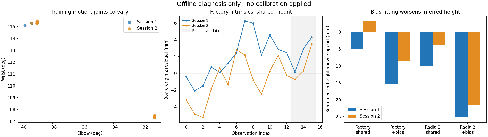

# 자세별 좌표 오차 자동 진단 — 2026-11-12

후속 결과: [고정 팔 모델·RGB-D 후보 개선](rgbd_refinement_2026-11-12.md).

**추가 실측·촬영·초기 세팅 없이 기존 자료의 자동 진단을 구현하고 실행했다. 최종 카메라 보정값은 아직 확정하지 않았다.**

영상 오차를 줄이는 관절 영점 후보는 얻었지만, 책상 높이가 더 틀어지고 추정값이 시험 범위의
끝에 걸렸다. 또한 카메라 장착값과 모든 관절 영점을 동시에 구하면 두 가지 모호성이 반드시
남는다. 따라서 이 결과를 실제 관절 영점이나 카메라 설정으로 적용하지 않았다.

## 1. 구현한 것

- `tools/vision_eval/pose_diagnostics.py`: URDF 기반 일괄 순기구학, 자세별 픽셀·위치 잔차,
  두 세션에 공통인 카메라 장착값 추정, 제한된 관절 영점 가설 비교, 추정 가능성 진단.
- `tools/vision_eval/diagnose_pose_residuals.py`: 원본 해시·모델·세션·관측 역할 확인부터
  계산·CSV·JSON 보고까지 수행하는 오프라인 실행 도구. ROS나 하드웨어 연결이 필요 없다.
- `tools/vision_eval/test_pose_diagnostics.py`: 계산 일치, 모호성 증명, 알려진 합성값 복원,
  검증 자료 학습 거부, 실제 설정 내보내기 금지를 확인하는 테스트 6개.
- `decision.json`: 추정 불가능한 방향, 약한 추정 조합, ±5° 시험 경계 도달을 자동 기록한다.
  진단 전용 도구이며 문제가 표시되지 않더라도 실제 보정값 승인 기능은 제공하지 않는다.

이 작업에서 `src/`의 실제 인식·제어 코드와 launch 기본값은 수정하지 않았다.
로봇 구동·관절 영점 변경·카메라 K/D 또는 TF 적용·깊이 스케일 변경도 하지 않았다.
수정할 근거가 확인된 실행 코드 결함은 없었으므로, 원인 미확정 오차를 상쇄하는 값을 넣지 않았다.

## 2. 계산 자료와 기준

- 책상에 표식판을 붙이고 팔을 움직였던 두 세션의 관측 32개: 학습 26개, 기존 검증 6개.
  검증 6개는 이번 최적화에 넣지 않았지만 이미 확인한 자료이므로 새로운 독립 검증은 아니다.
- 표식 실측 177×125mm, 기존에 생성한 팔 받침 +25mm 모델을 사용했다.
- 동일한 RGB를 내부값 없이 다시 검출한 코너를 모든 비교에 사용했다.
- 내부값은 기존 공장값과 앞서 고정한 `radial2` 후보 두 가지이며 이번에 재학습하지 않았다.
- 두 세션에 **하나의 공통 카메라 장착 변환**을 맞췄다. 표식의 세계 좌표는 세션별로 하나씩
  추정했다. 세션 사이 표식이 완전히 고정됐다는 가정을 강제로 넣지는 않았다.
- 기록된 최신 관절값으로 FK를 다시 계산했다. 이것과 RGB 시각의 저장 TF는 시각이 완전히
  같은 관절 표본이 아니므로 작은 차이를 곧바로 코드 오류로 해석하지 않는다.
- 책상 기준 높이는 `base_link`의 지지면 위 높이 10mm를 반영했다.
  당시 표식은 책상에 직접 붙어 있었으므로 예상 높이는 약 0mm다. 80mm 상자 높이가 아니다.
  책상이 완전히 수평이라는 정밀 기준이나 종이의 정확한 평면성은 보장되지 않는다.

원본 모델 SHA256:
`d7f6fa78a5391d07edbb66dd1c35d8bf3ab2eda7585a08614c634271b05e6546`

## 3. 확인된 사실

### 모델 좌표 계산과 저장 TF 사이의 차이는 작다

32개 관측에서 FK와 저장 TF의 위치 차이는 최대 **0.207mm**, 회전 차이는 최대 약 **0.088°**였다.
따라서 이번 자료에서 수 mm 이상의 불일치를 두 소프트웨어 계산 경로의 차이만으로 설명하기는
어렵다. 양쪽이 같은 URDF를 사용하는 계산이므로 **실제 로봇이 모델과 정확히 같다는 증명은 아니다.**

### 팔꿈치와 손목의 영향을 따로 분리하기 어렵다

| 학습 자세 범위 | 1차 세션 | 2차 세션 |
|---|---:|---:|
| 베이스 회전 | 23.906° | 35.771° |
| 어깨 | 12.305° | 17.051° |
| 팔꿈치 | 0.439° | 8.086° |
| 손목 | 0.176° | 8.174° |

2차 팔꿈치·손목 각도의 상관계수는 **−0.99944**다. 거의 항상 반대 방향으로 함께 움직였다.
1차는 두 관절이 사실상 고정돼 있었으므로 작은 양자화 변화의 상관계수를 해석하지 않는다.
자세·시야각·화면 내 위치가 함께 바뀌므로 특정 관절과 잔차의 상관관계가 원인을 증명하지 않는다.

### 모든 관절 영점과 카메라 장착값을 동시에 확정할 수 없다

장착값 6개, 두 표식 위치·방향 12개, 네 관절 영점 4개를 합친 **22개 변수 중 수치적 순위는 20**이다.
두 내부값 모두 같은 결과였다. 합성 데이터 테스트에서도 아래의 정확한 기하학적 모호성을 확인했다.

1. 베이스 회전 관절의 영점 변화는 미지의 표식 세계 위치·방향 변화로 흡수할 수 있다.
2. 손목 관절의 영점 변화는 미지의 카메라 장착 변환 변화로 흡수할 수 있다.

이는 두 관절이 고장 났다는 뜻이 아니다. 이 형태의 자료만으로 해당 변수들을 서로 분리할 수
없다는 뜻이다. 같은 방식으로 사진 수만 늘려도 이 두 모호성 자체는 없어지지 않는다.
기준값을 고정하거나 별도의 독립 기준을 추가해야 전체 변수의 의미가 결정된다.

## 4. 제한된 영점 가설을 시험한 결과

베이스·손목 영점은 0으로 고정하고 어깨·팔꿈치만 각각 ±5° 범위에서 추정했다.
이는 실제 로봇을 움직이는 범위가 아닌 **계산상의 가설 범위**다. 0°, +2°, −2°의 세 초기값으로
시험했으며 거의 같은 결과에 도달했다.

| 내부값 / 가설 | 기존 검증 픽셀 RMS 평균 | 기존 검증 최대 위치 불일치 | 1차 표식 높이 | 2차 표식 높이 |
|---|---:|---:|---:|---:|
| 공장값 / 공통 장착만 | 1.773px | 5.001mm | −4.929mm | +3.280mm |
| 공장값 / 어깨·팔꿈치 추가 | 1.615px | 4.272mm | −15.356mm | −8.690mm |
| radial2 / 공통 장착만 | 1.822px | 6.321mm | −10.164mm | −3.935mm |
| radial2 / 어깨·팔꿈치 추가 | 1.439px | 4.202mm | −25.269mm | −21.453mm |

픽셀 RMS는 각 영상의 코너 2차원 RMS를 구한 뒤 영상 간 평균을 낸 값이다.
위치 불일치는 영상에서 추정한 표식 원점과 학습으로 고정한 세션별 원점 사이의 거리다.
**실제 물체 위치의 절대 정확도나 Pick 오차가 4~5mm로 검증됐다는 뜻은 아니다.**
높이는 표식 원점이 아닌 무늬 중심에서 계산했다.

공장값에서는 어깨 +5°, 팔꿈치 +1.913°, radial2에서는 어깨 +5°, 팔꿈치 +4.423°가 나왔다.
어깨는 모두 임의로 정한 시험 범위의 끝에 걸렸고, 팔꿈치 추정은 내부값 선택에 따라 약 2.51° 달라졌다.
**이 숫자는 적용할 영점 보정값이 아니다.** 약한 변수 조합도 남았다(1°/1mm로 정규화한
야코비안 최소 상대 특이값 약 5.4~5.9×10⁻⁵). 세 초기값의 수렴 일치만으로 물리적 정확성을
입증하지 않는다.

영상 잔차를 줄이면서 높이가 더 틀어지는 결과는, 영점 변수가 다른 모델 오차까지 대신
흡수할 수 있음을 보여준다. 카메라 내부값·장착값·기구학·표식 형상의 기여를 아직 분리하지 못했다.

왼쪽은 팔꿈치·손목의 동반 움직임, 가운데는 공장 내부값의 자세별 z 잔차,
오른쪽은 영점 가설 추가 후 표식 높이가 더 낮아진 결과다. 회색 영역은 재사용 검증 관측이다.

이전 보고서에서는 세션별 장착값을 따로 맞췄고 이번에는 하나로 묶었다.
따라서 높이 숫자가 이전 결과와 달라진 것은 추정 조건의 차이이며 새 보정 성공을 뜻하지 않는다.

## 5. 검증과 보관

- 새 테스트 6개를 포함한 관련 오프라인 계산 테스트 **21개 통과**.
- 새 Python 파일 3개의 flake8(줄 길이 99), pydocstyle 통과.
- 실제 저장 자료 32개에 대한 전체 진단 실행 완료. 원본 해시와 기록된 모델·세션을 대조했다.
- 출력: `log/pose_diagnosis_20261112_02/`.
- 저장소용 수치 사본: [analysis.json](data/2026-11-12/pose_diagnosis/analysis.json),
  [자동 판정](data/2026-11-12/pose_diagnosis/decision.json),
  [자세별 CSV](data/2026-11-12/pose_diagnosis/pose_residuals.csv).
- [공유용 그림 PDF](data/2026-11-12/pose_diagnosis/pose_diagnostics.pdf).
- 원본 촬영 이미지는 기존 `log/`와 이전 백업에 보존하며 저장소용 사본에 넣지 않았다.
- 이번 도구·문서·수치 결과 백업: `log/backups/pose_residual_diagnosis_20261112.tar.gz`.
  백업 파일 SHA256과 검증 기록은 같은 이름의 `.sha256`, `_verification.json`에 있다.

실행 명령은 [도구 README](../../tools/vision_eval/README.md)의 자세별 오차 진단 절에 있다.

## 6. 현재 완료 범위와 다음 판단

사용자 추가 도움 없이 가능한 자료 감사, 자세별 분석, 가설 비교, 자동 판정, 회귀 테스트,
보고서 저장까지 완료했다. 이번 작업에 필요한 초기 세팅이나 추가 실측 요청은 없다.

최종 카메라 보정값 확정과 실물 절대 오차 검증은 남아 있다. 현재 자료에서 얻은 최솟값을
최종값으로 채택하거나 임의로 높이를 맞추지 않는다. 실제 적용을 진행할 때는 카메라 장착 또는
관절 기준 중 무엇을 독립적으로 고정할지 먼저 결정해야 한다. 이후 해당 기준에 맞는 최소 검증을
설계해야 하며, 관절 영점·깊이·물체별 오프셋을 한꺼번에 조정하지 않는다.

이번에는 로봇에서 확인할 변경 사항이 없다. 팔 속도·자세·비상정지와 기존 카메라 실행 설정은 유지했다.
