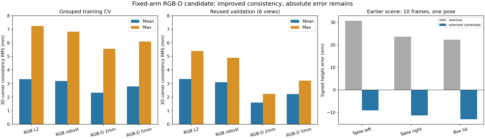

# 기존 RGB-D 자료를 이용한 카메라 보정 후보 개선 — 2026-11-12

후속 사용자 결정: [채택 보정값 적용과 실물 좌표 시험](accepted_calibration_test_2026-11-12.md).
아래의 미적용 상태는 후보 비교를 마쳤던 당시 상태다.

**추가 촬영·실측 없이 깊이 영상을 활용하는 계산과 자세 묶음 교차검증을 구현했다. 기존
자료의 일관성이 개선된 후보를 선정했지만, 별도 상자 장면에서 약 13mm 높이 오차가 남아 실제
설정에는 적용하지 않았다.** 선택한 결과는 명시한 후보군·평가 기준 안에서 가장 나은 후보이며,
실제 정확도에 대한 전역 최적값이나 최종 캘리브레이션 인증을 뜻하지 않는다.

## 1. 카메라 오차와 팔 오차를 왜 구분하기 어려운가

손에 휴대폰을 들고 책상을 찍는 상황을 생각하면 된다. 손목을 아래로 기울여도 화면에 책상이
더 보이고, 손목을 그대로 두고 휴대폰만 손 안에서 기울여도 책상이 더 보인다. 사진에는 최종적으로
카메라가 어디에서 어느 방향을 봤는지가 나타나며, 기울기의 원인이 손목인지 휴대폰 장착인지는
따로 표시되지 않는다.

한 방향의 기울기만 생각한 설명용 예시다. 아래 수치는 실제 로봇 측정값이 아니다.

| 팔 끝의 기울기 | 팔 끝에 대한 카메라 기울기 | 카메라가 보는 최종 방향 |
|---|---|---|
| 아래로 30° | 아래로 5° | 아래로 35° |
| 아래로 32° | 아래로 3° | 아래로 35° |
| 아래로 35° | 0° | 아래로 35° |

방향만 보면 세 경우가 같다. 실제 계산에는 위치와 세 방향의 회전도 포함되므로 각도를 단순히
더하는 식으로 처리하지 않지만, 서로 다른 원인 조합이 같은 관측을 설명할 수 있다는 원리는 같다.

로봇에서는 다음 연결을 사용한다.

`로봇 기준 → 팔 끝의 위치·방향 → 카메라 장착 위치·방향 → 카메라가 본 물체`

여기서 두 가운데 값을 모두 자유롭게 바꾸면 영상에 잘 맞도록 서로의 오차를 흡수할 수 있다.
특히 이 팔의 손목 영점 변화는 카메라 장착 변환에 흡수되는 정확한 모호성이 있다는 것을
[앞선 분석과 합성 테스트](pose_residual_diagnosis_2026-11-12.md)에서 확인했다.
베이스 관절 영점도 미지의 표식 세계 위치·방향과 구분되지 않는 방향이 있다.

따라서 이번에는 **관절 영점과 팔 모델을 고정한 뒤 카메라 장착값을 추정**했다. 이는 팔이
정확하다고 증명한 것이 아니라, 풀 수 없는 조합을 자유롭게 바꾸지 않도록 계산 기준을 정한 것이다.
팔→카메라→표식의 변환 관계는 [OpenCV 4.5.4 hand-eye 공식 설명](https://docs.opencv.org/4.5.4/d9/d0c/group__calib3d.html)과 같다.

## 2. 이번에 추가한 정보와 구현

이전 계산은 주로 RGB 무늬의 픽셀 위치를 사용했다. 이번에는 같은 시각에 저장된 깊이 영상에서
표식판 표면까지의 거리도 사용한다. 사진의 무늬 위치뿐 아니라 깊이 표면에도 맞도록 추정하는 것이다.
깊이 역시 완벽한 기준은 아니며 팔/장착 모호성 자체를 없애지는 않는다.

- `rgbd_refinement.py`: 깊이 평면 추정, 가까운 자세의 그룹화, 고정 팔 모델 기반 RGB/RGB-D
  최적화, 이상치의 영향을 줄이는 soft-L1 계산, 분리된 평가 지표.
- `refine_saved_rgbd.py`: 원본·기존 백업 대조, 계산 전 비교 계획 저장, 6개 방식의 교차검증,
  후보 선택 고정, 기존 검증 관측 평가, 후보 프로파일 생성.
- `audit_saved_surface.py`: 선택 후 앞서 촬영했던 다른 상자·책상 장면을 재계산. 후보값이나
  영역 선택을 이 결과에 맞춰 수정하지 않는다.
- 새 테스트 9개: 깊이 이상치, 단위·좌표 변환, 자료 분리, 합성 보정값 복원 등을 검증한다.

관절 영점·팔 모델·깊이 스케일을 새로 맞추지 않았다. 책상 높이를 0으로 만드는 제약도 넣지 않았다.
새 후보는 `candidate_profile.json`에 보관하며 `runtime_export_enabled: false`, `applied: false`다.
실제 제어 코드나 launch 파일이 자동으로 읽는 파일은 아니다.

## 3. 계산과 후보 선택 절차

1. 두 장착 보정 세션의 32개 관측을 읽는다. 학습 26개, 기존 검증 6개를 유지한다.
2. 원본 RGB·모델·세션을 대조하고 깊이 PNG는 당시 저장한 세션 백업의 바이트와 비교한다.
3. 내부값을 넣지 않은 검출점의 안쪽 볼록껍질을 9px 축소한 영역에서 깊이 점을 가져온다.
   16UC1을 mm로 해석하고 0.2~1.2m의 유효 점을 사용한다. 고정 난수 RANSAC와 반복 평면 추정,
   3mm 거리 기준을 적용하며 최소 70% 평면 지지가 없으면 계산을 중단한다.
4. 32개 영상의 평면 내부 RMS는 약 0.65~1.05mm였다. 이는 표면의 내부 적합도이며 깊이 센서의
   절대 정확도를 뜻하지 않는다.
5. 학습 관측 중 모든 관절 차이가 3° 이내인 가까운 자세는 세션을 가로질러 같은 그룹으로
   묶는다. 연결된 그룹도 합친다. 그룹을 5개 묶음으로 나눠, 한 묶음씩 제외하고 나머지로 계산한다.
   제외한 자세는 해당 계산의 초기화에도 사용하지 않는다.
6. 공통 카메라 장착값 6개와 세션별 표식 위치·방향 6개씩, 총 18개만 추정한다.
   이미지 시각에 저장한 팔 TF를 사용한다. 최신 관절 표본을 대신 사용하지 않는다.
7. 후보는 공장 내부값의 RGB L2 / RGB soft-L1 / RGB-D 2mm / RGB-D 5mm,
   그리고 radial2 내부값의 RGB L2 / RGB soft-L1, 총 6개다.
8. 순위 기준은 제외된 학습 자세의 `sqrt(mean((픽셀RMS² + (평면RMS_mm/3)²)/2))`다.
   이 1px·3mm 균형과 RGB-D의 2mm·5mm 가중 척도는 비교용 공학적 선택이며 측정 불확도나
   허용 오차를 의미하지 않는다. 높이 잔차는 순위에 넣지 않는다.
9. 현재 깊이 처리 경로와 호환되는 공장 내부값 4개 중 점수가 가장 낮은 방법을 고정한 뒤
   기존 검증 6개를 평가한다. 검증값이 좋은 다른 후보로 사후 교체하지 않는다.

저장된 깊이는 **기존 내부값으로 정렬된 깊이**다. 새 RGB 내부값을 끼워 넣는다고 깊이 정렬까지
교정되는 것은 아니다. 따라서 radial2는 RGB 진단 비교로 남기고 실제 사용 후보에서는 제외했다.
radial2의 깊이 불일치만으로 RGB 내부 보정 자체가 틀렸다고 단정하지 않는다.
[RealSense 공식 설명](https://dev.realsenseai.com/docs/projection-texture-mapping-and-occlusion-with-intel-realsense-depth-cameras/)은
영상 투영·역투영과 스트림 정렬에서 내부·외부 파라미터가 어떻게 사용되는지 설명한다.

기존 검증 영상은 앞선 작업에서 이미 확인한 자료다. 이번에도 새 독립 실물 검증으로 부르지 않는다.
교차검증 점수를 후보 선택에 사용했으므로 그 점수 자체도 최종 일반화 정확도의 독립 추정치는 아니다.

## 4. 결과

| 방식 | 교차검증 종합 점수↓ | 교차검증 3D 평균 / 최대(mm) | 기존 검증 3D 평균 / 최대(mm) |
|---|---:|---:|---:|
| 공장값 RGB L2 | 1.7690 | 3.329 / 7.244 | 3.345 / 5.398 |
| 공장값 RGB soft-L1 | 1.7589 | 3.188 / 6.829 | 3.100 / 4.901 |
| 공장값 RGB-D 2mm | 1.7390 | 2.332 / 5.569 | 1.602 / 2.239 |
| **공장값 RGB-D 5mm — 선정** | **1.7112** | **2.791 / 6.105** | **2.219 / 3.224** |
| radial2 RGB L2 — 진단용 | 4.3594 | 17.386 / 21.997 | 19.120 / 20.745 |
| radial2 RGB soft-L1 — 진단용 | 4.2363 | 16.838 / 21.400 | 18.450 / 20.237 |

3D 지표는 예측한 무늬 코너와 깊이 평면·기존 카메라 광선으로 얻은 코너 사이의 RMS를 영상별로
구해 요약한 것이다. **외부에서 실측한 물체 위치와의 오차나 Pick 정확도가 아니다.**
이전 보고서의 PnP 표식 원점 불일치와도 정의가 다르므로 숫자를 직접 이어 비교하지 않는다.

선정 후보는 동일한 이번 계산의 RGB L2 대비 기존 검증 평균이 약 33.7%, 최대가 약 40.3% 감소했다.
RGB-D 2mm 방식은 3D 수치가 더 작지만 RGB 픽셀과의 종합 교차검증 점수가 더 높아 선정하지 않았다.
특정 지표 하나에서 최솟값이라는 이유로 최종 보정값을 정하지 않았다.

선정 후보의 제외 자세에 따른 장착값 변화는 전체 학습 결과 대비 최대 2.69mm·0.50°였다.
이는 제외 그룹에 따른 민감도이며 통계적 신뢰구간이 아니다.

## 5. 다른 장면에서의 확인과 실제 적용 보류

후보 선택 후, 이전 `geometry_resume_01`의 상자·책상 10프레임도 확인했다.
같은 자세를 반복 촬영한 자료이며 서로 다른 10개 자세가 아니다. 당시 검토된 영역을 그대로
사용하고 새로운 영역을 고르지 않았다. 당시 모델의 팔 받침 높이 차이 +25mm를 대조한 뒤
현재 분석 모델 FK와 기존 TF의 일치를 확인했다. 세션 사이 실제 카메라 장착은 유지됐다고 가정한다.

| 확인 영역 | 기대 높이 | 기존 장착값 계산 | 선정 후보 계산 |
|---|---:|---:|---:|
| 책상 왼쪽 | 약 0mm | 30.75mm | −9.16mm |
| 책상 오른쪽 | 약 0mm | 23.66mm | −11.35mm |
| 상자 윗면 | 사용자 제공 80mm | 102.34mm | 66.93mm |

상자 높이 차이는 +22.34mm에서 −13.07mm로 줄었으나 여전히 크다. 표식 보정 자료에서 좋아진
후보를 다른 장면에서 검증 없이 적용할 수 없다는 근거다. 이 결과를 보고 z에 13mm를 더하거나
새 관절 영점을 넣지는 않았다. 표면 자체의 평면성·깊이 편향·장착 유지·기구학 가정도 한계로 남는다.

선정 후보의 자동 검토 결과는 다음과 같다. 기준은 계산 전 기록한 선별용 수치이며 정확도 인증이 아니다.

- 기존 검증 6개 최대 코너 RMS ≤5mm: 통과, 3.224mm.
- 교차검증 최대 코너 RMS ≤5mm: 미통과, 6.105mm.
- 전체 표식 관측의 깊이 코너 중심 높이 절댓값 ≤5mm: 미통과, 최대 8.258mm.
- 제외 그룹에 따른 장착 변화 ≤5mm·1°: 통과, 2.69mm·0.50°.
- 별도 상자 장면: 알려진 높이와 약 13mm 차이가 남음.

## 6. 구현 검증과 보관

관련 오프라인 계산 테스트 **30개 통과**, 그중 이번 추가 테스트는 9개다.
새 Python 파일 5개의 flake8(줄 길이 99), pydocstyle도 통과했다.
로봇을 실행하거나 움직이지 않았고, 실제 제어 설정은 변경하지 않았다.

- [후보 프로파일](data/2026-11-12/rgbd_refinement/candidate_profile.json)
- [방법별 CSV](data/2026-11-12/rgbd_refinement/method_summary.csv)
- [전체 계산 결과](data/2026-11-12/rgbd_refinement/comparison.json)
- [후보 선정 전 비교 계획](data/2026-11-12/rgbd_refinement/protocol.json)
- [선정값 고정 기록](data/2026-11-12/rgbd_refinement/selected_frozen.json)
- [별도 상자 장면 대조](data/2026-11-12/rgbd_refinement/surface_audit.json)
- [비교 그림 PDF](data/2026-11-12/rgbd_refinement/comparison.pdf)

원본 결과는 `log/rgbd_refinement_20261112_02/`, 재현 명령은
[도구 README](../../tools/vision_eval/README.md)에 있다. 코드·문서·수치 결과의 이번 백업은
`log/backups/rgbd_refinement_20261112.tar.gz`다. 원본 이미지는 기존 log 및 이전 백업에 보존했다.

## 7. 현재 완료 범위

추가 준비·실측 없이 사용할 수 있는 RGB-D 최적화, 후보 비교·선정, 교차검증, 다른 장면 대조까지
구현하고 실행했다. 이 단계에서 사용자가 팔과 카메라 중 어느 쪽이 정확한지 결정할 필요는 없다.
이번 계산 기준은 팔 모델 고정으로 정했고, 그 가정의 한계를 결과에 남겼다.

최종 실물 보정값 확정은 아직 완료하지 못했다. 확보한 자료에서 오차를 줄인 후보는 생겼지만,
절대 위치의 불일치까지 해결됐다는 근거는 없다. 추가 실측이나 사용자 동작은 이번에 요청하지 않는다.
