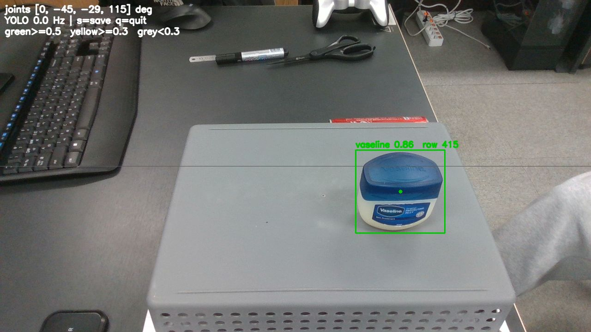
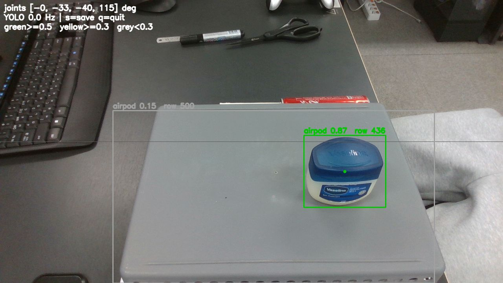

# 인식 자세 재선정 — 2026-11-04

**결론:** `recognition_pose_deg`를 `[0, -30, -41, 115]`에서 `[0, -45, -33, 115]`로 바꿨습니다.
- 바꾼 이유: 기존 자세에서는 vaseline이 airpod로 오인식되어 **0%** 였습니다.
- 새 자세에서는 네 물체를 세 위치에 놓고 시험한 12가지 조건 중 11개에서 **100%** 였습니다.
- 나머지 1개(tissue 오른쪽)는 모든 자세에서 0%였습니다. 자세와 무관한 조건 문제로 보고 따로 기록했습니다.

## 시험 조건

- **물체:** 높이 8 cm 박스 위. 바퀴 축에서 앞으로 24 cm, y = 0 / +6 / −6 cm(C / L / R)
- **높이:** coke 134, vaseline 69, tissue 97, airpod 23 mm
- **모델·기준:** `best.pt`, 신뢰도 0.5(평소 기준). 표의 "인식률"은 0.5 이상으로 잡힌 프레임 비율입니다.
- **도구:** `pose_sweep.py`(측정 전용). 사용자가 Y 버튼을 든 상태에서 에이전트가 실행했습니다.
  - 1차 탐색: 후보 20~26개, 자세당 3초, C 위치만
  - 2차 확인: 후보 10개, 자세당 6초, C·L·R
- **원본:** `raw/pose_sweep_2026-11-04.csv`(1차), `raw/pose_verify_2026-11-04.csv`(2차)

## 1차 탐색 (C 위치, 네 물체 모두 시험한 자세 20개)

네 물체 모두 인식된 자세는 두 개뿐이었습니다.

| 자세 (관절2, 관절3, 관절4) | vaseline | airpod | tissue | coke |
|---|---|---|---|---|
| 기존 (−30, −41, 115) | **0.00** (airpod로 오인식) | 1.00 | 1.00 | 1.00 |
| (−45, −30, 115) | 1.00 | 1.00 | 1.00 | 1.00 |
| (−35, −41, 115) | 1.00 | 1.00 | 0.97 | 1.00 |
| 나머지 17개 | | | 대부분 0~0.8 | |

## 2차 확인 (두 후보 주변 10개 자세 × 12개 조건)

가장 약한 조건의 인식률과 평균 신뢰도입니다. tissue R은 모든 자세에서 0이라 비교에서 뺐습니다.

| 자세 (관절2, 관절3) | 최저 인식률 | 평균 신뢰도 |
|---|---|---|
| **(−45, −33) ← 선택** | **1.00** | **0.85** |
| (−42, −30) | 1.00 | 0.84 |
| (−45, −27) | 1.00 | 0.83 |
| (−40, −36) | 0.95 | 0.82 |
| (−45, −30) | 0.00 (tissue L 1회) | 0.79 |
| (−35, −41) | 0.23 (vaseline L) | 0.77 |
| (−33, −41), 기존 자세 근처 | 0.00 (vaseline L·R) | 0.61 |

선택한 자세 (−45, −33, 115)의 조건별 결과 (인식률 / 평균 신뢰도):

| | C | L | R |
|---|---|---|---|
| tissue | 1.00 / 0.86 | 1.00 / 0.88 | 0.00 / 0.00 |
| vaseline | 1.00 / 0.88 | 1.00 / 0.89 | 1.00 / 0.89 |
| coke | 1.00 / 0.91 | 1.00 / 0.91 | 1.00 / 0.77 |
| airpod | 1.00 / 0.74 | 1.00 / 0.77 | 1.00 / 0.85 |

선택 이유:
- 이 자세와 바로 옆 자세(±3°)에서 tissue R을 뺀 모든 조건이 100%입니다.
- 실패가 몰려 있는 영역(관절3 −41° 이하)과 가장 멀리 떨어져 있습니다.

## 원인: 보는 각도에 따른 vaseline → airpod 오분류

| 새 자세 근처 (−45, −29): vaseline 0.86 | 기존 자세 근처 (−33, −40): 같은 물체가 airpod 0.87 |
|---|---|
|  |  |

- 위치 정밀도 문제가 아니라 **분류** 문제입니다.
- 기존 자세는 물체를 더 위에서 내려다봐서 파란 뚜껑 윗면이 크게 보입니다. 모델은 이 모습을 airpod로 분류했습니다.
- 새 자세는 카메라를 약 4.5 cm 뒤로 빼서 덜 내려다봅니다(약 44° → 37°). 그러면 라벨이 보이고 vaseline으로 분류됩니다.

## 기하 (URDF 계산)

| | 기존 | 새 자세 |
|---|---|---|
| 손 위치 (base_link, m) | (0.008, 0, 0.320) | (−0.027, 0, 0.320) |
| 카메라 위치 (m) | (−0.003, 0.019, 0.403) | (−0.048, 0.019, 0.401) |
| 카메라가 내려다보는 각도 | 44° | 37° |

- HOME → 새 자세, 새 자세 → CARGO, 새 자세 → HOME의 관절 경로를 계산으로 검사했습니다. 중간 자세 12개를 봤고, 기준은 바닥과 박스 윗면 모두에서 50 mm 이상 간격, 몸체 위 간격입니다. 모두 통과했습니다.
- 고정 자세 이동은 충돌 검사 없이 관절 공간으로 직행합니다. 실물에서 첫 이동을 Y 준비 상태로 확인해야 합니다.

## 남은 문제

1. **tissue R(오른쪽 6 cm) 0%:** 모든 자세에서 airpod로 오인식됐습니다.
   - 같은 자리에서 다른 물체(vaseline, coke, airpod)는 잘 잡혔고, tissue C·L도 잘 잡혔습니다.
   - 첫 시험 때 화면 오른쪽에 사람 몸(회색 옷)이 찍혀 있었습니다.
   - 사용자가 재시험을 원하지 않아 원인을 확정하지 못했습니다. 시연에서 tissue를 오른쪽에 둘 때 주의해야 합니다.
2. **카메라 장착 각도 오차 추정:** 실제 화면 속 물체 위치가 URDF 계산보다 일관되게 100~160 px 위에 찍혔습니다.
   - 같은 날 측정한 coke z 오차 +7 cm와 같은 원인일 가능성이 있습니다.
   - Pick 결과에서 빗나감이 나오면 카메라 장착 보정(5.5 조건부 항목)으로 다룹니다.
3. **조건 범위:** 이번 시험은 물체 높이 8 cm, 앞쪽 거리 24 cm 하나로만 했습니다. 다른 거리는 Pick 기준선 시험에서 함께 확인합니다.
